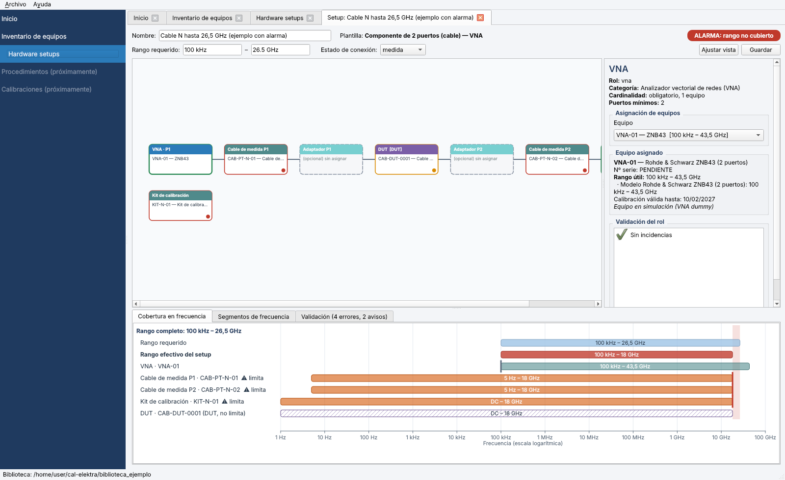

# CAL-ELEKTRA

Software para un **laboratorio de calibración de equipos de MC (CEM/EMC)**. Toma la arquitectura de R&S ELEKTRA —plantillas, *hardware setups* por rango de frecuencia, motor de secuencia, contenedor de resultados, gráficas e informes— y la adapta a la calibración de los equipos con los que se hacen los ensayos, no a los ensayos.

Ejemplos de lo que cubre:

- Cables y paths con VNA.
- Impedancia de LISN.
- Verificación de cámara semianecoica según CISPR 16-1-4: NSA con el método clásico y S_VSWR con el método de 6 posiciones.

## Estado

**Primer incremento.** Ya funciona:

- Catálogo de equipos en YAML (categoría → modelo → equipo).
- Cables definidos por su fichero S2P, con una referencia editable.
- Hardware setups genéricos y configurables, con **alarma cuando el conjunto de equipos no cubre el rango de frecuencia requerido**.
- VNA dummy con una interfaz de alto nivel.
- GUI con inventario, editor de setups y comprobación funcional del VNA.

Todavía falta: incertidumbre, procedimientos y ejecución, drivers reales (ZNB43, VNA de baja frecuencia, mástiles) e informes. El detalle está en [`docs/03_arquitectura_y_primer_incremento.md`](docs/03_arquitectura_y_primer_incremento.md).



## Puesta en marcha

Requisitos: Python 3.11 o superior.

```bash
python -m venv .venv
# Windows: .venv\Scripts\activate      Linux/macOS: source .venv/bin/activate
pip install -e ".[dev]"
python -m calelektra                  # abre la biblioteca de ejemplo
python -m calelektra C:\ruta\biblioteca   # o una biblioteca propia
python -m pytest                      # pruebas (núcleo + GUI)
```

También se puede indicar la biblioteca con la variable de entorno `CALELEKTRA_BIBLIOTECA`.

## Estructura

```
src/calelektra/
  core/          unidades, rangos de frecuencia y cobertura, Touchstone
  catalog/       catálogo de equipos y biblioteca YAML
  setups/        plantillas, setups configurados y su validación
  instruments/   interfaz de alto nivel del VNA, VNA dummy, factoría
  gui/           interfaz gráfica (PySide6)
biblioteca_ejemplo/   catálogo, inventario, S2P sintéticos, plantillas y setups de ejemplo
docs/                 diseño paso a paso (01 ingeniería inversa, 02 catálogo, 03 arquitectura)
tools/                generador de S2P sintéticos y capturas de pantalla
tests/                pruebas con pytest
```

## Documentación

1. [Ingeniería inversa de ELEKTRA y mapeo al laboratorio](docs/01_ingenieria_inversa_elektra.md)
2. [Catálogo de equipos y hardware setups (borrador del paso 2)](docs/02_catalogo_equipos_y_hardware_setups.md)
3. [Arquitectura del software y primer incremento](docs/03_arquitectura_y_primer_incremento.md)
