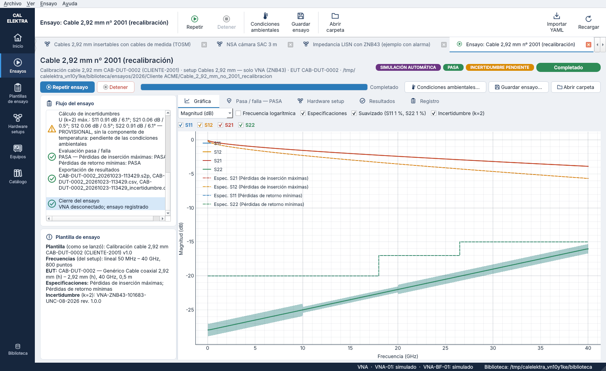
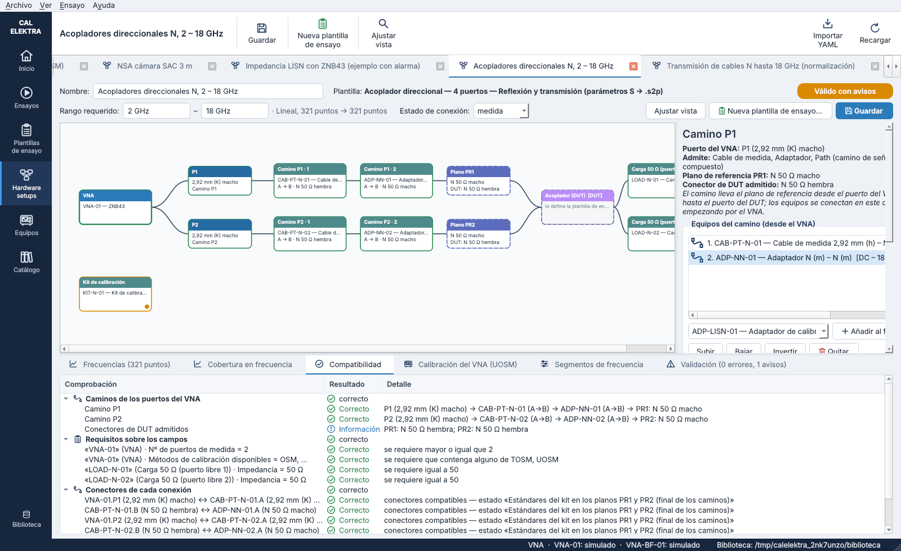

# CAL-ELEKTRA

Software para un **laboratorio de calibración de equipos de MC (CEM/EMC)**. Toma la arquitectura de R&S ELEKTRA —plantillas, *hardware setups* por rango de frecuencia, motor de secuencia, contenedor de resultados, gráficas e informes— y la adapta a la calibración de los equipos con los que se hacen los ensayos, no a los ensayos.

Ejemplos de lo que cubre:

- Cables y paths con VNA.
- Impedancia de LISN.
- Verificación de cámara semianecoica según CISPR 16-1-4: NSA con el método clásico y S_VSWR con el método de 6 posiciones.

## Estado

**Versión 0.8.1** — funcional con el VNA simulado:

- **Equipos definidos por categorías con campos tipados** (rango, puertos, conectores, potencia, IFBW, métodos de calibración, kit, longitud…). Los modelos dan los valores comunes y cada equipo los suyos; altas y ediciones con formularios generados a partir de esos campos. Los **modelos de EUT** llevan sus **especificaciones S** (ficheros S2P) para el **pasa / falla**.
- **Hardware setups con una estructura común**: el VNA a la izquierda, una línea que se divide en sus puertos (P1, P2…) y, de cada puerto, un **camino** (cables de medida, adaptadores, paths, preamplificadores…, en orden) que lleva el plano de referencia hasta el puerto del DUT. El conector del final de cada camino dice **qué conectores de DUT se pueden calibrar** con el setup. Cada setup tiene sus **frecuencias de medida** (lineal por nº de puntos o por paso, logarítmico o lista CSV), alarma de rango, **requisitos sobre los campos**, comprobación de **conectores** de cada unión y **diseño automático de la calibración** del VNA (TOSM si los planos se unen; si no, UOSM; OSM en 1 puerto; normalización de transmisión). Ver [`docs/09_caminos_y_nuevas_plantillas.md`](docs/09_caminos_y_nuevas_plantillas.md).
- **Plantillas de ensayo** (las *test templates* de ELEKTRA): **llaman a un hardware setup**, que se ve como diagrama, y **definen el EUT**; además potencia, **IFBW y promedios** (todas las trazas o por traza), **suavizado de la visualización**, calibración, verificación y exportación, con comprobación continua.
- **Ensayos**: registros de las plantillas lanzadas en una **carpeta** elegida por el usuario (explorador con carpetas externas). Cada ensayo guarda la plantilla tal como se lanzó, el setup y sus frecuencias, el EUT, las copias de las especificaciones, los resultados (.s2p/.s1p y CSV, sin suavizar), el **veredicto** con márgenes por parámetro y la trazabilidad (equipos, certificados, datos S, kit, calibración).
- **Seis plantillas de hardware setup**. Cuatro tienen ensayo con el VNA:
  - Camino RF de 2 puertos, **reflexión y transmisión** (S → .s2p);
  - Camino RF de 2 puertos, **transmisión** (S21 → .csv, con normalización);
  - **medida de impedancia** en 1 puerto (S11 → .s1p);
  - **acoplador direccional** de 4 puertos (un .s2p por par de puertos, con los otros dos en 50 Ω; pasa / falla frente a sus valores nominales).

  Las otras dos son **SAC — NSA** y **SAC — S_VSWR**: caminos que terminan en las antenas, todavía sin algoritmo de ensayo.
- **VNA simulado** realista (errores sistemáticos, calibración OSM/TOSM/UOSM, CAL/CAI) y **adaptador del R&S ZNB43** sobre los comandos del driver RsZnx, con barrido segmentado para las listas (pendiente de probar con el equipo).
- **Incertidumbre de cada traza** (magnitud en dB y fase en °, k = 2) con el **fichero de incertidumbres de cada unidad de VNA** (ZNB43 nº 101683 y E5061B nº MY49408336) y el algoritmo de cálculo del laboratorio, con resultados idénticos a los del script original. Las gráficas la muestran como una **zona sombreada** alrededor de cada traza, y el ensayo la guarda en su registro y en un CSV. Ver [`docs/07_incertidumbres.md`](docs/07_incertidumbres.md).
- **Condiciones ambientales de la sonda TPH**: al terminar un ensayo la incertidumbre queda **pendiente** (calculada sin la componente de temperatura) hasta que se carga el **.xlsx exportado de la sonda**; entonces se recalcula con la temperatura del ensayo. **«Guardar ensayo…»** reúne en un .zip el hardware setup y la plantilla tal como se lanzaron, las horas de inicio y fin, las condiciones ambientales, las medidas en Touchstone sin suavizado, los CSV, la incertidumbre y un resumen. Ver [`docs/08_condiciones_ambientales_y_paquete.md`](docs/08_condiciones_ambientales_y_paquete.md).
- **Depuración del control del VNA sin interfaz gráfica**: funciones que escriben cada parámetro del ZNB (frecuencias, puntos, paso, escala lineal o logarítmica, lista, trazas S11…S22 y su formato, promedios, IFBW, potencia, suavizado, max hold, reinicio del barrido, formato de exportación…), lo leen de vuelta y revisan la cola de errores; consola con eco de cada comando SCPI, scripts, comprobación completa con informe y un ZNB43 simulado a nivel SCPI. Ver [`docs/06_depuracion_vna.md`](docs/06_depuracion_vna.md).

Todavía falta: algoritmos de NSA y S_VSWR, mástiles, driver de la E5061B e informes; la incertidumbre de la impedancia (|Z|) queda aplazada. El detalle está en [`docs/04_algoritmo_medida_vna.md`](docs/04_algoritmo_medida_vna.md) y [`docs/05_plantillas_de_ensayo_y_ensayos.md`](docs/05_plantillas_de_ensayo_y_ensayos.md).





## Puesta en marcha

Requisitos: Python 3.11 o superior.

```bash
python -m venv .venv
# Windows: .venv\Scripts\activate      Linux/macOS: source .venv/bin/activate
pip install -e ".[dev]"                # añada ",instrumentos" para conectar VNA reales (pyvisa)
python -m calelektra                  # abre la biblioteca de ejemplo
python -m calelektra C:\ruta\biblioteca   # o una biblioteca propia
python -m pytest                      # pruebas (núcleo + GUI)
```

Depuración del control del VNA (sin interfaz gráfica):

```bash
python -m calelektra.instruments.znx_debug --simulado                 # ZNB43 simulado
python -m calelektra.instruments.znx_debug --ip 192.168.0.50          # socket SCPI (puerto 5025), sin VISA
python -m calelektra.instruments.znx_debug --visa TCPIP::192.168.0.50::hislip0::INSTR --log sesion.log
python -m calelektra.instruments.znx_debug --ip 192.168.0.50 --comprobar --informe informe_vna.txt
python -m calelektra.instruments.znx_debug --ip 192.168.0.50 --script tools/vna_secuencia_ejemplo.txt
```

Incertidumbre de un punto (misma línea de comandos que el script del laboratorio):

```bash
python -m calelektra.uncertainty --yaml biblioteca_ejemplo/catalogo/incertidumbres/VNA_ZNB43_101683_uncertainties_calculation.yaml \
    --equipment ZNB43 --parameter S21 --frequency-hz 1e9 --value -0.5 --unit dB --if-bandwidth-hz 1000
```

También se puede indicar la biblioteca con la variable de entorno `CALELEKTRA_BIBLIOTECA`.

## Estructura

```
src/calelektra/
  core/          unidades, rangos y cobertura, Touchstone, conectores, cálculo de la calibración
  catalog/       categorías con campos tipados, modelos, equipos y biblioteca YAML
  setups/        plantillas, setups configurados (con sus caminos y frecuencias), caminos, requisitos, conexiones y su validación
  procedures/    plantillas de ensayo, pasa / falla, motor y registro de ensayos, condiciones ambientales
                 (sonda TPH), incertidumbre pendiente / completa y paquete .zip del ensayo
  instruments/   interfaz de alto nivel del VNA, VNA simulado, adaptador R&S ZNx, factoría;
                 znx_debug/: depuración SCPI del ZNx (funciones, consola, comprobación, ZNB simulado)
  uncertainty/   incertidumbre de las medidas con VNA (motor del laboratorio y trazas completas)
  gui/           interfaz gráfica (PySide6)
biblioteca_ejemplo/   catálogo (con especificaciones S de los modelos), inventario, ficheros de incertidumbres de los VNA, S2P sintéticos, setups (con listas de frecuencias) y plantillas de ensayo
docs/                 diseño paso a paso (01 ingeniería inversa … 08 condiciones ambientales y paquete)
tools/                generador de S2P sintéticos, capturas de pantalla y secuencia de ejemplo para depurar el VNA
tests/                pruebas con pytest
```

## Documentación

1. [Ingeniería inversa de ELEKTRA y mapeo al laboratorio](docs/01_ingenieria_inversa_elektra.md)
2. [Catálogo de equipos y hardware setups (borrador del paso 2)](docs/02_catalogo_equipos_y_hardware_setups.md)
3. [Arquitectura del software y primer incremento](docs/03_arquitectura_y_primer_incremento.md)
4. [Campos de los equipos, algoritmo de medida con VNA y versión 0.3](docs/04_algoritmo_medida_vna.md)
5. [Hardware setups con frecuencias, plantillas de ensayo (setup + EUT) y ensayos como registros — versión 0.5](docs/05_plantillas_de_ensayo_y_ensayos.md)
6. [Depuración del control del VNA sin interfaz gráfica — versión 0.5.1](docs/06_depuracion_vna.md)
7. [Incertidumbre de las medidas con VNA y zona sombreada en las gráficas — versión 0.6](docs/07_incertidumbres.md)
8. [Condiciones ambientales de la sonda TPH, incertidumbre pendiente y paquete del ensayo — versión 0.7](docs/08_condiciones_ambientales_y_paquete.md)
9. [Hardware setups con un camino por puerto del VNA y nuevas plantillas (transmisión, impedancia, acoplador) — versión 0.8](docs/09_caminos_y_nuevas_plantillas.md)
