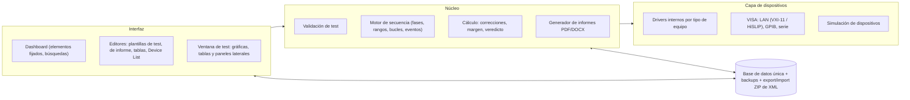
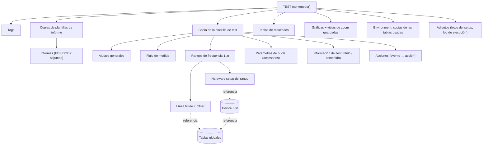
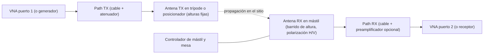
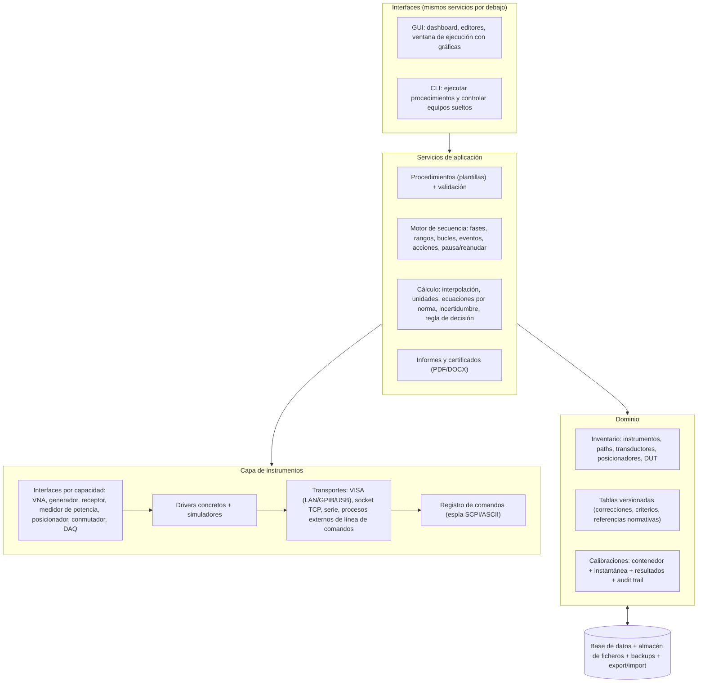

# Paso 1 — Ingeniería inversa de R&S ELEKTRA y mapeo a un laboratorio de calibración de equipos de MC

> **Estado:** análisis. Todavía no hay código.
> **Fuente:** manual de usuario de R&S ELEKTRA, licencia ELEMI-E (EMI), versión 26, software ≥ V5.30.
> **Criterio:** se toman los *conceptos* funcionales y de arquitectura. No se reutilizan textos, iconos, nombres comerciales ni marcas de Rohde & Schwarz.

---

## 0. Resumen

ELEKTRA es un **instrumento virtual basado en plantillas**:

1. El usuario declara **qué** medir en una *plantilla de test*: rangos de frecuencia, *hardware setup* por rango, línea límite, flujo de medida, bucles de accesorios y acciones.
2. Un **motor de ejecución** valida la plantilla y la ejecuta contra instrumentos reales o simulados.
3. Todo lo que se usó y midió se guarda en un **contenedor de test**: copia de la plantilla, copia de las tablas de corrección, resultados, gráficas, informes, adjuntos y log.
4. Con eso se calculan **margen y veredicto** y se genera un **informe** a partir de plantillas de informe.

Ese esqueleto encaja casi tal cual con un laboratorio de calibración. Hay cuatro cambios de fondo, detallados en el §8:

- El **DUT** (equipo a calibrar) pasa a ser una entidad propia.
- El *hardware setup* deja de ser “1 receptor + 1 cable + 1 transductor” y pasa a ser un **grafo de instrumentos, paths y posicionadores**.
- El flujo fijo *Overview → Reducción → Final* pasa a ser una **secuencia de fases configurable**.
- La línea límite pasa a ser un **criterio de aceptación con incertidumbre**, conforme a ISO/IEC 17025.

---

## 1. Arquitectura de ELEKTRA (vista funcional)



Rasgos transversales:

- **Usuarios** con roles (Operador / Experto / Admin) y **grupos** que limitan el acceso a los datos.
- **Etiquetas** (tags), búsqueda global, búsquedas guardadas y elementos fijados en el dashboard.
- **“Buscar referencias”**: árbol de quién usa a quién. No se puede borrar algo que está referenciado.
- **Historial de versiones** de las tablas: solo la última versión es editable.
- **Backups** programados y restauración, y **export/import** de elementos sueltos (ZIP con XML).
- **Asistente de configuración** que crea datos de ejemplo: plantillas, dispositivos, límites y tablas.
- **Conversor de unidades** con impedancia configurable (50 Ω por defecto).
- **Logs** con niveles y un “espía” de comandos SCPI para diagnosticar la comunicación con los equipos.
- **Recuperación** tras un cierre inesperado: el elemento recuperado se marca con un tag.

---

## 2. Modelo de dominio

### 2.1 Jerarquía de componentes



### 2.2 Copia frente a referencia (la decisión de diseño más importante)

| Elemento | Cómo entra en el test | Consecuencia |
|---|---|---|
| Plantilla de test | **Copia** | Cambiar la plantilla global no altera los tests ya creados |
| Plantilla de informe | **Copia**, refinable dentro del test y exportable de nuevo a global | Las opciones de detalle solo existen dentro del test |
| Dispositivos (receptor, paths, transductores) | **Referencia** a la Device List | Un cambio de propiedades afecta a todas las plantillas que usan el dispositivo; dentro de un test se ven en solo lectura |
| Líneas límite y tablas de corrección | **Referencia**, más una **copia en “Environment”** | Trazabilidad de los datos realmente usados |
| Informes | Siempre se generan de nuevo | — |

**Regla de consistencia:** si se modifica la plantilla embebida en un test que ya tiene resultados, el software propone borrarlos. Si el usuario no los borra, la incoherencia queda bajo su responsabilidad. Al reejecutar se vuelve a validar y se refrescan los datos globales (IP de los equipos, factores de antena nuevos…).

Además, un test marcado como **“Done”** ya no se puede editar.

### 2.3 Plantilla de test

**Ajustes generales**

- Modo del instrumento.
- Rango del eje Y de la gráfica.
- Eje X logarítmico.
- Plantilla de informe por defecto.
- Líneas límite adicionales que **solo se dibujan** y no se evalúan.
- Regla para unir trazas entre rangos de frecuencia adyacentes.

**Flujo de medida (tres fases fijas, activables)**

1. **Overview:**
   - Barrido rápido con hasta 4 “detectores”.
   - Repetición con *max-hold*, por recuento (1–100 000) o por tiempo (1–100 000 s), con fin manual.
   - Trigger.
   - Una gráfica por rango si se activa.
2. **Reducción de datos:**
   - Búsqueda de picos con *peak excursion* (por defecto 6 dB).
   - Máximos por subrango: equidistantes o según una lista de frecuencias.
   - Análisis de aceptación: un offset sobre el límite (por defecto −6 dB) descarta los puntos que quedan por debajo.
   - El resultado es la tabla de **puntos críticos**.
3. **Medida final:**
   - Se repite la medida solo en los puntos críticos, con detectores “lentos” mapeados uno a uno desde los del overview.
   - Opcionalmente, pausa antes de la final para editar a mano los puntos críticos.
   - Se puede **saltar** y usar los puntos críticos como resultado final.

**Detalles de flujo (lista de rangos de frecuencia)**

Cada rango tiene:

- Activo / inactivo y un nombre.
- f_start y f_stop (con entrada del tipo `10M`).
- **Hardware setup.**
- Ajustes del instrumento para overview y para final.
- Línea límite: global o individual por rango.
- Offset (dibuja el límite desplazado en trazo grueso y el original discontinuo).
- Comentario.

Sobre los rangos:

- Se pueden copiar, mover arriba y abajo, y borrar.
- Un rango nuevo hereda los ajustes del rango seleccionado.
- La interfaz muestra tres rangos informativos: el pedido, el que soporta el hardware setup y el que soporta el instrumento con esos ajustes.

**Hardware setup (uno por rango)**

- Diagrama `Receptor —— Signal path —— Transductor - - - EUT`.
- Al pulsar un icono se ven sus **Settings**, que son propios de esta plantilla, y sus **Properties**, que son globales y vienen de la Device List.
- Reglas de compatibilidad entre rangos: mismo tipo de transductor y misma unidad de resultado. La unidad de la línea límite debe coincidir con la del transductor; si no, no deja guardar.

**Parámetros de bucle (“Accessory settings”)**

- Ejemplos: línea de la LISN (N, L1, L2, L3), polarización y ejes (X/Y/Z), y **pasos definidos por el usuario** con acciones arbitrarias.
- Cada uno tiene una **prioridad**: el de prioridad 1 es el bucle más interno, y los bucles se anidan.
- Opciones por bucle:
  - **Gráfica por posición.**
  - **Merge:** gráfica con todas las posiciones.
  - **Combine:** gráfica conjunta de varios parámetros.
  - **Reducción por posición.**

**Información del test**

- Filas título / contenido, con valores por defecto globales: Descripción, Norma, Sitio y Operador.
- Guarda el historial del contenido de cada campo.

**Acciones (evento → acción)**

- Eventos:
  - Inicio / reanudación, pausa, parada y error.
  - En cada frecuencia, antes y después del *dwell*.
  - Entrar y salir de un rango, de cada fase y del barrido completo.
- Acciones: **Email**, **Notificar** (texto, sonido y lectura en voz alta, con opción de parar o continuar) y **Esperar** (resolución de 10 ms, con cuenta atrás).
- Variables sustituibles: `#TestName#`, `#TestVerdict#`, `#CurrentFrequency#`, `#CurrentFrequencyRange#`, `#TestStartTime#`, `#TestDuration#`, `#TestStatus#`…

### 2.4 Device List (inventario de equipos)

- **Categorías:** Receptor (solo uno), Signal Path, LISN, Guía TEM y Transductor (sonda: conducido o radiado).
- **Pestañas por categoría:**

| Pestaña | Contenido |
|---|---|
| General | Descripción, fabricante, nº de serie, **calibración válida hasta**, opciones, modelo, firmware (con mínimo requerido) y rango de frecuencia (se deduce de las tablas asignadas) |
| Conexión | Cadena VISA generada a partir de: interfaz (TCP/IP o GPIB), modo (VXI-11 o HiSLIP, por host o por IPv4), dirección, nº de placa y timeout |
| Detalles | Control **manual o remoto** del accesorio. En manual, el software muestra instrucciones al operador y espera su confirmación |
| Corrección de medida | Cable: valor fijo o tabla de atenuación. Transductor: tabla de corrección que convierte la unidad de entrada en la de resultado. Signal path: una o varias tablas en serie que se suman |
| Comprobación funcional | Prueba aislada del equipo (conmutar una línea, mover a una posición, captura de pantalla, abrir la web del instrumento) |

- **Operaciones:**
  - Marcar un equipo como **favorito** por categoría; se preselecciona en las plantillas nuevas.
  - **Búsqueda en red** (broadcast VXI-11 o GPIB) para añadir un equipo o asignarlo a una entrada existente.
  - Conexión **permanente** con reconexión al arrancar.
  - **Re-chequeo** con semáforo: verde = disponible, rojo = no disponible, naranja = el equipo no coincide con la configuración (por ejemplo, en las opciones instaladas).
  - Copiar, guardar uno o todos, descartar cambios y ver referencias.
  - Para sustituir un equipo se recomienda cambiar su *tipo*, no borrarlo, para no romper referencias.
- **Limitaciones** que habrá que superar: ver §8.2.

### 2.5 Tablas globales (versionadas)

- **Líneas límite:**
  - Columna de frecuencia más hasta 4 columnas de límite, una por detector.
  - Unidad de cada columna e interpolación lineal o logarítmica.
  - **Huecos** con `--`, verticales u horizontales.
  - Metadatos: norma, revisión y subclase.
- **Atenuación:** en dB. Una ganancia se introduce como atenuación negativa. Si varias tablas se solapan, se suman.
- **Lista de frecuencias:** frecuencias sueltas con un comentario.
- **Corrección de transductor:** convierte la unidad de entrada en la de resultado (por ejemplo, dBµV → dBµV/m con el factor de antena).
- **Funciones comunes:**
  - Importación con asistente (CSV, TXT o **SnP**; fila inicial, separador y unidades) y exportación a CSV.
  - Copiar y pegar desde una hoja de cálculo.
  - Ver la tabla como gráfica.
  - Precisión de 0 a 8 decimales.
  - Historial de versiones.

### 2.6 Ecuación de corrección

```
Nivel en el punto 1 = lectura del instrumento (punto 4)
                    + C[1-2]  tabla del transductor (cambio de unidad)
                    + C[2-3]  cable del transductor
                    + C[3-4]  signal path (una o varias tablas en serie)
```

---

## 3. Motor de ejecución

1. **Validación del test**, antes de empezar o al refrescar:
   - Conexión de los equipos.
   - Coherencia de unidades entre límite y transductor.
   - Rangos de frecuencia cubiertos por las tablas y los equipos.
   - Ajustes compatibles con el instrumento.

   Si falla, ofrece buscar el equipo, revisar su configuración, re-chequear o **simular**.
2. **Orden de ejecución:** fase → rango de frecuencia → bucles (la prioridad 1 es el más interno) → punto de frecuencia, disparando eventos y acciones en cada nivel.
3. **Modos:**
   - **Automático:** recorre el flujo completo.
   - **Interactivo:** medida en una frecuencia, botón **Grabar**, y recorrido de los puntos críticos hacia delante o hacia atrás.
   - En el modo interactivo, el origen de las frecuencias puede ser la plantilla, los puntos críticos o los resultados finales, con sintonía en paso lineal o logarítmico.
4. **Control de ejecución:**
   - Start / Resume continúa desde la frecuencia actual.
   - **Pause** mantiene las conexiones; **Stop** desconecta los equipos y los libera.
   - El panel de *Measurement Flow Control* permite activar o desactivar fases, fijar el paso de inicio, ver el progreso en % y terminar la repetición.
5. **Seguridad:** al pausar o parar, el instrumento queda en un estado seguro (máxima atenuación). Hay gestión de sobrecargas, con reintentos subiendo la atenuación en modo analizador.
6. **Trazabilidad:** se adjunta un log temporizado de la ejecución al test. Además, quedan registrados los ajustes de los accesorios en cada punto (por ejemplo, la polarización o el ángulo), que se ven al pasar el ratón por la gráfica.
7. **Simulación:** si falta un equipo y se acepta, los datos se simulan y el test queda **marcado como simulado**.

---

## 4. Resultados y veredicto

- **Tablas de resultados:**
  - *Overview*.
  - *Puntos críticos* (editables: se pueden añadir puntos arrastrándolos desde la gráfica).
  - *Resultados finales*.
  - *Resultados por bucle*.
  - Copias de referencia.
- **Columnas:**
  - Rango (Rg) y frecuencia.
  - Nivel, límite y margen por detector.
  - Corrección aplicada, ancho de banda de medida, tiempo de medida y fecha y hora.
  - **Origen** del dato (crítico, interactivo…) y comentario.
  - Columnas de bucle (polarización, línea…).
- **Funciones de tabla:**
  - Unidad conmutable por columna, con conversión automática.
  - Precisión por columna.
  - Cabeceras opcionales: detector, precisión y unidad base.
  - Exportación a CSV, copiar y pegar, y mostrar como gráfica.
  - Desplazamiento automático durante la medida.
- **Margen** = límite − nivel (positivo = cumple).
- **Veredicto:**

| Estado | Cuándo |
|---|---|
| **Inconcluso** | Test nuevo o interrumpido, o sin límite |
| **No pasa** | Algún margen < 0 en los resultados finales |
| **Pasa** | Ningún margen < 0 |

  - Se recalcula al editar valores o límites.
  - Se puede fijar a mano; la responsabilidad es del operador.
  - Las medidas interactivas no afectan al veredicto.

---

## 5. Gráficas (lo que hay que replicar)

**Disposición y ejes**

- Varias gráficas en el test, en horizontal, en vertical o en pestañas, hasta 4 columnas o filas.
- **Conectar gráficas:** los marcadores de varias gráficas se mueven juntos.
- Eje X lineal o logarítmico (también en todas a la vez).
- Cambio de escala por diálogo o arrastrando el tercio izquierdo, central o derecho del eje.
- Autoescala y autoescala a los resultados medidos.
- Leyenda, leyenda de límites y comentario en la gráfica.

**Zoom**

- Se hace dibujando un rectángulo y muestra un minimapa del área visible.
- Las **vistas de zoom con nombre** se pueden guardar y reutilizar en los informes.

**Trazas**

- Tipos:
  - Resultado medido: línea continua.
  - Puntos críticos y finales: símbolo con línea vertical hasta el eje.
  - Límites: con huecos y con offset.
  - Traza constante.
  - Traza de otro resultado del mismo test.
  - Límite global.
  - Tabla de atenuación o de transductor.
- Propiedades de cada traza:
  - Línea: color, grosor y estilo.
  - Símbolo: forma, tamaño y relleno.
  - Línea vertical hasta el eje.
  - Orden de dibujo, ocultar o mostrar, y filtro por “detector”.
- Estilos globales por defecto para cada tipo de traza (trazas 1–8).

**Marcadores**

- Movimiento:
  - Al pico, al siguiente pico, al mínimo y al siguiente mínimo (según *peak excursion*).
  - A una frecuencia dada.
  - A otra traza.
- Tipos de referencia: **delta**, **sincronizado** y **delta sincronizado**.
- *Pixel mode*: el marcador se mueve por píxeles en vez de saltar de punto a punto.
- El marcador se puede arrastrar a los campos de frecuencia.

**Etiquetas**

- Ligadas a una traza o flotantes.
- Etiquetas automáticas de las líneas límite.

**Durante la medida**

- Un marcador móvil indica la frecuencia actual.

**Gráficas especiales**

- Hay **mapas de calor** (espectro frente a acimut, o altura frente a acimut) y **gráficas esféricas o cilíndricas**. Son muy útiles para los barridos de mástil.

**Exportación**

- Copiar al portapapeles, guardar como PNG e imprimir.

---

## 6. Informes

**Plantilla de informe**

- Título.
- Cabecera y pie con tres zonas: fecha, hora, página n/N, nombre, **veredicto**, versión, título, logo o texto libre.
- Fuentes por elemento y formato de exportación: **PDF o DOCX**.

**Componentes ordenables**

- Gráficas de resultados (seleccionando gráficas y vistas de zoom concretas).
- Tablas de resultados:
  - Todas las filas o un rango de filas.
  - Opción de excluir filas sin resultado.
  - Opción de excluir filas con margen holgado.
  - Selección de columnas.
- Gráfica o tabla genérica, por ejemplo de líneas límite o de factores de corrección.
- Detalles de la plantilla de test, incluidas las acciones.
- **Detalles del equipamiento** (modelo, firmware, *cal. válida hasta*).
- Texto e imágenes, cargados de fichero o de los **adjuntos del test** filtrados por nombre (por ejemplo, `*setup*`).
- Subinformes.

**Opciones de cada componente**

- Nueva página, apaisado, título.
- 1–4 gráficas por fila, tamaño en mm y alineación.
- “Tabla filtrada por rango” bajo la gráfica de cada rango.
- Zoom por coordenadas `a;b` (mínimo y máximo) o `centro:span`.

**Plantilla global frente a embebida**

- En la plantilla **global** aparecen **marcadores de posición** (por ejemplo, `[Detector 1]`).
- Al copiarla dentro del test se resuelven a columnas y gráficas reales.

**Robustez**

- Tablas anchas partidas en (1/n), (2/n)…
- Mensajes cuando un componente está vacío.
- Errores en rojo cuando falta un recurso.

**Ciclo**

- Se genera la vista previa, se refresca y se **adjunta** al test.

---

## 7. Lo que NO tiene ELEKTRA y necesita un laboratorio de calibración

| Necesidad (ISO/IEC 17025 y práctica de calibración) | En ELEKTRA |
|---|---|
| El DUT como entidad: cliente, nº de serie, orden de trabajo, historial de calibraciones | El EUT solo se dibuja; no es un dispositivo |
| Varios instrumentos en un mismo setup (VNA, generador, receptor, medidor de potencia, DAQ) | Un único receptor por sistema |
| Paths con parámetros S, planos de calibración del VNA y adaptadores | Solo atenuación escalar en dB |
| Bloqueo por **calibración caducada** de un patrón y **comprobaciones intermedias** | La fecha de calibración es solo informativa |
| **Incertidumbre** por punto y **regla de decisión** (zona de guarda) | El veredicto solo compara con el límite |
| Certificado numerado, firmado y emitido; inmutable una vez emitido | Hay estado “Done”, pero no flujo de emisión |
| **Audit trail** (quién cambió qué y cuándo) y procedimientos aprobados y versionados | Roles y grupos, sin trazabilidad de cambios |
| El resultado de una calibración **genera una tabla** (factor de antena, pérdidas de un cable…) que alimenta otros setups | Las tablas se crean a mano o se importan |
| Validación del propio software (cláusula 7.11 de ISO/IEC 17025) | — |

---

## 8. Mapeo ELEKTRA → laboratorio de calibración de equipos de MC

### 8.1 Tabla de equivalencias

| ELEKTRA (ensayo EMI) | Laboratorio de calibración (propuesta) |
|---|---|
| Test (contenedor) | **Calibración / verificación**: el contenedor de una orden de trabajo, con una *instantánea* de procedimiento, equipos, tablas, condiciones ambientales y resultados |
| Plantilla de test | **Procedimiento de calibración (plantilla)**, versionado y **aprobado** |
| EUT | **DUT (equipo a calibrar)**: entidad con cliente, modelo, nº de serie y puertos |
| Receptor (único) | **Instrumentos** (N): VNA, generador, receptor/analizador, medidor de potencia, osciloscopio, DAQ, multímetro… definidos por *capacidades* |
| Signal path | **Path**: cadena de cables, adaptadores, atenuadores, preamplificadores y conmutadores, con tablas escalares **o parámetros S (.sNp)** |
| Transductor / LISN / TEM | **Transductores y accesorios**: antenas, LISN/AMN, pinzas, CDN, TEM… Pueden actuar como **patrón** o como **DUT** |
| Accesorios con control manual o remoto | **Posicionadores**: mástil (altura y polarización), mesa giratoria, trípode o posicionador lineal, matriz de conmutación. Si son manuales, el software indica al operador qué hacer y espera confirmación |
| Parámetros de bucle con prioridad | **Bucles de posición y condición**: posición en el volumen de ensayo, altura de TX, polarización, barrido de altura de RX, desplazamientos de SVSWR, puertos del DUT… |
| Flujo Overview → Reducción → Final | **Secuencia de fases configurable**: referencia/normalización → medida con bucles → reducción (por ejemplo, máximo en altura) → cálculo → evaluación |
| Detectores | **Magnitudes / trazas**: \|S21\|, máximo en altura, mínimo, máx − mín… |
| Repetición con *max-hold* | **Barrido de altura con *max-hold*** por frecuencia (el VNA barre mientras sube el mástil) |
| Línea límite (+ offset) | **Criterio de aceptación**: valor teórico o de referencia ± tolerancia, o especificación del fabricante del DUT |
| Margen y veredicto Pasa / No pasa / Inconcluso | **Desviación y margen frente a la tolerancia teniendo en cuenta la incertidumbre**: Conforme / No conforme / Indeterminado |
| Corrección C[1-2] + C[2-3] + C[3-4] | **Ecuación de medida definida por procedimiento**. Por ejemplo, para la NSA: V_directa − V_sitio − AF_TX − AF_RX − ΔAF_TOT |
| Acciones: Email, Notificar, Esperar | Las mismas, más **Comando** (ejecutar una orden o script de línea de comandos), **SCPI**, **Mover posicionador**, **Pedir confirmación u operación al operador** y **Registrar condiciones ambientales** |
| Comprobación funcional | **Comprobación funcional + comprobación intermedia** registrada |
| Validación de test | Lo mismo, más: **patrones en vigor**, cobertura en frecuencia de las tablas, coherencia de unidades y planos de calibración |
| Plantilla de informe → informe | **Plantilla de certificado** (contenido de la cláusula 7.8 de ISO/IEC 17025) e **informe técnico de verificación de sitio** |
| Tablas globales | Las mismas, más **tablas de referencia normativas** (NSA teórica, A_APR…) y **tablas generadas por calibraciones** (con enlace al certificado de origen) |
| Simulación de dispositivos | Igual: imprescindible para desarrollar y validar sin hardware. Los resultados simulados se marcan |

### 8.2 Cambios de fondo respecto a ELEKTRA

1. **Hardware setup como grafo.** Por cada rango de frecuencia (se mantiene la idea de un setup por rango) habrá:
   - Instrumentos con puertos.
   - Paths con su caracterización.
   - Transductores, posicionadores y el DUT.

   El diagrama del setup seguirá siendo visual, como en ELEKTRA, pero con más nodos.
2. **Procedimiento como secuencia de fases.** Se conserva el diagrama de flujo con fases activables, la ejecución desde una fase concreta, el progreso en % y la pausa para intervención manual. Lo que cambia es que las fases no están fijadas a “overview / final”.
3. **Ciclo cerrado de trazabilidad.** Calibrar un cable con el VNA produce una tabla de pérdidas versionada. Esa tabla se usa después en el setup de la NSA, y el certificado de la NSA referencia esa versión concreta.
4. **Calidad (ISO/IEC 17025)** integrada desde el modelo de datos, no añadida al final.

---

## 9. Caso guía: verificación de la cámara según CISPR 16-1-4

> Los valores concretos (alturas, posiciones, pasos) dependen de la **edición** de la norma y del **tipo de recinto**. Abajo van como ejemplo y quedan **pendientes de confirmar** contigo (ver §11).

### 9.1 NSA (30 MHz – 1 GHz)



**Fases**

1. **Referencia directa:** se unen los cables con un adaptador y se mide V_directa. Con un VNA, esto equivale a una normalización *through*.
2. **Medida en el sitio, con bucles anidados** (el primero es el más interno):
   1. Barrido de altura de RX (por ejemplo, 1 → 4 m) con *max-hold* por frecuencia.
   2. Polarización H / V.
   3. Altura de TX (por ejemplo, H: 1 m y 2 m; V: 1 m y 1,5 m).
   4. Posición en el volumen de ensayo: centro, izquierda, derecha, delante y, según el tamaño, detrás.
3. **Cálculo:** `NSA_med = V_directa − V_sitio,máx − AF_TX − AF_RX − ΔAF_TOT`.
4. **Evaluación:** `Δ = NSA_med − NSA_teórica`. Criterio: `|Δ| ≤ 4 dB`.
   - Como alternativa, el **método de sitio de referencia** compara con la atenuación de referencia del par de antenas (A_APR) en lugar de usar los factores de antena y la NSA teórica.

**Rangos de frecuencia**

- Por ejemplo, una bicónica en 30–200 MHz y una log-periódica en 200–1000 MHz, o una antena híbrida en todo el rango.
- Es justo el concepto de “un hardware setup por rango” de ELEKTRA.

**Gráficas**

- Δ frente a la frecuencia, con líneas en ±4 dB:
  - Una gráfica por posición y polarización (= *gráfica por posición*).
  - Una gráfica conjunta (= *merge / combine*).
- Altura del máximo frente a la frecuencia.
- Mapa de calor altura × frecuencia.

**Resultado**

- Conformidad por posición y conformidad global del recinto.
- Informe con setup, equipos y vigencia de sus calibraciones, tablas usadas, gráficas e incertidumbre.

### 9.2 SVSWR (1 – 18 GHz)

**Setup**

- Antena TX con diagrama casi omnidireccional.
- Antena RX (bocina) a distancia fija.
- La TX se desplaza en línea hacia la RX: 6 posiciones (por ejemplo, 0, 2, 10, 18, 30 y 40 cm), con posicionador lineal o a mano con aviso al operador.

**Bucles**

- Posición en el volumen (delante, izquierda, derecha…) × altura × polarización × las 6 posiciones de desplazamiento.

**Cálculo**

- `S_VSWR(f) = máx − mín` (en dB) de las 6 lecturas.
- Criterio: `S_VSWR ≤ 6 dB`.
- Existe una **variante en el dominio del tiempo con VNA**, a confirmar si la usáis.

**Gráficas**

- S_VSWR frente a la frecuencia, con una línea en 6 dB, por posición y polarización, más una gráfica conjunta.

### 9.3 Cómo se vería como plantilla de procedimiento

> Boceto **ilustrativo**: no es el formato definitivo, sirve para ver que el modelo de ELEKTRA encaja.

```yaml
procedimiento: "Verificación NSA – SAC 3 m – CISPR 16-1-4"
version: 1            # aprobado por / fecha → requisito 17025
criterio: { magnitud: delta_NSA, tolerancia_dB: 4 }
rangos:
  - nombre: "Bicónica"
    f: [30 MHz, 200 MHz]
    instrumento_ajustes: { IFBW: 1 kHz, potencia: 0 dBm, puntos: 401 }
    hardware_setup:
      vna: VNA-01            # puerto 1 → TX, puerto 2 → RX
      path_tx: CAB-TX-01     # tabla de pérdidas (versión fijada en la instantánea)
      path_rx: CAB-RX-01
      antena_tx: BIC-01      # factor de antena
      antena_rx: BIC-02
      posicionadores: { mastil_rx: MAST-01, soporte_tx: manual }
  - nombre: "Log-periódica"
    f: [200 MHz, 1 GHz]
    # … mismo esquema con LPDA-01 / LPDA-02
fases:
  - referencia_directa
  - medida_sitio:
      bucles:                # prioridad 1 = el más interno
        - altura_rx: { de: 1 m, a: 4 m, modo: continuo, reduccion: max_hold }
        - polarizacion: [H, V]
        - altura_tx: { H: [1 m, 2 m], V: [1 m, 1.5 m] }
        - posicion: [centro, izquierda, derecha, delante, detras]
  - calculo: "NSA = V_directa - V_sitio_max - AF_TX - AF_RX - dAF_TOT"
  - evaluacion: "delta = NSA - NSA_teorica(d, h_tx, pol)"
acciones:
  al_entrar_posicion: { avisar: "Coloque la antena TX en {posicion}, h = {altura_tx}", confirmar: true }
  al_terminar: { email: "lab@…" }
```

---

## 10. Arquitectura propuesta (alto nivel, a validar contigo)



**Ideas clave**

- **Una sola lógica y dos interfaces.** La CLI y la GUI llaman a los mismos servicios, así que todo lo que se hace en la GUI se puede automatizar por script, y al revés. Ejemplo orientativo de CLI:
  - `calmc run "NSA SAC 3m" --dut CAM-01`
  - `calmc mast goto --height 2.5 --pol V`
  - `calmc vna sweep --start 30M --stop 1G --points 401 --s21`
  - `calmc table import cable.s2p`
- **Drivers por capacidad, no por modelo.** Un procedimiento pide “un VNA de 2 puertos que cubra hasta 1 GHz”, no un modelo concreto. Esto permite cambiar de equipo sin tocar procedimientos, como el *cambio de tipo* de ELEKTRA, pero generalizado.
- **Simulador por cada capacidad**, para desarrollar y hacer pruebas automáticas sin laboratorio.
- **Instantánea inmutable** al cerrar una calibración: copia del procedimiento, versiones exactas de las tablas, estado de los equipos (incluida su calibración vigente), condiciones ambientales, log de comandos y resultados.

---

## 11. Preguntas de contexto (para el paso 2)

**A. Alcance**

1. ¿Qué calibraciones entran en la **primera versión**?
   - (a) Verificación de la cámara según CISPR 16-1-4: NSA y SVSWR.
   - (b) Calibración de antenas: CISPR 16-1-6 / ANSI C63.5.
   - (c) LISN/AMN: impedancia y factor de división, según CISPR 16-1-2.
   - (d) Cables y atenuadores con VNA.
   - (e) Receptores EMI: CISPR 16-1-1.
   - (f) Otros: pinzas, CDN, generadores de inmunidad…

   *Mi propuesta:* empezar por **(a) + (d)**, porque (d) produce las tablas de pérdidas que (a) necesita.
2. Cuando dices **“UNAs”**, ¿te refieres a **VNAs**, a **redes artificiales (AMN/LISN)** o a otra cosa?

**B. Cámara y método**

3. Tipo de recinto (SAC, FAR u OATS), distancia de medida (3, 5 o 10 m), tamaño del volumen de ensayo (diámetro × altura) y si hay mesa giratoria.
4. Edición de CISPR 16-1-4 que aplicáis y método:
   - NSA clásica con factores de antena o método de sitio de referencia (A_APR).
   - SVSWR estándar (6 posiciones) o en el dominio del tiempo.
5. ¿Medís con **VNA** o con **generador + receptor**? ¿El barrido de altura es **continuo** (el VNA barre mientras sube el mástil) o **por pasos**?

**C. Hardware y control**

6. Marca, modelo e interfaz (LAN, GPIB, USB, serie) de:
   - El VNA.
   - El controlador de mástil y mesa (Maturo, innco, ETS-Lindgren, Frankonia…).
   - El soporte o posicionador de la antena TX.
   - La matriz de conmutación, si la hay.
   - El **equipo de adquisición de datos**: ¿qué es y qué magnitudes mide?
7. “Controlar por **línea de comandos**”: ¿quieres decir…
   - (a) que el programa tenga **su propia CLI** para lanzarlo todo por script,
   - (b) que el programa **invoque herramientas o scripts externos** (por ejemplo, un ejecutable del fabricante del mástil), o
   - (c) ambas?

   ¿El controlador del mástil trae ya una utilidad de línea de comandos o un protocolo ASCII documentado?

**D. Plataforma**

8. ¿Lenguaje y plataforma? Veo C# en tu repositorio.
   - Opción 1: **.NET 8 en Windows** (WPF o Avalonia para la GUI, CLI propia) con NI-VISA, R&S VISA o Keysight IO.
   - Opción 2: Python.
   - ¿La base de datos es local (SQLite) o un servidor compartido por varios puestos?
9. ¿Quieres la **GUI desde el principio**, o primero el **núcleo + CLI + simuladores** y la GUI después? Yo recomiendo lo segundo.

**E. Calidad**

10. ¿Estáis **acreditados según ISO/IEC 17025** (o en proceso)?
    - ¿Necesitáis incertidumbre integrada y reglas de decisión?
    - ¿Certificados numerados y firmados? ¿En qué idioma (ES, EN o bilingüe)?
    - ¿Formato de salida: PDF, DOCX o ambos?
    - ¿Tenéis ya un modelo de certificado o informe que deba respetarse?

**F. Repositorio**

11. He creado la carpeta `Software de calibración MC/` dentro de este repositorio (`Projects`). ¿Te vale, o prefieres un repositorio aparte?

---

## 12. Hoja de ruta (paso a paso)

| Paso | Entregable | Depende de |
|---|---|---|
| **1 (este)** | Ingeniería inversa, mapeo y preguntas | — |
| 2 | Especificación funcional y **modelo de datos** detallado (entidades, campos, versionado, instantáneas), centrada en NSA, SVSWR y cables | Respuestas a A, B y E |
| 3 | Contratos de la **capa de instrumentos** (capacidades), protocolo de mástil y VNA, diseño de la **CLI** y simuladores | Respuestas a C y D |
| 4 | Motor de secuencia y cálculo NSA/SVSWR funcionando **con simuladores** y con pruebas automáticas | 2, 3 |
| 5 | Gráficas e informes / certificados | 4 |
| 6 | Drivers reales de tu hardware y validación del software frente a medidas conocidas | 4, acceso al laboratorio |
| 7 | GUI completa (dashboard, editores, ventana de ejecución) | 4, 5 |
