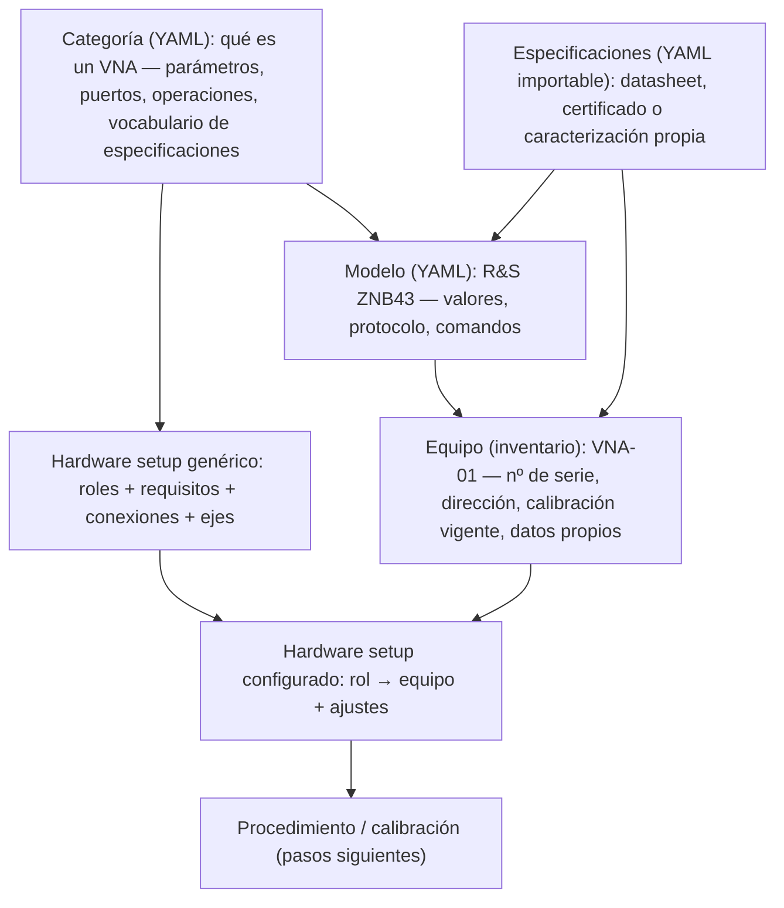
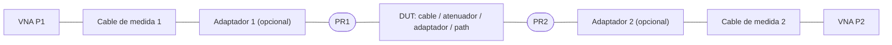
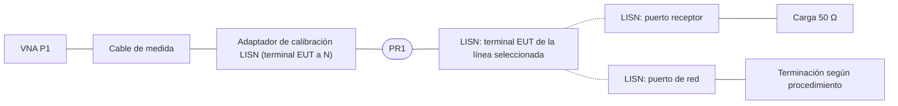
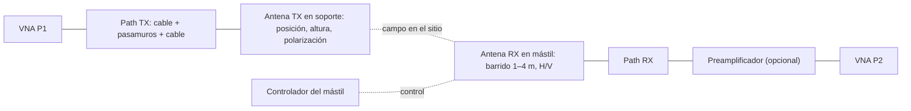
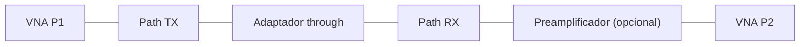
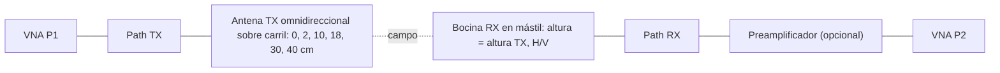

# Paso 2 — Catálogo de equipos y hardware setups

> **Nota (paso 3):** documento del paso 2, conservado como histórico. Sus YAML de borrador están en [`historico_paso2/`](historico_paso2/). Los formatos **implementados** (v0.2) están en [`../biblioteca_ejemplo/`](../biblioteca_ejemplo/) y se describen en [`03_arquitectura_y_primer_incremento.md`](03_arquitectura_y_primer_incremento.md).

> **Estado:** borrador de diseño para revisarlo juntos. Todavía no hay código.
> Los YAML de este paso son **propuestas de formato**. Los valores marcados como `EJEMPLO`, `FICTICIO` o `A CONFIRMAR` no son datos reales.

## 0. Decisiones recogidas del paso 1

| Tema | Decisión |
|---|---|
| “UNAs” | Son **VNAs** |
| Alcance de la v1 | Arquitectura de alto nivel centrada en: (1) **catálogo de equipos**, con parámetros, protocolo de comunicación y especificaciones de incertidumbre **importables en YAML**; (2) **hardware setups**: cable, 1 puerto/LISN y cámara semianecoica (NSA y SVSWR) |
| Instrumento de medida | **Siempre VNA**. Ejemplo: VNA R&S de 100 kHz a 43,5 GHz (supongo un **ZNB43**; está pendiente de confirmar) |
| NSA | CISPR 16-1-4, **método clásico con factores de antena** |
| SVSWR | CISPR 16-1-4, **método estándar de 6 posiciones** |

---

## 1. Visión general



La idea central es esta: **en ELEKTRA las categorías de equipo y sus drivers están dentro del programa**. Aquí son **datos**. Un VNA nuevo, un mástil nuevo o incluso una categoría nueva se dan de alta con ficheros YAML, sin recompilar.

---

## 2. Tres niveles de equipo

| Nivel | Qué contiene | Ejemplo | Quién lo mantiene | Fichero de ejemplo |
|---|---|---|---|---|
| **Categoría** | El esquema de parámetros, los puertos, las **operaciones abstractas** que usa el motor y el **vocabulario** de especificaciones | `vna`, `posicionador` | Responsable técnico; se modifica pocas veces | [`catalogo/categorias/vna.yaml`](historico_paso2/catalogo/categorias/vna.yaml), [`posicionador.yaml`](historico_paso2/catalogo/categorias/posicionador.yaml) |
| **Modelo** | Los valores de esos parámetros, el **protocolo** (transportes y comandos) y los enlaces a las especificaciones del fabricante | R&S ZNB43 | Se importa por cada modelo nuevo | [`catalogo/modelos/rs_znb43.yaml`](historico_paso2/catalogo/modelos/rs_znb43.yaml), [`mastil_PLANTILLA.yaml`](historico_paso2/catalogo/modelos/mastil_PLANTILLA.yaml) |
| **Equipo** | La unidad física: nº de serie, opciones instaladas, dirección, **calibración** (bloqueante si está caducada), especificaciones propias y tablas propias (factor de antena, S2P…) | VNA-01 | Gestión de equipos del laboratorio | [`catalogo/equipos/VNA-01.yaml`](historico_paso2/catalogo/equipos/VNA-01.yaml) |

**Precedencia de las especificaciones:** las del **equipo** (certificado o caracterización propia) prevalecen sobre las del **modelo** (datasheet) para la misma magnitud y las mismas condiciones.

### 2.1 Categorías necesarias para los setups de la v1

| Categoría | Clase | Parámetros clave | Puertos | Especificaciones típicas |
|---|---|---|---|---|
| `vna` | instrumento | Rango de frecuencia, nº de puertos, conector, potencia, IFBW, puntos, métodos de calibración | P1…Pn | Datos efectivos del sistema, ruido de traza, rango dinámico, linealidad, deriva |
| `kit_calibracion` | pasivo (o instrumento si es una unidad automática) | Familia y género del conector, rango, métodos | Según los estándares | Incertidumbre de los estándares, repetibilidad del conector |
| `cable_medida` | pasivo | Conectores A/B, rango, longitud | A, B | Estabilidad de magnitud y fase con flexión, pérdidas, RL |
| `adaptador` / `adaptador_lisn` | pasivo | Conectores A/B, rango | A, B | RL, pérdidas, repetibilidad; S2P del certificado |
| `carga` / `terminacion` | pasivo | Conector, impedancia | P | RL |
| `path` | **compuesto** | Lista ordenada de componentes (cable + pasamuros + cable…) | A, B | Estabilidad; tabla de atenuación medida (sale de `componente_2p`) |
| `preamplificador` | activo, caracterizado | Rango, ganancia | IN, OUT | Ganancia, estabilidad |
| `antena` | pasivo / transductor | Tipo (bicónica, log-periódica, híbrida, bocina, omnidireccional SVSWR), rango, polarizaciones | RF + soporte | **Tabla AF** del certificado + su incertidumbre, VSWR, diagrama |
| `lisn` | pasivo (con control remoto opcional) | Líneas, red nominal, conectores EUT/RX/red, tipo de control | EUT[línea], RX, RED | — (actúa como DUT) |
| `posicionador` | posicionador | **Ejes** (altura, polarización, acimut, desplazamiento): rango, velocidad, si admite movimiento continuo | soporte | Exactitud y repetibilidad de posición |
| `recinto` | recinto | Tipo (SAC/FAR), distancia de medida, volumen de ensayo, posiciones NSA/SVSWR, mesa giratoria | — | — (actúa como DUT) |
| `sensor_ambiental` | instrumento | Magnitudes (T, HR, p) | — | Incertidumbre de T y HR |

Cualquier categoría puede ocupar el rol de **DUT** en un setup (`es_dut: true`). Así una antena puede ser patrón en un setup y equipo a calibrar en otro.

---

## 3. Protocolo de comunicación (dentro del modelo)

Cada **operación abstracta** de la categoría (por ejemplo, `leer_parametro_s`) se traduce, en el YAML del modelo, a los comandos de ese equipo.

```yaml
comunicacion:
  driver: scpi_generico          # o "plugin:<nombre>" si hace falta lógica a medida
  transportes: [VISA HiSLIP | VISA VXI-11 | GPIB | tcp | serie | comando_externo]
  identificacion: { consulta: "*IDN?", patron: "^Rohde-Schwarz,ZNB43" }
  comandos:
    configurar_ifbw: "SENS{canal}:BWID {valor}"
    leer_parametro_s: ["CALC{canal}:PAR:SEL 'Trc_{parametro}'", "CALC{canal}:DATA? SDAT"]
```

**Drivers**

- **Driver genérico** (`scpi_generico` / `texto_generico`): ejecuta las plantillas de comandos, valida la identificación (`*IDN?` contra un patrón), consulta los errores después de cada bloque y espera la finalización (`*OPC?`).
- **Plugin**: solo cuando una operación necesita lógica que no cabe en una plantilla. Por ejemplo, un protocolo binario o una secuencia de calibración automática.

**Transporte `comando_externo`**

- Si el fabricante del mástil entrega una **utilidad de línea de comandos**, el software la lanza con argumentos y lee la salida con una expresión regular.
- Así entra en el diseño lo de “controlar por línea de comandos”.

**Registro de comandos**

- Todos los comandos enviados y las respuestas se registran (como el “espía” SCPI de ELEKTRA).
- El registro se guarda con cada calibración, para la trazabilidad.

**Simulador**

- Cada categoría tiene uno, que implementa sus operaciones. Sirve para desarrollar y probar sin hardware; las medidas simuladas quedan **marcadas** como tales.

> ⚠ Los comandos SCPI de `rs_znb43.yaml` son orientativos: hay que verificarlos con el manual del firmware. Los del mástil son **ficticios** hasta que sepamos qué controlador tenéis.

---

## 4. Especificaciones e incertidumbre (YAML importable)

Ejemplo de formato: [`catalogo/especificaciones/rs_znb43_EJEMPLO.yaml`](historico_paso2/catalogo/especificaciones/rs_znb43_EJEMPLO.yaml). **Todos sus valores son ficticios.**

### 4.1 Estructura de un ítem

```yaml
- magnitud: directividad_efectiva      # término del vocabulario de la categoría
  tipo: limite_min                     # limite_max | limite_min | tipico | incertidumbre
  distribucion: rectangular            # rectangular (a/√3) | normal (U/k) | en_U (a/√2)
  condiciones: { calibracion: TOSM, kit: "…", ifbw: 10 Hz }
  valores:                             # constante | bandas | tabla | tabla_2d
    bandas:
      - { f: [100 kHz, 2 GHz], valor: 46 }
```

### 4.2 Formas de expresar los valores

| Forma | Uso |
|---|---|
| `constante` | Un único valor en todo el rango |
| `bandas` | Valor por tramo de frecuencia: es como suelen darse en los datasheets |
| `tabla` | Pares frecuencia–valor con interpolación lineal o logarítmica |
| `tabla_2d` | Valor que depende de la frecuencia **y del nivel medido**. Por ejemplo, la incertidumbre en transmisión frente a \|S21\|, digitalizada del datasheet o evaluada por el laboratorio |

### 4.3 Dos maneras de dar la incertidumbre del VNA (pueden convivir)

1. **Términos de error residuales** (directividad, adaptación de fuente y de carga, seguimientos) más el ruido, la linealidad y la deriva. El software combina estos términos con los parámetros S medidos (modelo de la guía EURAMET cg-12).
2. **Incertidumbre ya combinada** como `tabla_2d`. Se usa tal cual.

### 4.4 Flujo de importación

1. Leer el YAML.
2. Validarlo:
   - Las magnitudes existen en el vocabulario de la categoría y las unidades son coherentes.
   - Las bandas no se solapan y sin huecos dentro del rango del modelo.
   - Las tablas 2D tienen las dimensiones correctas.
   - Los ficheros con `estado: EJEMPLO_NO_USAR` se rechazan.
3. Mostrar un **resumen y una gráfica** de cada magnitud frente a la frecuencia.
4. Aceptar → se guarda como **versión nueva**, enlazada al modelo o al equipo.
5. Cada calibración guarda **qué versión** de las especificaciones usó, para la trazabilidad.

### 4.5 Selección por condiciones

Al validar un setup se elige el ítem cuyas `condiciones` coinciden con lo configurado. Por ejemplo, los datos efectivos del sistema que correspondan **al kit asignado** al rol `kit_cal`. Si no hay ninguno que coincida, aparece un **aviso**.

---

## 5. Modelo de hardware setup

Un hardware setup **genérico** describe una topología de medida con **roles** (huecos tipados), sin equipos concretos. Al **configurarlo**, cada rol se asigna a un equipo del inventario y se fijan sus ajustes.

| Elemento | Qué es | Equivalente en ELEKTRA |
|---|---|---|
| `roles` | Hueco con una categoría, una cardinalidad (`1`, `0..1`, `0..n`), unos **requisitos** sobre las propiedades del equipo y unos **ajustes** propios del uso | Iconos del diagrama del hardware setup; *Properties* frente a *Settings* |
| `es_dut` | Marca qué rol se calibra | El EUT, pero ahora como equipo real |
| `planos_referencia` | Dónde queda calibrado el VNA (PR1, PR2) | — (no existía) |
| `estados_conexion` | **Varias topologías con nombre** (calibración, normalización, medida). Al pasar de una a otra, el software genera las instrucciones al operador a partir de las conexiones que cambian | Mensajes de “operación manual” de LISN o GTEM |
| `calibracion_vna` | Método (OSM, TOSM, UOSM, normalización…), puertos, kit y validez (horas, ΔT) | — |
| `segmentos` | Asignaciones distintas por tramo de frecuencia (por ejemplo, bicónica o log-periódica) | **Un hardware setup por rango de frecuencia** |
| `ejes` | Grados de libertad (posición, alturas, polarización, línea de la LISN, desplazamiento…). Cada eje tiene actuador motorizado o **manual**, y puede estar **acoplado** a otro | **Parámetros de bucle** (*Loop parameters*) |
| `secuencia_sugerida` | Anidamiento de los ejes, donde la prioridad 1 es el bucle más interno | Prioridad de los bucles |
| `resultados` | Magnitudes derivadas con su ecuación | Columnas Level / Correction / Margin |
| `criterio` | Tolerancia o límite (±4 dB, ≤ 6 dB, ±20 %…) | Línea límite y veredicto |
| `incertidumbre` | Qué magnitudes de qué rol contribuyen. Los valores salen de los YAML de especificaciones | — (no existía) |
| `validaciones` | Comprobaciones antes de ejecutar | *Test Validation* |
| `graficas` | Gráficas declaradas: por posición, combinadas, mapas de calor | *Graphics per position / Merge / Combine* |
| `extiende` | Herencia: un setup especializado reutiliza uno genérico | — |

### 5.1 Validaciones comunes a todos los setups

- **Cobertura en frecuencia:** el rango de medida debe estar dentro de la intersección de los rangos de todos los equipos asignados.
- **Conectores:** compatibilidad de familia y género en cada conexión de cada estado.
- **Vigencia:** calibración vigente de todos los patrones (VNA, kit, antenas…). Si alguna está caducada, la ejecución **se bloquea**; ELEKTRA solo lo mostraba como dato informativo.
- **Calibración del VNA:** activa, en los puertos y el rango requeridos, y dentro de su validez (tiempo y temperatura).
- **Ejes:** los motorizados cubren los valores pedidos; los manuales tienen instrucción al operador.
- **Especificaciones:** existe una que coincide con las condiciones (kit, IFBW…) para cada contribución de incertidumbre.

---

## 6. Setup A — Componente de 2 puertos (cable)

Fichero: [`hardware_setups/componente_2p.yaml`](historico_paso2/hardware_setups/componente_2p.yaml)



**Calibración y medida**

- **Estados:** `calibracion` (estándares en PR1 y PR2) → `medida`.
- **Método de calibración:**
  - TOSM si el DUT es insertable.
  - UOSM si no lo es: mismo género en ambos extremos o familias de conector distintas.
  - Admite unidad de calibración automática.
- **Medidas:** S11, S21, S12 y S22.

**Resultados**

- Fichero S2P.
- Pérdidas de inserción, pérdidas de retorno, VSWR.
- Opcionalmente, fase y retardo de grupo.

**Cierre de trazabilidad.** La tabla de atenuación del cable se **registra en el inventario**, ligada al certificado. Después la usan otros setups; por ejemplo, el `path` de la NSA.

**Incertidumbre**

- Términos residuales del VNA (del YAML de especificaciones, para el kit usado), más ruido y deriva.
- Estabilidad de los cables de medida con la flexión.
- Repetibilidad de los conectores.

---

## 7. Setup B — Reflexión en 1 puerto y su especialización para LISN

Ficheros:

- Genérico: [`hardware_setups/reflexion_1p.yaml`](historico_paso2/hardware_setups/reflexion_1p.yaml). Sirve también para el VSWR de antenas, cargas, etc.
- Especializado: [`hardware_setups/lisn_impedancia.yaml`](historico_paso2/hardware_setups/lisn_impedancia.yaml), con `extiende: reflexion_1p`.



**Genérico.** Calibración OSM en PR1 → S11 → Z = Z0(1+Γ)/(1−Γ), |Z|, fase(Z), RL y VSWR.

**Lo que añade la especialización LISN**

- **Eje `linea`** (L1, N, L2, L3):
  - Con LISN remota, la selección de línea la hace el software (como el control TTL de las LISN en ELEKTRA).
  - Con LISN manual, se pide al operador.
- **Ajustes de la LISN** durante la medida: filtro paso alto, limitador, mano artificial.
- **Roles extra:** carga de 50 Ω en el puerto receptor y terminación del puerto de red.
- **Criterio:** |Z| ±20 % y fase ±11,5° respecto a la curva nominal (tabla normativa según la red de la LISN). Está pendiente de confirmar con vuestra edición de CISPR 16-1-2.

> ⚠ **Primer aviso que daría la validación:** la impedancia de una LISN suele verificarse desde **9 kHz**, pero el VNA supuesto empieza en **100 kHz**. O se usa otro equipo para 9–100 kHz, o el procedimiento se limita a ≥ 100 kHz.

---

## 8. Setup C — Cámara semianecoica: NSA (método clásico)

Fichero: [`hardware_setups/sac_nsa.yaml`](historico_paso2/hardware_setups/sac_nsa.yaml)



Estado `normalizacion`: las antenas se desconectan y los paths se unen con el adaptador *through*.



**Estados de conexión**

1. `normalizacion`: da S21_norm, que equivale a la **V_DIRECTA** del método clásico.
2. `medida`: las antenas están montadas. Se rehace la normalización si cambia el path o el preamplificador.

**Segmentos de frecuencia**

- Dos pares de antenas (bicónica 30–200 MHz y log-periódica 200–1000 MHz) o una antena híbrida en todo el rango.
- Es justo el concepto de ELEKTRA de un hardware setup por rango.

**Ejes, del más interno al más externo**

1. `altura_rx`: 1–4 m con el mástil, en modo continuo o por pasos, quedándose con el **máximo por frecuencia**.
2. `altura_tx`: depende de la polarización (por ejemplo, H: 1 y 2 m; V: 1 y 1,5 m).
3. `polarizacion`: la del RX la cambia el mástil y la del TX se **acopla** con aviso manual.
4. `posicion`: posiciones del volumen de ensayo; manual.

**Cálculo**

```
NSA_medida = S21_norm − S21_max − AF_TX − AF_RX − ΔAF_TOT
ΔNSA = NSA_medida − NSA_teórica(distancia, altura_tx, polarización)
```

ΔAF_TOT = 0 salvo que uséis dipolos sintonizados.

**Criterio:** |ΔNSA| ≤ 4 dB.

**Gráficas**

- ΔNSA con líneas en ±4 dB, por posición, polarización y altura TX, más una gráfica combinada.
- NSA medida frente a teórica.
- Altura del máximo.
- Mapa de calor altura × frecuencia.

**Validaciones específicas**

- Tablas AF vigentes y que cubren cada segmento.
- Normalización posterior al último cambio de path.
- En modo continuo: velocidad del mástil × tiempo de barrido ≤ resolución de altura admitida.
- **Margen dinámico:** el S21 mínimo esperado debe quedar por encima del suelo de ruido del VNA. Se calcula con el rango dinámico del YAML de especificaciones, corregido por la IFBW.

---

## 9. Setup D — Cámara semianecoica: SVSWR (6 posiciones)

Fichero: [`hardware_setups/sac_svswr.yaml`](historico_paso2/hardware_setups/sac_svswr.yaml)



**Medida**

- Es **relativa** (máximo − mínimo), así que no hace falta normalizar.
- Rango 1–18 GHz con paso ≤ 50 MHz (341 puntos por defecto).

**Ejes, del más interno al más externo**

1. `desplazamiento`: 0, 2, 10, 18, 30 y 40 cm hacia la antena RX.
2. `polarizacion`: con el TX acoplado.
3. `altura`: el RX queda acoplado a la misma altura que el TX.
4. `posicion`: posiciones del volumen de ensayo.

**Cálculo:** `S_VSWR(f) = max(S21_dB) − min(S21_dB)` sobre las 6 posiciones.

**Criterio:** S_VSWR ≤ 6 dB.

**Gráficas**

- S_VSWR con línea en 6 dB, por posición, altura y polarización, más una gráfica combinada.
- Las 6 trazas de S21 superpuestas.

---

## 10. Preguntas para cerrar este paso

**VNA**

1. ¿Es un **ZNB43**? ¿Con 2 o 4 puertos? ¿Qué conector tiene en los puertos?
2. ¿Calibráis con **unidad automática** o con **kits manuales**? ¿Cuáles?
3. Para la incertidumbre, ¿vais a cargar los **datos de sistema efectivos** del datasheet, las **curvas de incertidumbre ya combinadas**, o vuestra propia caracterización? ¿Tenéis ya algún YAML o Excel que deba respetar el formato?

**Cables**

4. ¿Qué conectores tienen los DUT habituales (N, SMA, 3,5 mm, 2,92 mm)?
5. ¿Os encaja que la tabla de atenuación resultante se registre automáticamente en el inventario?

**LISN**

6. ¿Qué rango de frecuencia necesitáis? Ojo con los 9–100 kHz.
7. ¿Qué adaptador de calibración usáis? ¿Calibráis en su salida o hacéis de-embedding con su S2P?
8. ¿Entran en la v1 el **factor de división de tensión** y el **aislamiento**? Ambos irían con el setup de 2 puertos.

**NSA**

9. ¿Normalizáis con un adaptador *through* (como he planteado) o con una calibración completa de 2 puertos en los conectores de las antenas?
10. ¿El barrido de altura es **continuo** o **por pasos**?
11. ¿El soporte TX es un trípode manual o un mástil motorizado?
12. ¿Distancia de 3 m o 10 m? ¿Qué posiciones y alturas usáis?
13. ¿Tenéis la NSA teórica en tablas, o la calculamos?

**SVSWR**

14. ¿El carril de la antena TX es manual o motorizado?
15. ¿Qué posiciones y alturas del volumen usáis?
16. ¿Aplicáis corrección por distancia entre las 6 posiciones?

**Mástil**

17. Marca y modelo del controlador, interfaz y protocolo. ¿Tiene utilidad de línea de comandos?

**Plataforma** (pendiente del paso 1)

18. ¿.NET en Windows o Python? Lo necesito antes de pasar a código.

## 11. Siguiente paso propuesto (paso 3)

1. Formalizar estos formatos como **esquemas validables** (JSON Schema) y fijar el pequeño lenguaje de requisitos y ecuaciones.
2. Implementar el **importador y validador** de YAML: categoría, modelo, especificaciones, equipo y setup, con informe de errores.
3. Montar el **resolutor de setups**: asignar equipos a roles y ejecutar las validaciones de §5.1 con datos simulados.
4. Hacer los **simuladores** de VNA y mástil para recorrer un setup completo sin hardware.
