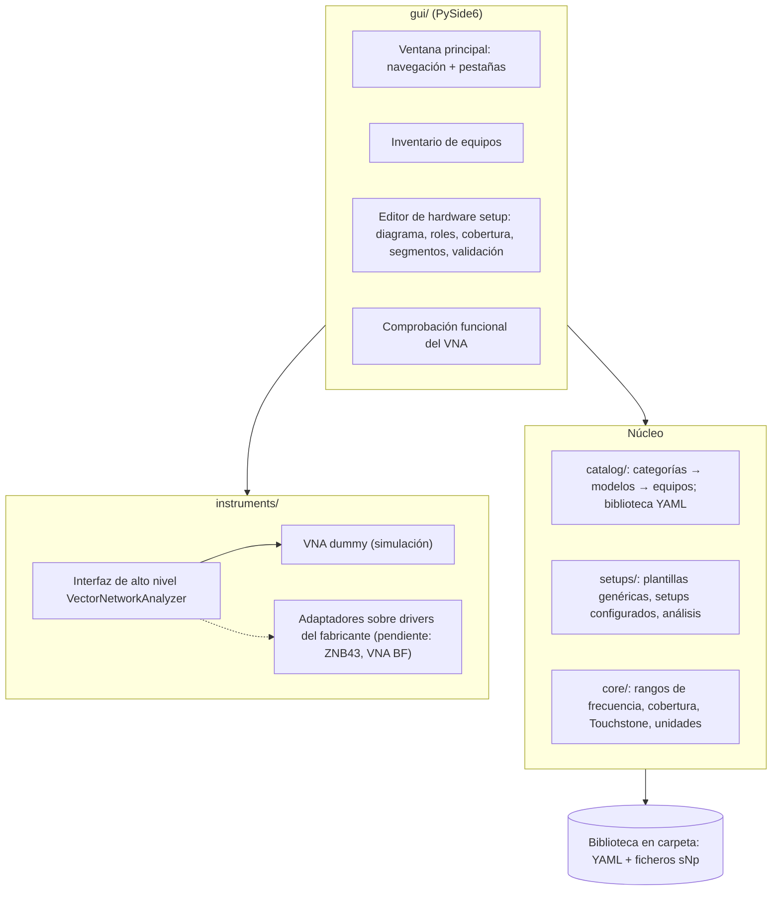

# Paso 3 — Arquitectura del software y primer incremento

> **Estado:** primer incremento funcional. Incluye:
> - el núcleo,
> - el catálogo de equipos,
> - los hardware setups con alarma de rango,
> - el VNA dummy,
> - una primera GUI.
>
> La incertidumbre, los procedimientos y la ejecución de ensayos vienen después.

## 0. Decisiones recogidas

| Tema | Decisión |
|---|---|
| “Control por línea de comandos” | Significa un **control de alto nivel apoyado en los comandos de los drivers del fabricante**. El software llama a operaciones abstractas (configurar barrido, leer S21…) y un adaptador por equipo las traduce a esos comandos |
| VNA | Hay dos: un **R&S ZNB43 de 2 puertos** y un **VNA de baja frecuencia** (modelo pendiente). De momento solo se usa un **VNA dummy**; la integración real viene después |
| Plataforma | Libre. Se elige **Python + Qt (PySide6)**; ver §1 |
| GUI | Desde el principio, empezando por el núcleo y creciendo poco a poco |
| Incertidumbre | Se integrará, pero **no en este paso** (el YAML del VNA llegará más adelante) |
| Rango de frecuencia | **El rango efectivo es la intersección de los rangos de todos los equipos.** Si no cubre el requerido, salta una alarma. Ejemplo: VNA 100 kHz–43,5 GHz con un cable 5 Hz–18 GHz → rango efectivo 100 kHz–18 GHz |
| Cables | A efectos del hardware setup, **un cable es su fichero S2P calibrado**, con una **referencia concreta y modificable** |
| Alturas y posiciones (NSA, SVSWR) | Las define la norma y afectan a la **ejecución**, no al hardware setup. Se tratarán más adelante |
| Soportes de antena | Las antenas emisora y receptora van en **mástiles automatizados**, pero el setup también admite **trípodes manuales** (con avisos al operador, a definir) |

## 1. Plataforma: Python 3.11+ con PySide6 (Qt)

- **Qt** da lo que pide un software tipo ELEKTRA: diagramas interactivos de hardware setup, pestañas, tablas y paneles acoplables. Además es nativo en Windows, que es donde estarán los equipos.
- **pyqtgraph** sirve para gráficas de medida rápidas, con zoom y marcadores; será la base de las gráficas de resultados.
- **Python** tiene buen ecosistema para la integración real:
  - VISA (`pyvisa`) y la librería de R&S (`RsInstrument`) para controlar los equipos.
  - `numpy` para el cálculo.
  - Más adelante, librerías de incertidumbre e informes.
- **YAML y pydantic** dan formatos legibles por el laboratorio, con validación y mensajes de error claros.

## 2. Arquitectura en capas



| Módulo | Contenido |
|---|---|
| `core/units.py` | Lectura y escritura de frecuencias (`"100 kHz"`, `"43,5 GHz"`, `"18G"`, `"DC"`) |
| `core/frequency.py` | `FrequencyRange`, intersección y **análisis de cobertura** (rango efectivo, equipos que limitan, zonas sin cubrir) |
| `core/touchstone.py` | Lectura y escritura de Touchstone `.sNp` (1.x y 2.0 básico; RI, MA, DB) |
| `catalog/model.py` | Modelos de datos del catálogo (`Category`, `EquipmentModel`, `Equipment`, `SParameterData`…) |
| `catalog/library.py` | Biblioteca basada en carpetas: carga, validación cruzada, rango útil de cada equipo, guardado e importación de YAML |
| `setups/model.py` | `SetupTemplate` (roles, estados de conexión, herencia `extiende`) y `ConfiguredSetup` (asignaciones, segmentos, disposición) |
| `setups/analysis.py` | **Validación del setup**: roles, categorías, calibración, puertos, tipos, datos S y cobertura por segmento |
| `instruments/` | Interfaz de alto nivel, VNA dummy y factoría (simulado o real) |
| `gui/` | Ventana principal, inventario, lista de setups, editor de setup, diagrama, gráfica de cobertura y diálogos |

## 3. Formatos de datos (v0.2)

La biblioteca es una carpeta; el ejemplo está en [`../biblioteca_ejemplo/`](../biblioteca_ejemplo/):

```
catalogo/categorias/         qué describe a cada tipo de equipo
catalogo/modelos/            modelos concretos (parámetros + comunicación)
catalogo/equipos/            inventario (nº serie, calibración, conexión, datos S)
catalogo/datos_s/            ficheros .sNp de cables, paths, preamplificadores…
catalogo/especificaciones/   especificaciones / incertidumbre (se guardan; aún no se procesan)
hardware_setups/plantillas/  plantillas genéricas
hardware_setups/configurados/ setups con equipos asignados
```

Cada fichero declara su tipo con `formato: calelektra/<tipo>@0.2`. Así *Archivo → Importar YAML…* sabe a qué carpeta va cada fichero.

### 3.1 Cambios respecto a los borradores del paso 2

- **Equipos y modelos con identificador propio.** Un equipo apunta a su modelo con `modelo: rs_znb43`.
- **Nuevas marcas en las categorías:**
  - `rf`: si el equipo cuenta para la cobertura en frecuencia. Los posicionadores y el recinto no cuentan.
  - `requiere_calibracion`.
  - `requiere_datos_s` y `puertos_datos_s`: por ejemplo, un cable de medida debe tener un S2P.
- **Datos S de un equipo:** se declaran así:
  ```yaml
  datos_s:
    fichero: ../datos_s/CAB-PT-N-01.s2p
    referencia: "Certificado / medida de la que proceden"
    fecha: 2026-06-12
  ```
- **Requisitos de rol estructurados** (ya se comprueban): `puertos_min`, `tipos`, `requiere_datos_s`, `cardinalidad`, `es_dut`, `por_segmento` y `montado_en`.
- **Simulación:** `conexion.simulado: true` hace que el equipo use el **VNA dummy** con los parámetros de su modelo.
- **Segmentos** en el setup configurado: es el “hardware setup por rango de frecuencia” de ELEKTRA. Por ejemplo, bicónicas en 30–200 MHz y log-periódicas en 200 MHz–1 GHz.
- **Separación de responsabilidades:**
  - El hardware setup describe **qué equipos y cómo se conectan**.
  - Los resultados, criterios (±4 dB, ≤ 6 dB…), gráficas, alturas y posiciones pasan al futuro **procedimiento / ejecución**.

## 4. Regla del rango de frecuencia efectivo

1. **Rango útil de cada equipo:** es la intersección de:
   - el rango nominal del **modelo**,
   - el rango propio del **equipo**, si lo declara,
   - el rango de sus **datos S** (fichero sNp), si los tiene.

   La interfaz muestra de dónde sale cada límite.
2. **Rango efectivo del setup** (por segmento): es la intersección de los rangos útiles de **todos los equipos de medida asignados**. Cuentan el VNA, los cables, los paths, los adaptadores, el kit, las antenas, las cargas, el preamplificador…
3. **Alarma:**
   - Si el rango efectivo no contiene el rango requerido, se genera un **error** por cada borde sin cubrir.
   - Cada error nombra los equipos que limitan. Ejemplo: *«Sin cubrir 18 GHz – 26,5 GHz: «CAB-PT-N-01» (Cable de medida P1) termina en 18 GHz»*.
4. **El DUT no limita.** Es lo que se calibra; se da un **aviso** si el rango requerido sale de su rango nominal.
5. **Equipos sin RF** (posicionadores, recinto): no participan en el cálculo.
6. **Segmentos:** cada uno se evalúa por separado. Además se comprueba que el conjunto de segmentos cubre el rango requerido sin huecos.

## 5. Validaciones del setup implementadas

| Código | Gravedad | Qué comprueba |
|---|---|---|
| `rol.sin_asignar` | Error | Rol obligatorio sin equipo (también por segmento) |
| `rol.multiple` | Error | Más equipos de los que admite el rol |
| `equipo.inexistente`, `equipo.categoria` | Error | El equipo no existe o no es de la categoría del rol |
| `equipo.estado` | Error | El equipo no está en servicio |
| `calibracion.caducada` / `calibracion.proxima` / `calibracion.sin_datos` | Error / Aviso / Aviso | Vigencia de la calibración de los patrones. El DUT no se comprueba. «Próxima» significa que caduca en menos de 30 días |
| `equipo.puertos`, `equipo.tipo` | Error | Número mínimo de puertos y tipos admitidos (por ejemplo, antena bicónica o log-periódica) |
| `datos_s.faltan` / `datos_s.invalidos` / `datos_s.puertos` / `datos_s.sin_referencia` | Error / Error / Error / Aviso | Cables y paths con su sNp válido, del número de puertos correcto y con referencia |
| `rango.no_cubierto`, `rango.limite_inferior`, `rango.limite_superior`, `rango.sin_interseccion` | Error | Cobertura en frecuencia (§4) |
| `rango.dut` | Aviso | El rango requerido excede el nominal del DUT |
| `segmento.hueco` / `segmento.fuera` | Error / Aviso | Los segmentos no cubren el rango requerido, o se salen de él |
| `posicionador.manual` | Información | Hay un trípode manual: habrá confirmación al operador (por definir) |

## 6. Capa de instrumentos

**Interfaz de alto nivel.** `VectorNetworkAnalyzer` (en `instruments/base.py`) define estas operaciones:

- `preset`
- `configure_sweep`
- `set_if_bandwidth`
- `set_power`
- `single_sweep`
- `frequencies`
- `read_s_parameter`
- `calibration_active`

Todas quedan registradas en un log, que es el “espía” de comandos.

**VNA dummy.** Se comporta como un VNA real:

- **Rechaza** la configuración que sale de sus especificaciones: rango, puntos, IFBW y potencia.
- Simula un dispositivo conectado entre sus puertos: los estándares *through*, *abierto*, *cortocircuito* y *carga*, o **la red S de cualquier fichero sNp** de la biblioteca.
- Añade ruido que depende de la IFBW y de la potencia.

**Factoría.** Si el equipo está marcado `simulado` (o el driver del modelo es `dummy`), devuelve un VNA dummy con el rango y los puertos del modelo. Si no, indica que el driver real todavía no está integrado.

**Integración real (siguiente fase).** Habrá un adaptador por equipo (`rs_znb`, VNA de baja frecuencia) que implementa la misma interfaz sobre los comandos del driver del fabricante. El resto del software no cambia.

## 7. Interfaz gráfica

Se lanza con `python -m calelektra` y abre la biblioteca de ejemplo.

| Pantalla | Qué hace |
|---|---|
| **Inicio** | Estado de los setups, calibraciones caducadas o próximas, y problemas al cargar la biblioteca |
| **Inventario de equipos** | Tabla filtrable con el rango útil de cada equipo y su calibración. En el detalle de cada equipo: datos S (fichero y referencia editables, gráfica de los parámetros S) y, en los VNA, la **comprobación funcional** con el VNA dummy |
| **Hardware setups** | Plantillas genéricas y setups configurados con su estado. Permite crear un setup desde una plantilla o duplicar uno existente |
| **Editor de setup** | Diagrama **interactivo** (nodos arrastrables, coloreados por validación). Un multipuerto como el VNA aparece como «VNA · P1» y «VNA · P2»; las antenas aparecen sobre su mástil; el enlace radiado se dibuja como arco «campo». Además: estado de conexión seleccionable, panel del rol con asignación filtrada por categoría (y por segmento si procede), **gráfica de cobertura en frecuencia**, tabla de segmentos y lista de validación. El indicador superior muestra *Setup válido* / *Válido con avisos* / **ALARMA: rango no cubierto** |

Capturas: [cable con alarma](capturas/setup_cable_alarma.png), [LISN con alarma](capturas/setup_lisn_alarma.png), [NSA por segmentos](capturas/setup_sac_nsa.png), [VNA dummy](capturas/vna_dummy.png), [inventario](capturas/inventario.png).

## 8. Ejemplos incluidos en la biblioteca

| Setup | Resultado esperado |
|---|---|
| Cable N hasta 26,5 GHz | **Alarma**: los cables N (S2P hasta 18 GHz) y el kit N limitan el rango a 100 kHz–18 GHz |
| Cable N hasta 18 GHz | Válido con aviso: el kit N caduca pronto |
| Impedancia LISN con ZNB43 | **Alarma**: el ZNB43 empieza en 100 kHz y se pide desde 9 kHz. Asignando `VNA-BF-01` la alarma desaparece |
| NSA cámara SAC 3 m | Válido, con dos segmentos: bicónicas y log-periódicas |
| S_VSWR cámara SAC 3 m | Válido, de 1 a 18 GHz |

> Los ficheros S2P de ejemplo son **sintéticos**; se generan con `tools/generar_s2p_sinteticos.py`. Los números de serie, certificados y fechas de calibración también son de ejemplo.

## 9. Pendiente para los próximos pasos

1. **Compatibilidad de conectores** (familia y género) en cada conexión. Los datos ya están en los modelos.
2. **Editor de plantillas en la GUI**. Hoy las plantillas genéricas se editan en YAML y los setups configurados en la GUI.
3. **Mástiles:** protocolo y controladores reales. **Trípodes manuales:** avisos y confirmación antes de medir.
4. **Integración del ZNB43** (y del VNA de baja frecuencia) sobre los comandos de su driver.
5. **Procedimientos y ejecución:** secuencia, bucles de posición y altura, normalización y medida.
6. **Incertidumbre** a partir del YAML de especificaciones del VNA.
7. Gráficas de resultados e informes y certificados.
