# Paso 4 — Campos de los equipos, algoritmo de medida con VNA y versión 0.3

> **Estado:** versión 0.3, funcional con el VNA simulado. Incluye:
> - campos tipados por categoría de equipo, que usan los hardware setups y los ensayos;
> - compatibilidad del setup: requisitos sobre los campos, conectores de cada conexión y diseño de la calibración;
> - un **setup sencillo de calibración de cables solo con VNA** (`cable_vna`);
> - el algoritmo de medida: calibración de los dos puertos (OSM / TOSM / UOSM), verificación, medida de los cuatro parámetros S y **exportación a .s2p**;
> - un adaptador para el **R&S ZNB43** basado en los comandos del driver del fabricante (pendiente de probar con el equipo);
> - una interfaz rediseñada, más cercana a ELEKTRA.
>
> La incertidumbre sigue fuera de este paso.

## 0. Material de partida y decisiones

| Tema | Decisión |
|---|---|
| Documentación del ZNB43 | El fichero recibido (`RsZnx.4.25.0_x64.msi`) **no es el manual de usuario**: es el instalador del **driver IVI.NET RsZnx 4.25.0** de R&S. Incluye el código fuente C# del driver, con el comando SCPI exacto que envía cada función. Se ha usado como referencia de comandos (§6). El manual de usuario del ZNB sigue siendo útil para validar detalles (§6.3) |
| Setup sencillo | `cable_vna`: solo el VNA (más el kit, opcional) y el cable a calibrar conectado directamente a sus puertos |
| Planos de referencia | Los define la plantilla (`planos_referencia`). En `cable_vna` son los propios puertos del VNA |
| Método de calibración | **Automático a partir de los conectores** (campos): TOSM con through plano si los planos se pueden unir (macho con hembra); UOSM con through desconocido si no (p. ej. dos puertos macho). El procedimiento puede fijarlo |
| Rango de la medida | El **rango requerido del hardware setup**. Si sale del rango nominal del cable, hay aviso |
| Resultado | Fichero Touchstone `.s2p` (S11, S21, S12, S22) con la trazabilidad en los comentarios, más CSV y el registro del ensayo |

## 1. Campos de cada tipo de equipo

Cada **categoría** declara sus campos (`campos`) con tipo, unidad y nivel. Los **modelos** dan los valores comunes y cada **equipo** los suyos.

```yaml
# catalogo/categorias/vna.yaml (extracto)
campos:
  rango_frecuencia: { etiqueta: Rango de frecuencia, tipo: rango_frecuencia, nivel: modelo, obligatorio: true }
  num_puertos:      { etiqueta: Nº de puertos de medida, tipo: entero, nivel: modelo, obligatorio: true, minimo: 1 }
  conector_puertos: { etiqueta: Conector de los puertos de medida, tipo: conector, nivel: ambos, obligatorio: true }
  potencia_salida_dbm: { etiqueta: Rango de potencia de salida, tipo: rango_numero, unidad: dBm, nivel: modelo }
  ifbw:             { etiqueta: Rango de IFBW, tipo: rango_frecuencia, nivel: modelo }
  puntos_max:       { etiqueta: Nº máximo de puntos por barrido, tipo: entero, nivel: modelo }
  metodos_calibracion: { etiqueta: Métodos de calibración disponibles, tipo: multiopcion, opciones: [OSM, TOSM, UOSM, TRL, TNA, autocal, normalizacion] }
```

- **Tipos:** `texto`, `numero`, `entero`, `booleano`, `opcion`, `multiopcion`, `lista`, `frecuencia`, `rango_frecuencia`, `rango_numero`, `conector`, `familia_conector`, `fecha`.
- **Nivel:** `modelo` (común a todas las unidades), `equipo` (propio de cada unidad) o `ambos` (el equipo puede sustituir el valor del modelo).
- **Valor efectivo:** equipo → modelo → valor por defecto. La interfaz muestra de dónde sale cada valor.
- **Puertos:** la categoría dice qué campo da el conector de cada puerto (`P1…Pn` del VNA, extremos `A`/`B` de un cable…).
- **Conectores:** familia + género (`{ familia: 2.92 mm, genero: macho }`). Reglas de unión: misma familia y géneros opuestos; 3,5 / 2,92 mm / SMA son compatibles mecánicamente (aviso); PC-7 no tiene género; las bornas no coaxiales no se comprueban.

### 1.1 Dónde se usa cada campo

| Campo | Hardware setup (compatibilidad) | Ensayo (ejecución) |
|---|---|---|
| `rango_frecuencia` (todos) | Rango efectivo y alarma de cobertura | — |
| `num_puertos`, `metodos_calibracion` (VNA) | Requisitos de la plantilla; método posible | Puertos y método enviados al VNA |
| `conector_puertos` (VNA), `conector_a/b` (cables, adaptadores) | Unión de cada conexión; planos de referencia; TOSM o UOSM | Conectores de la calibración (`SENS:CORR:COLL:CONN`) y textos al operador (género de los estándares) |
| `potencia_salida_dbm`, `ifbw`, `puntos_max` (VNA) | — | Límites del barrido antes de enviar nada |
| `familia_conector`, `generos_disponibles`, `metodos` (kit) | El kit sirve para los planos y el método | — |
| `nombre_kit_vna` (kit) | Aviso si falta | Selección del kit en el VNA (`SENS:CORR:CKIT:…:SEL`) |
| `longitud_m`, `atenuacion_db_m_1ghz` (cable DUT) | Requisito (aviso) en `cable_vna` | Modelo del DUT en simulación |
| `lineas`, `red_nominal`, `control` (LISN) | Requisitos de `lisn_impedancia` | Una medida por línea; desviación respecto a la red nominal |
| `motorizado` (posicionador) | Aviso si el mástil RX es manual (NSA) | Confirmaciones al operador (próximos pasos) |

## 2. Compatibilidad del hardware setup

El análisis del setup (`setups/analysis.py`) añade a lo del paso 3 tres comprobaciones. Todas aparecen en la pestaña **Compatibilidad** del editor.

### 2.1 Requisitos sobre los campos (`requisitos`)

```yaml
requisitos:
  - id: vna_puertos
    campo: vna.num_puertos          # rol.campo[.atributo]
    operador: ">="
    valor: 2
    mensaje: El VNA debe tener al menos 2 puertos de medida
  - campo: kit_cal.familia_conector
    operador: "=="
    valor: "@vna.conector_puertos.familia"   # referencia a otro campo
    gravedad: aviso                          # error (por defecto) | aviso | info
```

- **Operadores:** `==`, `!=`, `>=`, `<=`, `>`, `<`, `en`, `no_en`, `contiene`, `contiene_alguno`, `existe`, `cubre`, `dentro_de`.
- **Atributos:** `familia` / `genero` de un conector; `inicio` / `fin` de un rango de frecuencia; `min` / `max` de un rango numérico.
- **Referencias:** `@rol.campo[.atributo]` o `@rango_requerido` (del setup o del segmento).
- Las plantillas hijas (`extiende`) heredan los requisitos del padre; uno con el mismo `id` lo sustituye.

### 2.2 Conectores de cada conexión

Para cada estado de conexión (calibración, medida…) se comprueba cada unión con los campos de conector de los dos puertos. Si un rol opcional no está asignado (p. ej. un adaptador), se **puentea**: `cable.B – [adaptador] – dut.A` pasa a ser `cable.B – dut.A`.

Ejemplo `cable_vna_N_alarma`: un cable N macho no se puede conectar a los puertos 2,92 mm macho del ZNB43 → error, y el kit N no sirve para esos planos → error.

### 2.3 Diseño de la calibración (`setups/connections.py`)

1. **Planos de referencia:** el primer candidato asignado de `planos_referencia.PRn.en`, con su puerto del VNA (`puerto_vna`).
2. **Método:** 1 plano → OSM. 2 planos → TOSM si los conectores de los planos se unen directamente; si no, UOSM.
3. **VNA:** el método debe estar en `metodos_calibracion`; los puertos deben existir.
4. **Kit:** familia igual a la de los planos; deben existir estándares del género contrario al de cada plano (`generos_disponibles`); el método debe estar en `metodos`; el nombre en el VNA (`nombre_kit_vna`) debe estar indicado. Sin kit asignado se usa el kit seleccionado en el VNA (aviso: no queda registrado).

| Setup de ejemplo | Planos | Método |
|---|---|---|
| `cable_vna_292` (cable 2,92 h–h al ZNB43) | 2,92 m / 2,92 m | **UOSM** |
| `componente_292_tosm` (cables de medida 2,92 h→m y h→h) | 2,92 m / 2,92 h | **TOSM** |
| `cable_N_18G` (cables de medida 2,92→N h) | N h / N h | **UOSM** |
| `lisn_impedancia_VNA-BF` | N h | **OSM** |

## 3. Algoritmo de medida (procedimientos)

Un **procedimiento** (`procedimientos/*.yaml`, el *test template* de ELEKTRA) dice cómo medir: algoritmo, barrido, calibración, verificación y exportación. Se ejecuta sobre un setup cuya plantilla (o una antecesora) esté en `plantillas_compatibles`.

> **Versión 0.4:** la plantilla de ensayo define también el rango de frecuencias (lineal por puntos o paso, logarítmico, lista CSV), los ajustes de cada traza y las especificaciones (pasa / falla); el ensayo se crea en una carpeta y el equipo a calibrar se elige en el ensayo, no en el setup. Se añade el paso *Evaluación pasa / falla*. Ver [05](05_plantillas_de_ensayo_y_ensayos.md).

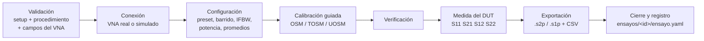

### 3.1 Dos puertos (`vna_2_puertos`, procedimiento `cable_parametros_s`)

1. **Validación** (`prepare_run`): el setup no tiene errores; el procedimiento es compatible con la plantilla; los puntos, la IFBW y la potencia están dentro de los campos del VNA; el barrido logarítmico no empieza en DC.
2. **Configuración:** preset, barrido en el rango requerido del setup, IFBW, potencia y promedios.
3. **Calibración guiada:** se define la calibración (método, puertos, conectores de los planos, kit) y se pide al operador cada estándar, nombrando el plano, el equipo y el género del estándar:
   *«Conecte el estándar Abierto (Open) hembra del kit «KIT-292-01» (2.92 mm Ideal Kit) en el plano PR1 (puerto P1 del VNA, 2,92 mm (K) macho).»*
   Orden: Open, Short, Match en cada puerto; después el through plano (TOSM) o el through desconocido (UOSM, un adaptador recíproco y corto). Al final se aplica y se comprueba que el VNA queda en `CAL`.
4. **Verificación** (si está activa):
   - TOSM: through plano de nuevo → |S21| dentro de ±tolerancia de 0 dB y |S11|, |S22| por debajo del límite.
   - UOSM: through desconocido de nuevo → reciprocidad |S21| − |S12| dentro de tolerancia.
   - En todos los métodos: carga adaptada en cada plano → |Γ| por debajo del límite.
   - Si no cumple, el operador decide si continuar; el ensayo queda como *verificación fallida*.
5. **Medida:** el operador conecta el DUT (extremo A en PR1, B en PR2) y se leen los cuatro parámetros S corregidos.
6. **Exportación:** Touchstone 1.1 (`RI`, `MA` o `DB`; unidad configurable) con el orden estándar `S11 S21 S12 S22`; los comentarios llevan ensayo, procedimiento, setup, DUT, identificación del VNA, calibración y barrido (y **DATOS SIMULADOS** si el VNA es simulado). CSV con `;` y coma decimal. Resumen: pérdidas de inserción mín./máx., pérdidas de retorno mínimas, retardo y reciprocidad.

### 3.2 Un puerto (`vna_1_puerto`, procedimiento `impedancia_lisn`)

Calibración OSM en el plano (extremo del cable de medida), verificación con la carga y una medida por cada línea del campo `lineas` de la LISN. Exporta un `.s1p` y un CSV por línea con |Z|, fase y la **desviación respecto a la red nominal** (campo `red_nominal`). Las tolerancias (±20 %, ±11,5°) son opciones del procedimiento, **a confirmar** con el procedimiento del laboratorio.

### 3.3 Registro del ensayo

`ensayos/<fecha>_<setup>/ensayo.yaml` (`calelektra/ensayo@0.3`; desde la versión 0.4, `<carpeta elegida>/<nombre del ensayo>/ensayo.yaml`, ver [05](05_plantillas_de_ensayo_y_ensayos.md)) guarda: estado, operador, procedimiento, setup, DUT, **todos los equipos con su certificado, vencimiento y referencia de datos S**, barrido, identificación del instrumento, calibración (método, motivo, planos, kit), verificación, resultados y ficheros. Junto a él quedan los `.sNp`, los CSV y `registro.txt` con todas las operaciones enviadas al VNA.

## 4. Modelo de error y cálculo de la calibración (`core/calibration.py`)

Modelo de 12 términos sin aislamiento (8 términos con conmutador ideal en el simulador):

- Por puerto: directividad `e00`, adaptación de fuente `e11`, seguimiento de reflexión `e10e01`.
- Por sentido: seguimiento de transmisión `e10e32` / `e23e01` y adaptación de carga `e22f` / `e11r`.

| Método | Cálculo |
|---|---|
| OSM | Sistema lineal por frecuencia con open (Γ = +1), short (−1) y match (0) ideales |
| TOSM | Through plano conocido: `e22f` y `e11r` a partir de S11/S22 del through corregidos con los términos de cada puerto; seguimientos con S21/S12 |
| UOSM | Through recíproco desconocido: `(e10e32)² = S21m·e10e01·e23e32 / S12m`; el signo de la raíz se elige como el «retardo automático» del VNA (fase continua con 0 en DC). El barrido debe muestrear bien la fase del through (paso de fase < π entre puntos) |

En el ZNB43 real estos cálculos los hace el propio VNA; el software solo dirige la secuencia. El módulo se usa en el VNA simulado y está verificado numéricamente en las pruebas.

## 5. VNA simulado (`instruments/dummy_vna.py`)

- Cada puerto tiene errores sistemáticos fijos (directividad −27 dB, adaptación −17 dB, retardo del cable de puerto…), así que **la medida en bruto es incorrecta hasta calibrar**.
- **Banco simulado:** lo que hay conectado a cada puerto (estándar, through, red del DUT, carga de 1 puerto). El motor lo cambia en los mismos puntos en que pide al operador conectar algo.
- Máquina de estados de la calibración como el ZNB: definir → adquirir estándares → aplicar. Estado `CAL` (mismo barrido), `CAI` (interpolado), `OFF` (desactivada o fuera del rango calibrado), `NONE`.
- Ruido según IFBW, potencia y promedios. Límites tomados de los campos del VNA.
- El DUT simulado sale de su fichero de datos S o de sus campos (longitud y atenuación de un cable, red nominal de una LISN).

## 6. Adaptador del R&S ZNB43 (`instruments/rs_znx.py`)

Implementa la misma interfaz que el VNA simulado con los comandos SCPI que envía el driver **RsZnx 4.25.0**. Transporte VISA (`pyvisa`, extra `instrumentos`), con transferencia binaria `REAL,32` en orden `SWAP`; tras cada operación lee la cola `SYST:ERR?` y convierte los errores del equipo en mensajes.

### 6.1 Operaciones y comandos

| Operación | Comandos SCPI |
|---|---|
| Conectar | `*IDN?`, `*CLS`, `FORM:BORD SWAP`, `:FORM REAL,32` |
| Preset | `*RST;*OPC?`, `INIT1:CONT OFF`, una traza por parámetro: `CALC1:PAR:SDEF 'CE_S21','S21'` + `DISP:WIND1:TRAC:EFE 'CE_S21'`, borrado de las demás (`CALC1:PAR:CAT?`, `CALC1:PAR:DEL`) |
| Barrido | `SENS1:SWE:TYPE LIN\|LOG`, `SENS1:FREQ:STAR`, `SENS1:FREQ:STOP`, `SENS1:SWE:POIN` |
| IFBW / potencia | `SENS1:BAND`, `SOUR1:POW` |
| Promedios | `SENS1:AVER:COUN n`, `SENS1:AVER ON\|OFF`, `SENS1:SWE:COUN n` (y `SENS1:AVER:CLE` antes de cada barrido) |
| Barrido único | `INIT1;*OPC?` (tiempo de espera según `SENS1:SWE:TIME?`) |
| Leer datos | `CALC1:PAR:SEL 'CE_S21'`, `CALC1:DATA? SDAT`; frecuencias con `CALC1:DATA:STIM?` |
| Definir calibración | `SENS1:CORR:COLL:CONN:PORT SING`, `…:CONN:GEND SING`, `SENS1:CORR:COLL:CONN<p> PC292MALE…`, `SENS:CORR:CKIT:PC292:SEL '<kit>'` (o `SENS:CORR:CKIT:SEL '<conector>','<kit>'`), `SENS1:CORR:COLL:METH:DEF 'CALELEKTRA',TOSM\|UOSM\|FOP,1,2` |
| Adquirir estándar | `SENS1:CORR:COLL:SEL OPEN\|SHOR\|MATC,<p>;*OPC?`, `SENS1:CORR:COLL:SEL THR,1,2;*OPC?`, `SENS1:CORR:COLL:SEL UTHR,1,2,OFF,AUTO;*OPC?` |
| Aplicar | `SENS1:CORR:COLL:SAVE:SEL;*OPC?` |
| Estado | `SENS1:CORR:SST?` → `'CAL'`, `'CAI'`, `'CA?'`, `'CAV'`, `'CAL OFF'`, `''` |
| Corrección on/off | `SENS1:CORR ON\|OFF` |
| Guardar / cargar calibración | `MMEM:STOR:CORR 1,'<nombre>.cal'`, `MMEM:LOAD:CORR 1,'<nombre>.cal'` |

### 6.2 Uso

En el equipo `VNA-01`, poner `conexion.simulado: false` y el recurso VISA (`TCPIP::<ip>::hislip0::INSTR`). Instalar `pip install -e ".[instrumentos]"` y un backend VISA (R&S VISA, NI-VISA o pyvisa-py).

### 6.3 Pendiente de validar con el ZNB43

1. Que el género de `SENS:CORR:COLL:CONN<p>` sea el del **conector del puerto** (plano), como se ha supuesto.
2. Los nombres de los kits instalados en el VNA (`nombre_kit_vna` de cada kit).
3. Opciones instaladas, potencia mínima/máxima y conector real de los puertos del ZNB43 (marcados *A CONFIRMAR* en el modelo).
4. Tiempos de espera de barridos largos y promedios.
5. Transferencia binaria (`REAL,32`) con el backend VISA del laboratorio.

## 7. Interfaz (versión 0.3)

- **Barra lateral:** Inicio, Ensayos, Procedimientos, Hardware setups, Equipos, Catálogo.
- **Cinta de acciones** según la sección o el documento activo; los setups y ensayos se abren como **pestañas de documento**.
- **Inicio:** indicadores (equipos, calibraciones, setups, ensayos, procedimientos), últimos ensayos, estado de los setups, alertas de calibración e instrumentos.
- **Equipos:** inventario filtrable; ficha con los campos agrupados y su origen (modelo/equipo), calibración, datos S, conexión y driver, y setups donde se usa. Alta y edición con **formulario generado a partir de los campos de la categoría** (vacío = hereda del modelo).
- **Catálogo:** categorías con la definición de sus campos y modelos con sus valores; alta y edición de modelos.
- **Hardware setups:** estado de cada setup (rango, requisitos, conectores, calibración) y plantillas con sus roles, planos y requisitos. El editor añade las pestañas **Compatibilidad** y **Calibración del VNA**.
- **Procedimientos:** editor completo (algoritmo, plantillas compatibles, barrido, calibración, verificación, exportación, opciones).
- **Ensayos:** asistente con **comprobación previa**, ventana de ejecución con el flujo de pasos, gráfica en vivo (magnitud, fase, |Z|), resultados y registro; peticiones al operador con pictograma. Con el VNA simulado se puede ejecutar en modo automático, sin diálogos. Historial con el detalle de cada ensayo y sus ficheros.

| | |
|---|---|
| 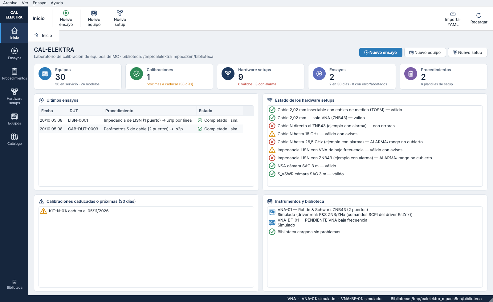 | 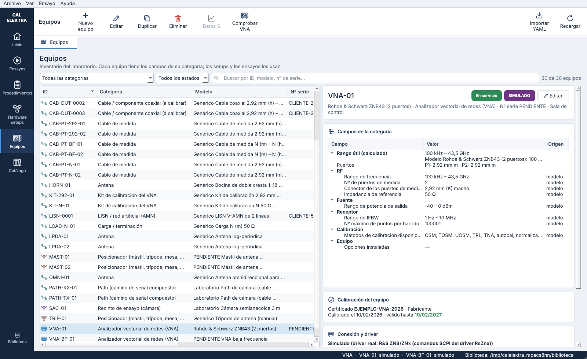 |
| 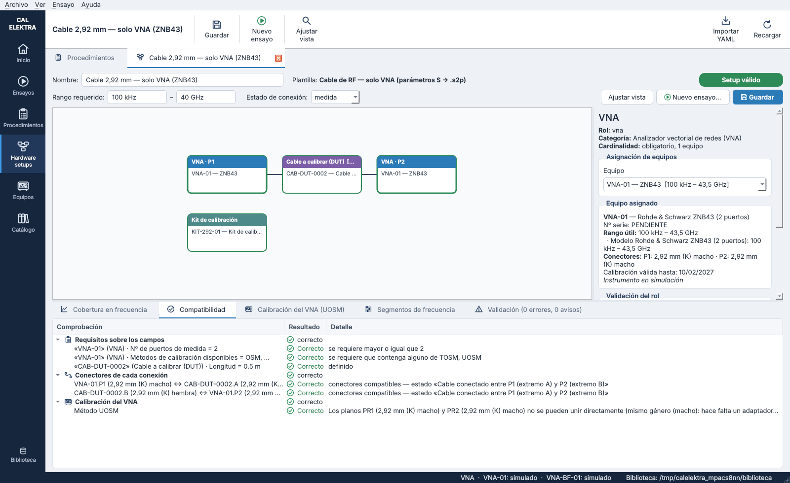 | 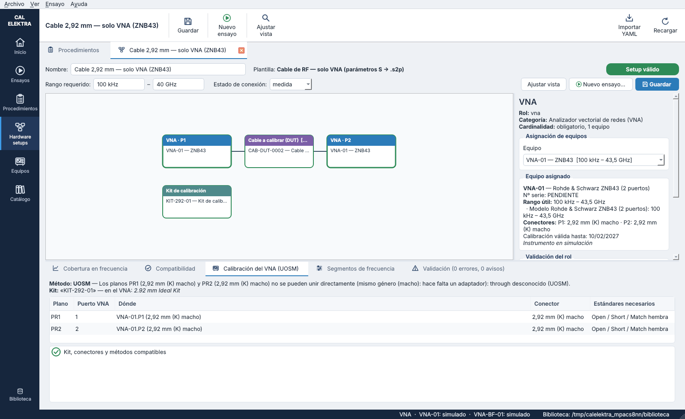 |
| 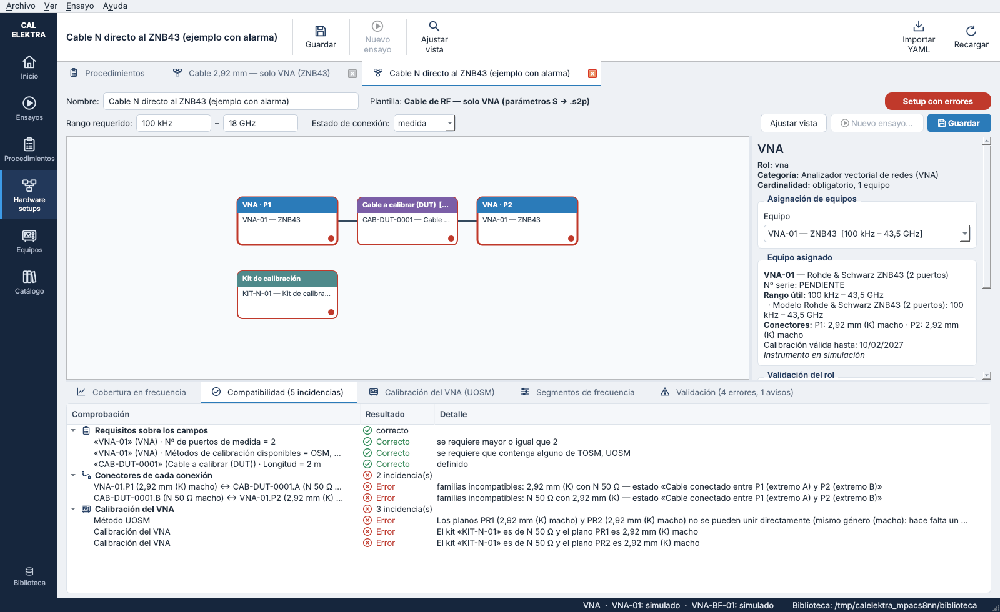 | 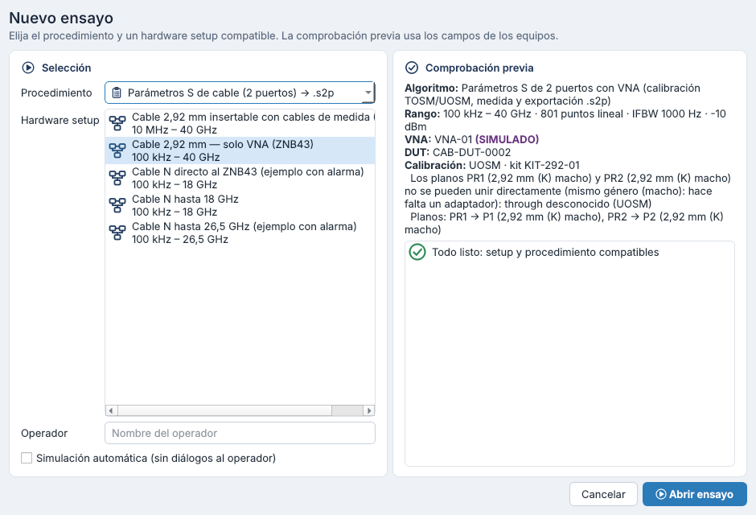 |
| 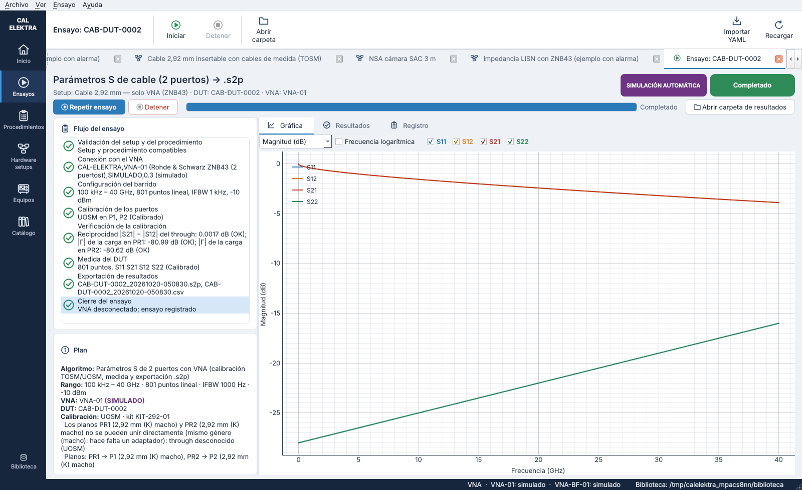 | 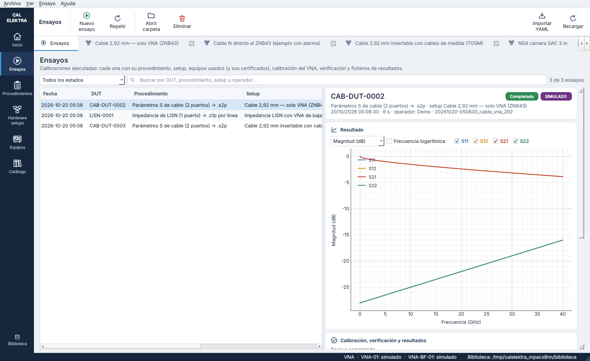 |
| 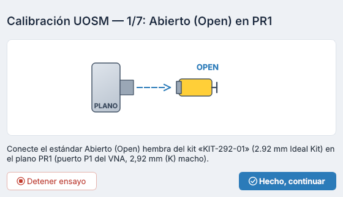 | 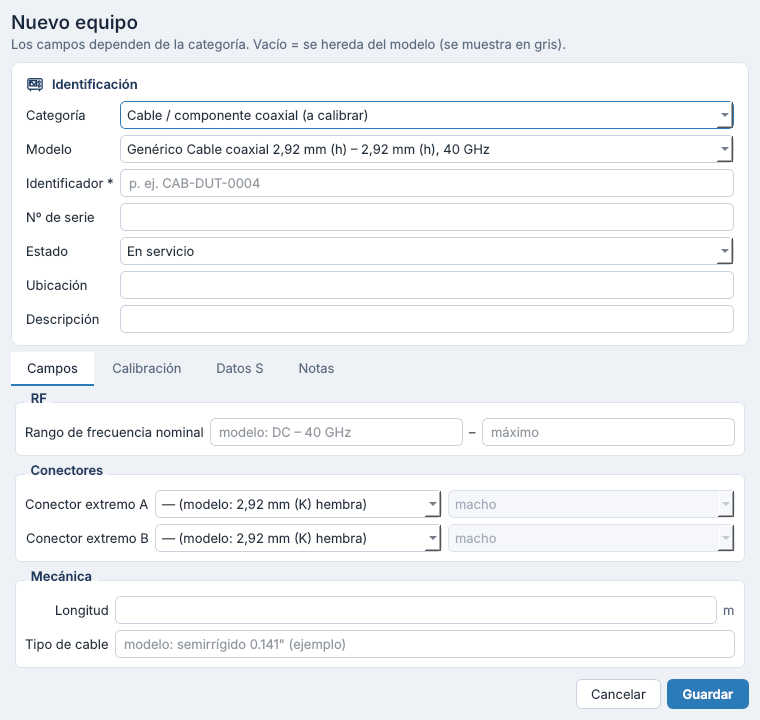 |
| 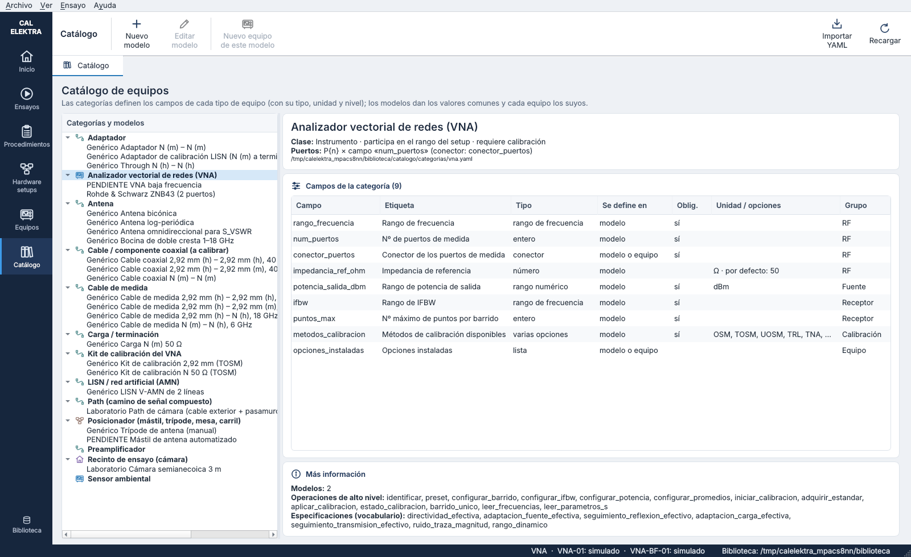 | 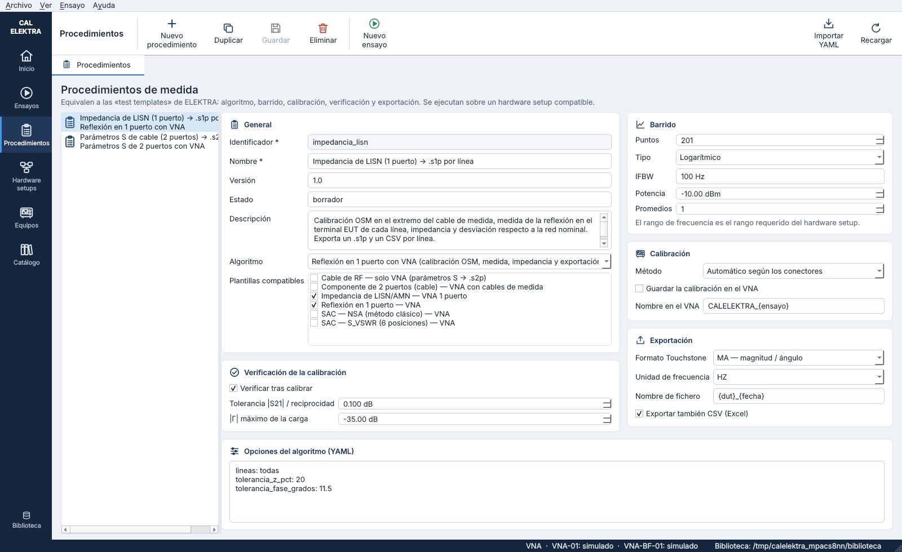 |

## 8. Pendiente para los próximos pasos

1. **Probar el adaptador con el ZNB43** (§6.3) y añadir el VNA de baja frecuencia cuando se conozca su modelo.
2. **Incertidumbre** a partir del YAML de especificaciones del VNA (y de los certificados del kit y los cables).
3. **NSA y S_VSWR:** procedimientos con alturas, polarizaciones y posiciones; mástiles reales y confirmaciones con trípodes manuales.
4. Editor de plantillas de setup en la interfaz (hoy en YAML).
5. Informes y certificados a partir del registro de cada ensayo.
