# 5. Plantillas de ensayo y ensayos en carpetas (versión 0.4)

Este paso completa el caso del **cable de RF con VNA** para integrar toda la arquitectura antes de extenderla al resto de equipos:

- definición del **rango de frecuencias** en la plantilla de ensayo: lineal (nº de puntos o paso), logarítmico (nº de puntos) o lista de frecuencias (CSV);
- **IFBW, promedios y suavizado** para todas las trazas o para cada traza;
- **ensayos lanzados en una carpeta** elegida por el usuario, una vez definido el hardware setup;
- en el ensayo se definen el **cable a calibrar** y los **ficheros S2P de especificación** que dan el **pasa / falla**, y se **selecciona y visualiza** el hardware setup aplicable.

## 5.1 ¿Seguía la versión 0.3 esta estructura?

No del todo. Esta tabla compara lo pedido con la versión 0.3 y con la 0.4:

| Lo pedido | Versión 0.3 | Versión 0.4 |
|---|---|---|
| Elegir la carpeta en la que se lanza la plantilla de ensayo | No. Cada ensayo se guardaba solo en `ensayos/<fecha>_<setup>/` | Explorador de carpetas (`ensayos/`, subcarpetas y carpetas externas); el ensayo se crea en la carpeta elegida |
| Cable a calibrar definido en el ensayo | No. El DUT se asignaba en el **hardware setup** | El DUT se elige al **crear el ensayo**; el setup describe solo el banco de medida |
| Ficheros S2P de especificación y pasa / falla | No existían | En la plantilla de ensayo, modificables en cada ensayo; veredicto **PASA / FALLA** con márgenes |
| Seleccionar y visualizar el hardware setup aplicable | Se elegía en una lista, sin vista del setup | Solo se ofrecen los setups compatibles y se ven como **diagrama con el cable del ensayo colocado** |
| Rango de frecuencias en la plantilla | No. Rango requerido del setup; lineal o logarítmico por nº de puntos | Lineal (puntos o paso), logarítmico (puntos) o lista CSV; o, si se quiere, el rango del setup |
| IFBW, promedios y suavizado por traza | IFBW y promedios globales; sin suavizado | Para todas las trazas o por traza; suavizado incluido |

## 5.2 Flujo

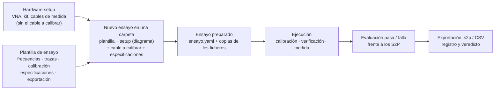

1. **Hardware setup** (`hardware_setups/configurados/`): el banco con el que se mide. El rol del DUT puede quedar vacío; el análisis lo indica como información: *«Cable a calibrar (DUT)» se elige al crear cada ensayo*. Si un setup tiene el DUT asignado, se propone al crear el ensayo.
2. **Plantilla de ensayo** (`procedimientos/*.yaml`, la *test template* de ELEKTRA): cómo se mide.
3. **Nuevo ensayo**: se elige la carpeta, el nombre, la plantilla, un setup compatible (se ve el diagrama) y el cable a calibrar; las especificaciones vienen de la plantilla y se pueden cambiar. La **comprobación previa** usa los campos de los equipos: conectores, rangos, kit, límites del VNA y ficheros de especificación.
4. El ensayo queda **preparado** en su carpeta. Al abrirlo se ve su definición, el setup y la comprobación; mientras está preparado se puede cambiar su definición.
5. **Ejecución**: los mismos pasos que en la versión 0.3, más la **evaluación pasa / falla**.

## 5.3 La plantilla de ensayo

Ejemplo de `biblioteca_ejemplo/procedimientos/cable_292_pasa_falla.yaml`:

```yaml
formato: calelektra/procedimiento@0.3
id: cable_292_pasa_falla
nombre: Cable 2,92 mm 0,5 m — 50 MHz a 40 GHz con pasa / falla
algoritmo: vna_2_puertos
plantillas_compatibles: [cable_vna, componente_2p]
barrido:
  modo: lineal              # lineal | logaritmico | lista
  definicion: paso          # lineal: puntos | paso
  inicio: 50 MHz            # sin inicio/fin: el rango requerido del hardware setup
  fin: 40 GHz
  paso: 50 MHz              # → 800 puntos
  potencia_dbm: -10
  ifbw: 1 kHz               # ajustes de todas las trazas…
  promedios: 1
  suavizado_pct: 0
  por_traza: true           # …o de cada traza (vacío = el valor de todas)
  trazas:
    S11: { suavizado_pct: 1 }
    S21: { ifbw: 100 Hz, promedios: 4 }
    S12: { ifbw: 100 Hz, promedios: 4 }
    S22: { suavizado_pct: 1 }
especificaciones:
  - nombre: Pérdidas de inserción máximas
    fichero: especificaciones/cable_292_0m5_mascara.s2p
    parametros: [S21, S12]
    criterio: minimo        # |S| medida ≥ |S| de la máscara
    magnitud: magnitud_db
  - nombre: Pérdidas de retorno mínimas
    fichero: especificaciones/cable_292_0m5_mascara.s2p
    parametros: [S11, S22]
    criterio: maximo        # |S| medida ≤ |S| de la máscara
    magnitud: magnitud_db
```

Las rutas relativas son relativas a `procedimientos/`. El editor copia los ficheros elegidos en `procedimientos/listas/` y `procedimientos/especificaciones/`. Los ficheros de la versión 0.3 se siguen leyendo (`tipo: lineal` equivale a `modo: lineal`).

### Rango de frecuencias (`procedures/frequencies.py`)

| Modo | Se define con | Puntos |
|---|---|---|
| Lineal, por nº de puntos | inicio, fin, puntos | `linspace(inicio, fin, puntos)` |
| Lineal, por paso | inicio, fin, paso | `inicio + k·paso` hasta `fin`. Si el rango no es múltiplo del paso, el último punto queda por debajo de `fin` y la comprobación previa lo avisa |
| Logarítmico | inicio, fin, puntos | `geomspace(inicio, fin, puntos)`; no puede empezar en DC |
| Lista | fichero CSV | Las frecuencias del fichero, ordenadas y sin repetir; `inicio`/`fin` opcionales filtran la lista |

Sin `inicio` ni `fin` (casilla *Rango requerido del hardware setup*), el barrido usa el rango requerido del setup elegido.

Formato del CSV: primera columna (separador `;` o tabulador), coma o punto decimal, líneas que empiezan por `#` ignoradas. La unidad puede ir en cada valor (`1,5 GHz`) o en la cabecera (`Frecuencia (MHz)`); si no aparece, son Hz.

Comprobaciones antes de ejecutar:

- los puntos del ensayo deben estar dentro del **rango efectivo del setup** (intersección de los rangos de los equipos de medida); si no, el error nombra los equipos que limitan. El cable a calibrar no limita: si el ensayo sale de su rango nominal, solo se avisa;
- nº de puntos ≤ campo *Nº máximo de puntos* del VNA;
- IFBW de **cada traza** dentro del campo *IFBW* del VNA, y potencia dentro de su campo de potencia.

### Trazas: IFBW, promedios y suavizado

- **Todas las trazas** o **por traza** (S11, S21, S12, S22; S11 en los procedimientos de 1 puerto). Una celda vacía toma el valor de *Todas las trazas*.
- En el VNA la IFBW y los promedios son ajustes del canal. Por eso las trazas que comparten IFBW y promedios se leen del mismo barrido y cada combinación distinta necesita **su propio barrido**; al terminar se restauran los ajustes de todas las trazas. En el ejemplo: un barrido a 1 kHz para S11 y S22 y otro a 100 Hz con 4 promedios para S21 y S12. La calibración y la verificación usan los ajustes de todas las trazas.
- El **suavizado** lo aplica CAL-ELEKTRA después de leer el VNA (`procedures/processing.py`), igual para el VNA real y el simulado: media móvil sobre el % de puntos indicado, de la magnitud en dB y de la fase desenrollada por separado (promediar los complejos anularía la fase de un cable largo). Equivale a la apertura de suavizado del ZNB (`CALC:SMO:APER`). Los ficheros exportados llevan las trazas suavizadas y `ensayo.yaml` guarda los ajustes de cada traza.

### Especificaciones (pasa / falla) (`procedures/specs.py`)

Cada especificación es un fichero Touchstone (S2P o S1P) y dice cómo se compara:

| Criterio | Pasa si | Uso típico |
|---|---|---|
| `minimo` | medida ≥ especificación | \|S21\| frente a las pérdidas de inserción máximas |
| `maximo` | medida ≤ especificación | \|S11\| frente a la máscara de pérdidas de retorno |
| `tolerancia` | \|medida − especificación\| ≤ tolerancia | curva de referencia ± 0,5 dB (o ± grados) |

- Magnitud en dB (`magnitud_db`) o fase en grados (`fase_grados`; la diferencia se reduce a ±180°).
- La especificación se interpola en las frecuencias medidas **dentro de su propio rango**; los puntos fuera de él no se evalúan y se indican. Un escalón de una máscara se escribe con dos frecuencias muy próximas.
- **Margen** = distancia al límite, positivo si el punto pasa. Por especificación y parámetro se guardan el margen mínimo, su frecuencia y los puntos que fallan.
- **Veredicto** del ensayo: **FALLA** si algún parámetro falla; **PASA** si todos pasan; **NO EVALUADO** si alguno no se pudo evaluar (sin puntos comunes, fichero ilegible…); sin especificaciones no hay veredicto.

## 5.4 El ensayo

### Carpetas

El explorador de **Ensayos** muestra `ensayos/` de la biblioteca, sus subcarpetas y las **carpetas externas** que se añadan (por ejemplo, en una unidad de red; la lista está en `ensayos/carpetas.yaml`). Cada carpeta indica cuántos ensayos contiene. Al seleccionar una carpeta se ven sus ensayos (también los de sus subcarpetas) con estado y veredicto.

### Contenido de la carpeta de un ensayo

```
ensayos/2026/Cliente ACME/Cable_2_92_mm_0_5_m_no_2001/
  ensayo.yaml                           definición, estado, equipos, calibración, veredicto, resultados
  especificaciones/cable_292_0m5_mascara.s2p   copia de la especificación usada (con su SHA-256 en ensayo.yaml)
  listas/…csv                           copia de la lista de frecuencias (modo lista)
  CAB-DUT-0002_20261020-071233.s2p      resultado (Touchstone)
  CAB-DUT-0002_20261020-071233.csv      resultado (CSV, coma decimal)
  registro.txt                          operaciones del ensayo y comandos de alto nivel enviados al VNA
```

`ensayo.yaml` (`calelektra/ensayo@0.3`):

- `definicion`: plantilla (`procedimiento`), `setup`, `dut` y `configuracion`, la **copia completa de la plantilla** tal como se lanzó, con las especificaciones del ensayo. Cambiar después la plantilla de la biblioteca no cambia los ensayos ya creados;
- `estado`: `preparado` → `en_curso` → `completado` / `verificacion_fallida` / `abortado` / `error`;
- `veredicto` y `especificaciones`: resultado de cada especificación y de cada parámetro (margen mínimo, frecuencia, puntos que fallan, puntos sin especificación) y el SHA-256 del fichero usado;
- lo que ya guardaba la versión 0.3: equipos con certificado y vencimiento, barrido (ahora con el modo, el paso y los ajustes por traza), instrumento, calibración, verificación, resultados y ficheros.

**Repetir** un ensayo crea uno nuevo, preparado, en la misma carpeta y con la misma definición (incluidas sus copias de las especificaciones).

## 5.5 Control del R&S ZNB (`instruments/rs_znx.py`)

| Función | Comandos (driver RsZnx 4.25.0) |
|---|---|
| Lineal / logarítmico | `SENS1:SWE:TYPE LIN\|LOG`, `SENS1:FREQ:STAR`, `SENS1:FREQ:STOP`, `SENS1:SWE:POIN` |
| Lista de frecuencias | barrido segmentado: `SENS1:SEGM:DEL:ALL`; un segmento por cada tramo de paso constante de la lista: `SENS1:SEGM<n>:INS inicio,fin,puntos,potencia,0,0,ifbw,AUTO,NORM,AUTO,STEP`; `SENS1:SEGM:BWID:CONT OFF`, `SENS1:SEGM:POW:CONT OFF` (la IFBW y la potencia del canal valen para todos los segmentos); `SENS1:SWE:TYPE SEGM` |
| IFBW y promedios por traza | `SENS1:BAND`, `SENS1:AVER:COUN` antes del barrido de cada grupo de trazas |
| Suavizado | en CAL-ELEKTRA (el ZNB tiene `CALC:SMO`, no se usa para que el resultado no dependa del instrumento) |

La lista del ejemplo (30 MHz – 1 GHz cada 10 MHz y 1 – 18 GHz cada 100 MHz) da dos segmentos. **Pendiente de comprobar con el ZNB43**: número máximo de segmentos y orden de los parámetros de `SEGM:INS`.

## 5.6 Ejemplos de la biblioteca

| Plantilla | Frecuencias | Trazas | Especificaciones | Setups compatibles |
|---|---|---|---|---|
| `cable_parametros_s` | Lineal, 801 puntos, rango del setup | Todas: 1 kHz | — | `cable_vna`, `componente_2p` |
| `cable_292_pasa_falla` | Lineal 50 MHz – 40 GHz, paso 50 MHz | S21/S12: 100 Hz y 4 promedios; S11/S22: suavizado 1 % | Máscara de 0,5 m: pérdidas de inserción y de retorno | `cable_vna`, `componente_2p` |
| `cable_N_lista` | Lista CSV `listas/puntos_cable_N.csv` (268 puntos) | Todas: 300 Hz, 2 promedios | \|S21\| y \|S12\| = referencia de 2 m ± 0,5 dB | `cable_vna`, `componente_2p` |
| `impedancia_lisn` | Logarítmico 9 kHz – 30 MHz, 201 puntos | Todas: 100 Hz | — (desviación frente a la red nominal) | `lisn_impedancia`, `reflexion_1p` |

Resultados con el VNA simulado:

| Ensayo | Resultado |
|---|---|
| `cable_292_pasa_falla` + `cable_vna_292` + CAB-DUT-0002 (0,5 m, h–h) | UOSM; **PASA** (margen mínimo +0,13 dB en inserción, +1,03 dB en retorno) |
| `cable_292_pasa_falla` + `componente_292_tosm` + CAB-DUT-0003 (1,2 m, h–m) | TOSM; **FALLA**: pérdidas de inserción por encima de la máscara (margen −2,5 dB a 40 GHz) |
| `cable_N_lista` + `cable_N_18G` + CAB-DUT-0001 | UOSM; **PASA** frente a la referencia ± 0,5 dB |
| `impedancia_lisn` + `lisn_impedancia_VNA-01` + LISN-0001 | No se ejecuta: el ensayo empieza en 9 kHz y el ZNB43 en 100 kHz |
| `cable_parametros_s` + `cable_vna_N_alarma` + CAB-DUT-0001 | No se ejecuta: conectores N del cable frente a los puertos 2,92 mm y kit N |

Las máscaras y la referencia son **sintéticas** (`tools/generar_s2p_sinteticos.py`): no son especificaciones de ningún fabricante.

## 5.7 Limitaciones y pendientes

- **UOSM con listas poco densas**: el through desconocido se resuelve siguiendo su fase entre puntos (como el retardo automático del VNA); con pasos de frecuencia grandes puede fallar. Para UOSM conviene un barrido denso; con listas de pocos puntos, mejor TOSM.
- El fichero exportado lleva las trazas suavizadas; si hiciera falta, se puede añadir la exportación de las trazas sin suavizar.
- Especificaciones de fase: se comparan con la fase desenrollada de la especificación; conviene que el S2P de referencia esté bien muestreado.
- La incertidumbre y el informe todavía no están.
- Validación con el ZNB43 real: barrido segmentado, IFBW por traza y tiempos de barrido con promedios.

## 5.8 Interfaz

| | |
|---|---|
| 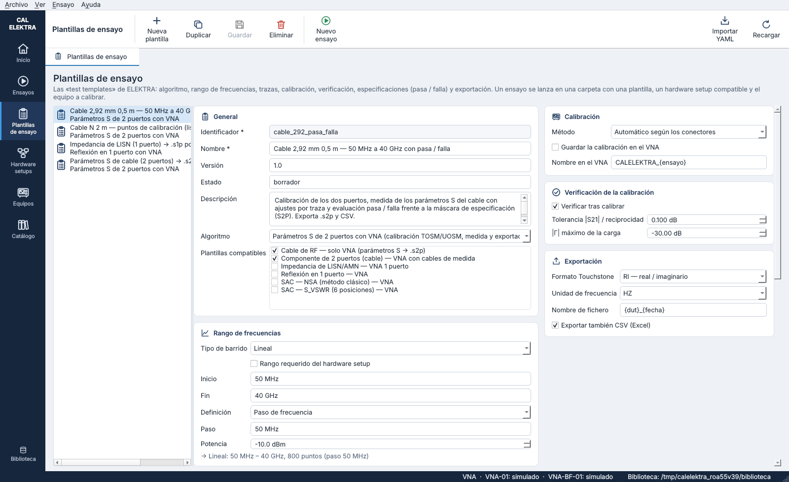 | 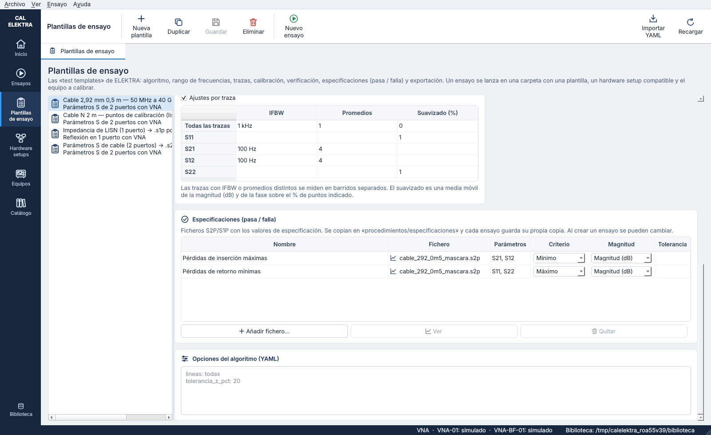 |
| 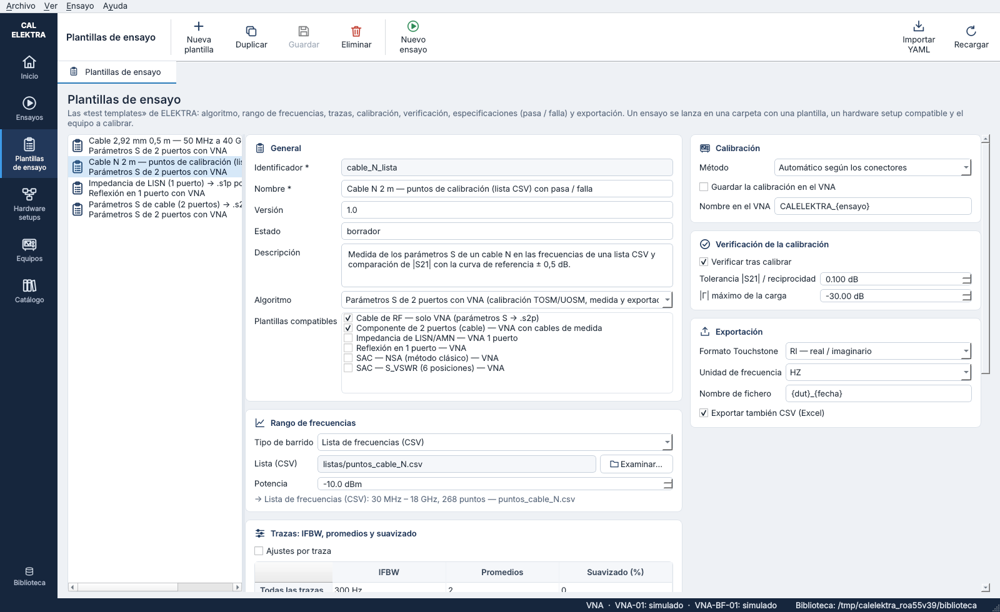 | 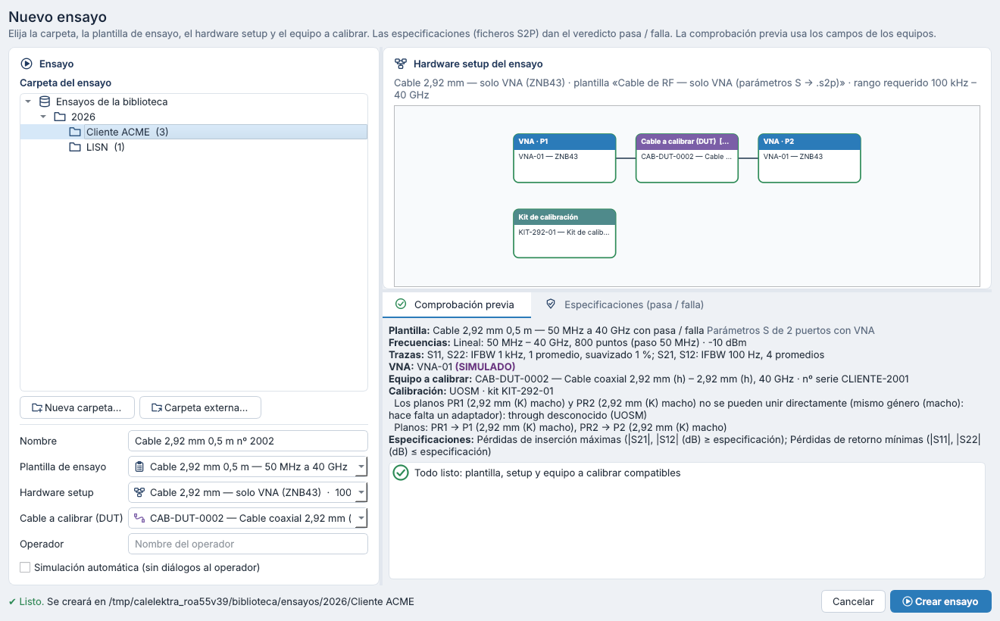 |
| 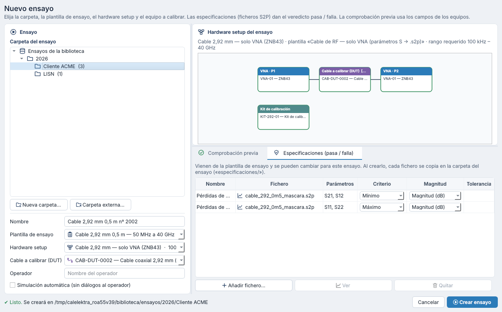 | 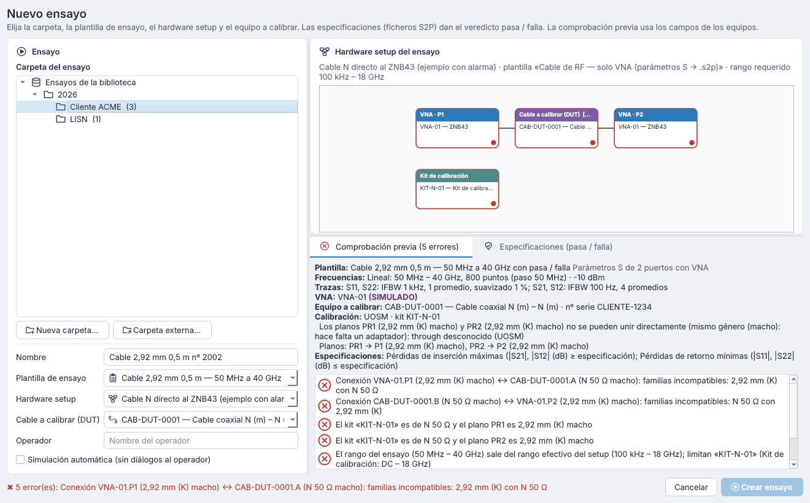 |
| 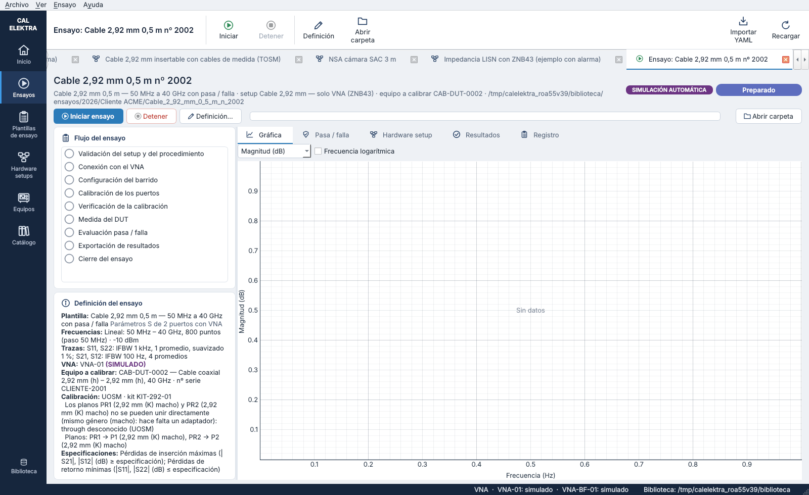 | 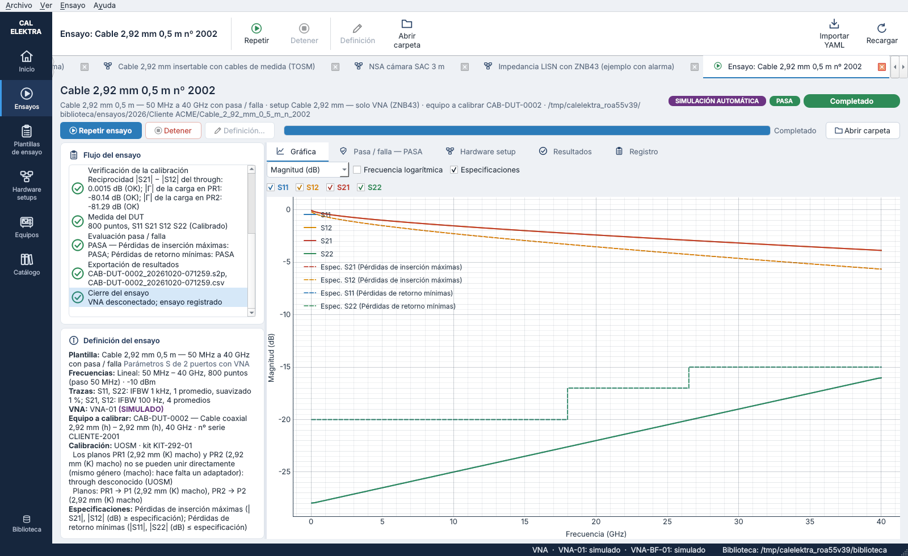 |
| 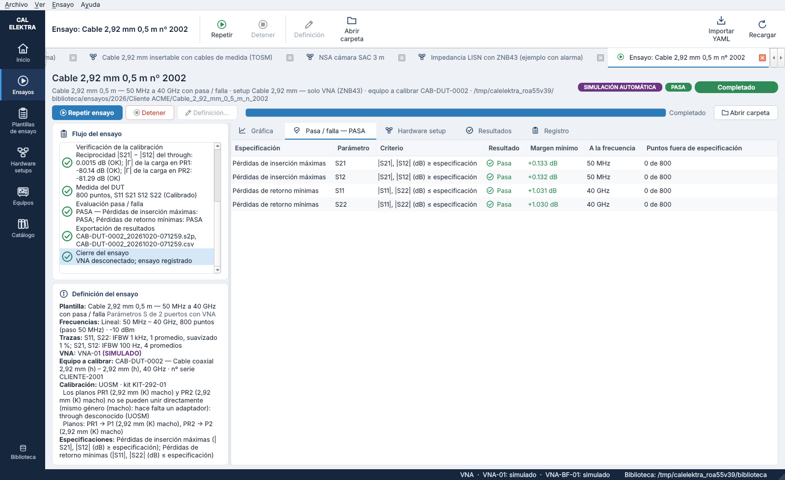 | 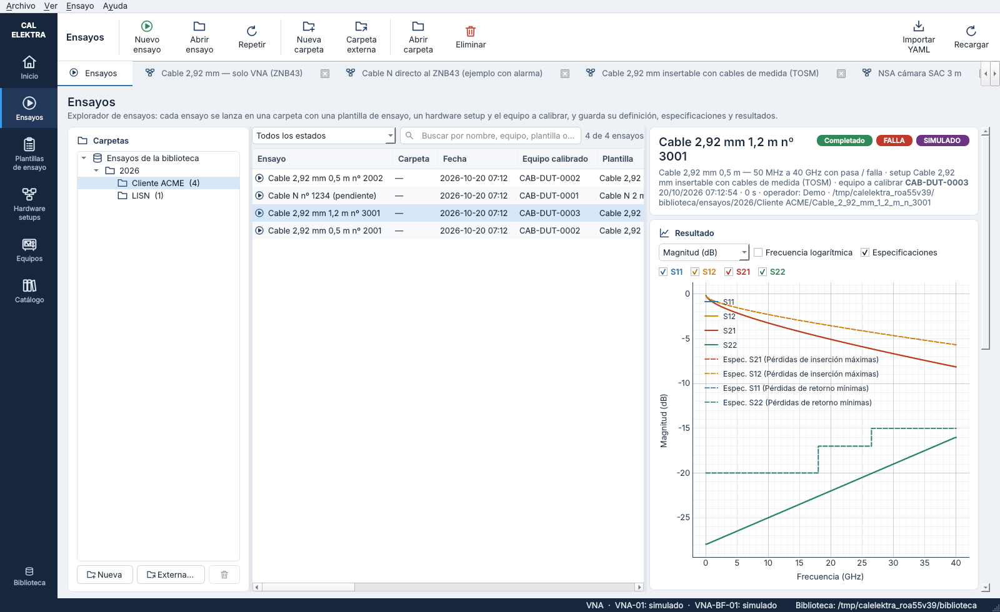 |
