# 5. Hardware setups, plantillas de ensayo y ensayos (versión 0.5)

Este paso fija la estructura del caso del **cable de RF con VNA**, que sirve para integrar la arquitectura antes de extenderla al resto de equipos:

| Pieza | Qué define | Dónde se guarda |
|---|---|---|
| **Hardware setup** (configurado) | El banco de un **grupo de cables**: VNA, kit, cables de medida… y las **frecuencias** de medida: lineal (nº de puntos o paso), logarítmico (nº de puntos) o lista CSV, dentro de su rango requerido | `hardware_setups/configurados/*.yaml` (listas en `hardware_setups/listas/`) |
| **Modelo del EUT** (catálogo) | Las **especificaciones S** (ficheros S2P/S1P) que dan el **pasa / falla** de cada unidad del modelo | `catalogo/modelos/*.yaml` (`especificaciones_s`; ficheros en `catalogo/especificaciones/`) |
| **Plantilla de ensayo** (*test template*) | **Llama a un hardware setup** y define el **EUT**; además potencia, **IFBW y promedios** (de todas las trazas), **suavizado de la visualización** (de todas las trazas o por traza), calibración, verificación y exportación | `procedimientos/*.yaml` |
| **Ensayo** | El **registro** de una medida lanzada a partir de una plantilla en una **carpeta** elegida por el usuario | `<carpeta>/<ensayo>/ensayo.yaml` y sus ficheros |

## 5.1 Qué cambia respecto a la versión 0.4

| Versión 0.4 | Versión 0.5 |
|---|---|
| Las frecuencias se definían en la plantilla de ensayo | Las da el **hardware setup** |
| Las especificaciones S2P estaban en la plantilla y se podían cambiar en cada ensayo | Están en el **modelo del EUT** (catálogo) |
| La plantilla solo indicaba plantillas de setup compatibles; el setup y el cable se elegían al crear el ensayo | La plantilla **llama a un hardware setup** concreto y **define el EUT** |
| Un ensayo se «preparaba» con su propia definición y luego se ejecutaba | Un ensayo es el **registro de un lanzamiento** de la plantilla; repetir es lanzarla otra vez |
| El suavizado se aplicaba a los datos medidos y exportados | El suavizado **solo afecta a la visualización**; los datos, el pasa / falla y los ficheros exportados son los medidos |

## 5.2 Flujo

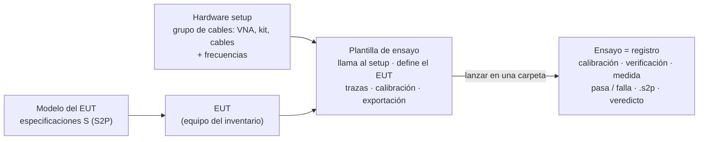

1. **Hardware setup**: se configura el banco de un grupo de cables (p. ej. «Cables 2,92 mm — solo VNA») y sus frecuencias. El rol del cable a calibrar queda vacío: lo define cada plantilla de ensayo. Desde el setup se puede crear directamente una plantilla que lo llame (*Nueva plantilla de ensayo*).
2. **Catálogo**: el modelo del EUT lleva sus especificaciones S (editor del modelo, *Especificaciones S (pasa / falla)*).
3. **Plantilla de ensayo**: se elige el hardware setup (solo los que tienen los planos que necesita el algoritmo) y se **ve como diagrama con el EUT colocado**; se elige el EUT (equipos de las categorías del rol DUT del setup) y se ven las especificaciones de su modelo. La **comprobación de la plantilla** está siempre a la vista: conectores, rangos, kit, límites del VNA, ficheros de especificación.
4. **Lanzar ensayo**: en el explorador de ensayos (o desde la plantilla) se elige la **carpeta** y la plantilla; el diálogo muestra el setup, la comprobación previa y el nombre del ensayo. Al lanzarla se crea el ensayo y empieza la medida.
5. **Ensayo**: pasos, peticiones al operador, gráfica con las especificaciones, tabla de pasa / falla por parámetro, setup, resultados y registro. *Repetir* lanza la plantilla otra vez en la misma carpeta (un ensayo nuevo).

## 5.3 Frecuencias del hardware setup

```yaml
# hardware_setups/configurados/cable_vna_292.yaml
id: cable_vna_292
nombre: Cables 2,92 mm — solo VNA (ZNB43)
plantilla: cable_vna
rango_requerido: [50 MHz, 40 GHz]
frecuencias:
  modo: lineal          # lineal | logaritmico | lista
  definicion: paso      # lineal: puntos | paso
  paso: 50 MHz          # → 800 puntos
asignaciones:
  vna: VNA-01
  kit_cal: KIT-292-01
```

| Modo | Se define con | Puntos |
|---|---|---|
| Lineal, por nº de puntos | `puntos` | `linspace(inicio, fin, puntos)` del rango requerido |
| Lineal, por paso | `paso` | `inicio + k·paso` hasta `fin`. Si el rango no es múltiplo del paso, el último punto queda por debajo de `fin` (aviso) |
| Logarítmico | `puntos` | `geomspace(inicio, fin, puntos)`; no puede empezar en DC |
| Lista | `fichero_lista` (relativo al YAML del setup) | Las frecuencias del CSV dentro del rango requerido; las de fuera no se miden (aviso). Al elegir una lista en el editor, el rango requerido pasa a ser el de la lista |

Formato del CSV: primera columna (separador `;` o tabulador), coma o punto decimal, líneas con `#` ignoradas; unidad en cada valor (`1,5 GHz`) o en la cabecera (`Frecuencia (MHz)`); si no aparece, Hz.

El análisis del setup calcula los puntos y los comprueba: definición válida, fichero legible, nº de puntos ≤ campo *Nº máximo de puntos* del VNA. Como antes, el rango requerido debe estar dentro del rango efectivo (intersección de los equipos de medida; el DUT no limita). El editor del setup tiene la pestaña **Frecuencias** con la vista previa de los puntos.

## 5.4 Especificaciones S del modelo del EUT

```yaml
# catalogo/modelos/cable_coaxial_292_hh.yaml
id: cable_coaxial_292_hh
categoria: cable
modelo: Cable coaxial 2,92 mm (h) – 2,92 mm (h), 40 GHz, 0,5 m
especificaciones_s:
  - nombre: Pérdidas de inserción máximas
    fichero: ../especificaciones/cable_292_0m5_mascara.s2p
    parametros: [S21, S12]
    criterio: minimo        # |S| medida ≥ |S| de la máscara
    magnitud: magnitud_db
  - nombre: Pérdidas de retorno mínimas
    fichero: ../especificaciones/cable_292_0m5_mascara.s2p
    parametros: [S11, S22]
    criterio: maximo        # |S| medida ≤ |S| de la máscara
    magnitud: magnitud_db
```

| Criterio | Pasa si | Uso típico |
|---|---|---|
| `minimo` | medida ≥ especificación | \|S21\| frente a las pérdidas de inserción máximas |
| `maximo` | medida ≤ especificación | \|S11\| frente a la máscara de pérdidas de retorno |
| `tolerancia` | \|medida − especificación\| ≤ tolerancia | curva de referencia ± 0,5 dB (o ± grados) |

- Magnitud en dB (`magnitud_db`) o fase en grados (`fase_grados`; la diferencia se reduce a ±180°).
- La especificación se interpola en las frecuencias medidas **dentro de su propio rango**; los puntos fuera de él no se evalúan y se indican. Un escalón de una máscara se escribe con dos frecuencias muy próximas.
- **Margen** = distancia al límite, positivo si el punto pasa. Por especificación y parámetro se guardan el margen mínimo, su frecuencia, los puntos que fallan y los que quedan sin especificación.
- **Veredicto**: **FALLA** si algún parámetro falla; **PASA** si todos pasan; **NO EVALUADO** si alguno no se pudo evaluar; si el modelo no tiene especificaciones, no hay veredicto.
- Se evalúan los **datos medidos, sin suavizar**.

## 5.5 Plantilla de ensayo

```yaml
# procedimientos/cable_CAB-DUT-0002.yaml
id: cable_CAB-DUT-0002
nombre: Calibración cable 2,92 mm CAB-DUT-0002 (CLIENTE-2001)
algoritmo: vna_2_puertos
hardware_setup: cable_vna_292     # banco y frecuencias
eut: CAB-DUT-0002                 # su modelo da las especificaciones
barrido:
  potencia_dbm: -10
  ifbw: 1 kHz                     # IFBW y promedios: los de todas las trazas (un solo barrido)
  promedios: 1
  suavizado_pct: 0                # suavizado de la visualización de todas las trazas…
  por_traza: true                 # …o de cada traza (vacío = el valor de todas)
  trazas:
    S11: { suavizado_pct: 1 }
    S22: { suavizado_pct: 1 }
calibracion: { metodo: automatico }
verificacion: { activa: true, tolerancia_s21_db: 0.1, s11_max_db: -30 }
exportacion: { formato: RI, unidad_frecuencia: HZ, nombre_fichero: "{dut}_{fecha}", csv: true }
```

- **IFBW y promedios** (0.10.3): son los de todas las trazas, así que el DUT se mide en un solo barrido. La calibración y la verificación usan los mismos.
- **Suavizado**: media móvil de la magnitud en dB y de la fase desenrollada sobre el % de puntos indicado, como la apertura de suavizado del ZNB. Solo se aplica al dibujar las trazas (casilla *Suavizado* de la gráfica); los ficheros exportados llevan la medida sin suavizar (lo indica su cabecera). El VSWR y el retardo de grupo se suavizan siempre al 1 % ([`13_certificado_de_cables.md`](13_certificado_de_cables.md)).
- **Editor:** en la tarjeta «Medida: potencia y trazas», la potencia, el IFBW y los promedios; debajo, la tabla del suavizado, con una columna por traza (Todas, S11, S21, S12, S22) y una fila. Con «Suavizado por traza», una celda vacía toma el valor de «Todas».
- **Hardware setup:** un doble clic en el diagrama del setup de la plantilla lo abre en su propia pestaña.
- Las plantillas de versiones anteriores se siguen leyendo: se ignoran las claves de frecuencias, `plantillas_compatibles` y `especificaciones`, y el IFBW y los promedios por traza.

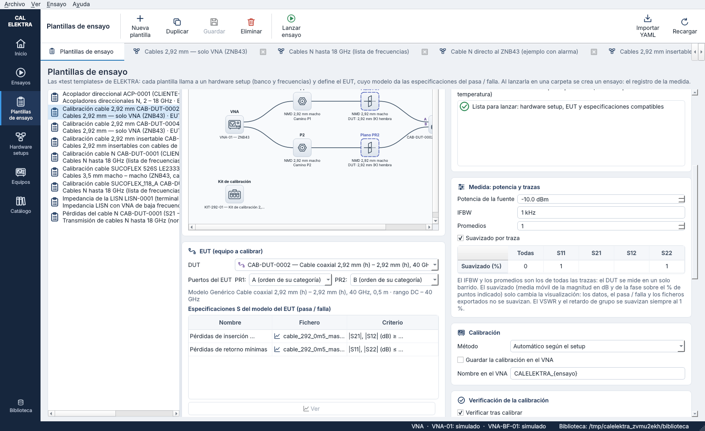

## 5.6 El ensayo: registro de la medida

```
ensayos/2026/Cliente ACME/Cable_2_92_mm_no_2001/
  ensayo.yaml                                   registro (ver abajo)
  especificaciones/cable_292_0m5_mascara.s2p    copia de la especificación usada (con su SHA-256)
  listas/…csv                                   copia de la lista de frecuencias (setups por lista)
  CAB-DUT-0002_20261020-071233.s2p              resultado (Touchstone, sin suavizar)
  CAB-DUT-0002_20261020-071233.csv              resultado (CSV, coma decimal)
  registro.txt                                  operaciones del ensayo y comandos de alto nivel enviados al VNA
```

`ensayo.yaml` (`calelektra/ensayo@0.3`) guarda: `plantilla` (la plantilla tal como se lanzó), `setup` (con su rango requerido y sus frecuencias), `dut` (EUT con modelo, nº de serie y campos), todos los `equipos` con certificado y vencimiento, `barrido` (puntos medidos y ajustes de cada traza), `instrumento`, `calibracion`, `verificacion`, `especificaciones` (las del modelo, apuntando a sus copias), `evaluacion` (resultado por especificación y parámetro), `veredicto`, `resultados`, `ficheros` y `pasos`.

El **explorador de ensayos** muestra `ensayos/` de la biblioteca, sus subcarpetas y las **carpetas externas** (lista en `ensayos/carpetas.yaml`), con el nº de ensayos de cada carpeta; al elegir una carpeta se ven sus ensayos con estado y veredicto, y el detalle con la gráfica, las especificaciones y los ficheros.

## 5.7 Control del R&S ZNB (`instruments/rs_znx.py`)

| Función | Comandos (driver RsZnx 4.25.0) |
|---|---|
| Lineal / logarítmico | `SENS1:SWE:TYPE LIN\|LOG`, `SENS1:FREQ:STAR`, `SENS1:FREQ:STOP`, `SENS1:SWE:POIN` |
| Lista de frecuencias | barrido segmentado: `SENS1:SEGM:DEL:ALL`; un segmento por cada tramo de paso constante: `SENS1:SEGM<n>:INS inicio,fin,puntos,potencia,0,0,ifbw,AUTO,NORM,AUTO,STEP`; `SENS1:SEGM:BWID:CONT OFF`, `SENS1:SEGM:POW:CONT OFF`; `SENS1:SWE:TYPE SEGM` |
| IFBW y promedios | `SENS1:BAND`, `SENS1:AVER:COUN` (los de todas las trazas) |
| Suavizado | en la visualización de CAL-ELEKTRA (no se usa `CALC:SMO` del ZNB, para no alterar los datos) |

La lista del ejemplo (30 MHz – 1 GHz cada 10 MHz y 1,1 – 18 GHz cada 100 MHz) da dos segmentos. **Pendiente de comprobar con el ZNB43**: número máximo de segmentos y orden de los parámetros de `SEGM:INS`.

## 5.8 Ejemplos de la biblioteca

| Plantilla | Hardware setup (frecuencias) | EUT (modelo → especificaciones) | Resultado con el VNA simulado |
|---|---|---|---|
| `cable_CAB-DUT-0002` | `cable_vna_292`: 50 MHz – 40 GHz, paso 50 MHz | CAB-DUT-0002, 2,92 mm h–h 0,5 m → máscara de 0,5 m | UOSM; **PASA** (margen mínimo +0,13 dB en inserción, +1,0 dB en retorno) |
| `cable_CAB-DUT-0003` | `componente_292_tosm`: 50 MHz – 40 GHz, paso 50 MHz | CAB-DUT-0003, 2,92 mm h–m (mide 1,2 m) → máscara de 1 m | TOSM; **FALLA** (pérdidas de inserción, margen −0,59 dB) |
| `cable_CAB-DUT-0001` | `cable_N_18G`: lista CSV de 268 puntos (30 MHz – 18 GHz) | CAB-DUT-0001, N m–m 2 m → referencia ± 0,5 dB | UOSM; **PASA** |
| `lisn_LISN-0001` | `lisn_impedancia_VNA-BF`: logarítmico 9 kHz – 30 MHz, 201 puntos | LISN-0001 → sin especificaciones S (desviación frente a la red nominal) | OSM; completado, sin veredicto |

Las máscaras y la referencia son **sintéticas** (`tools/generar_s2p_sinteticos.py`): no son especificaciones de ningún fabricante.

## 5.9 Limitaciones y pendientes

- **UOSM con listas poco densas**: el through desconocido se resuelve siguiendo su fase entre puntos (como el retardo automático del VNA); con pasos grandes puede fallar. Para UOSM conviene un barrido denso; con listas de pocos puntos, mejor TOSM.
- Especificaciones de fase: se comparan con la fase desenrollada de la especificación; conviene que el S2P de referencia esté bien muestreado.
- Una plantilla define un EUT concreto; para calibrar otra unidad se duplica la plantilla y se cambia el EUT (las especificaciones vienen solas de su modelo).
- La incertidumbre y el informe todavía no están. Validación con el ZNB43 real: barrido segmentado y tiempos de barrido con promedios.

## 5.10 Interfaz

| | |
|---|---|
| 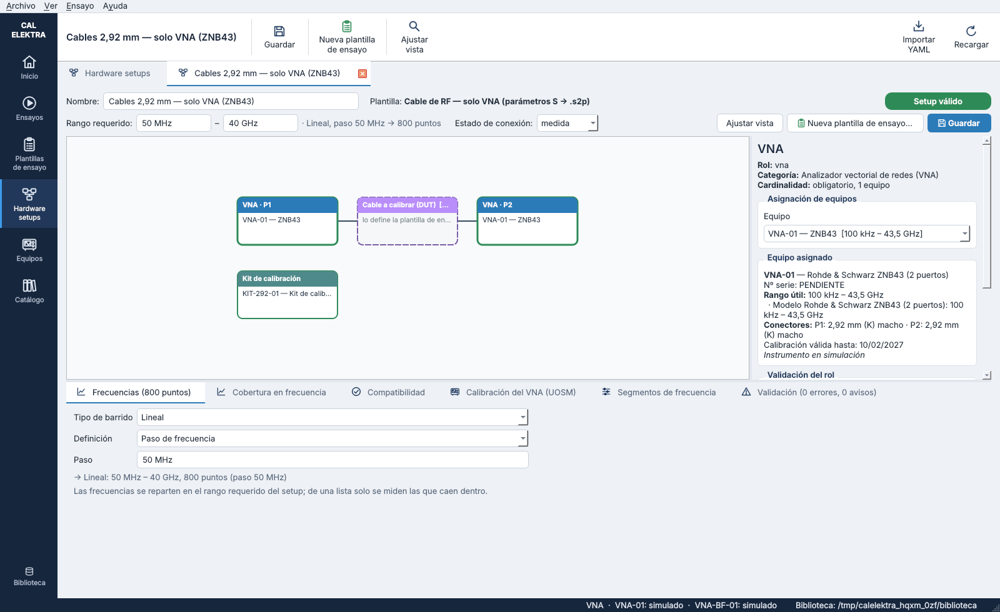 | 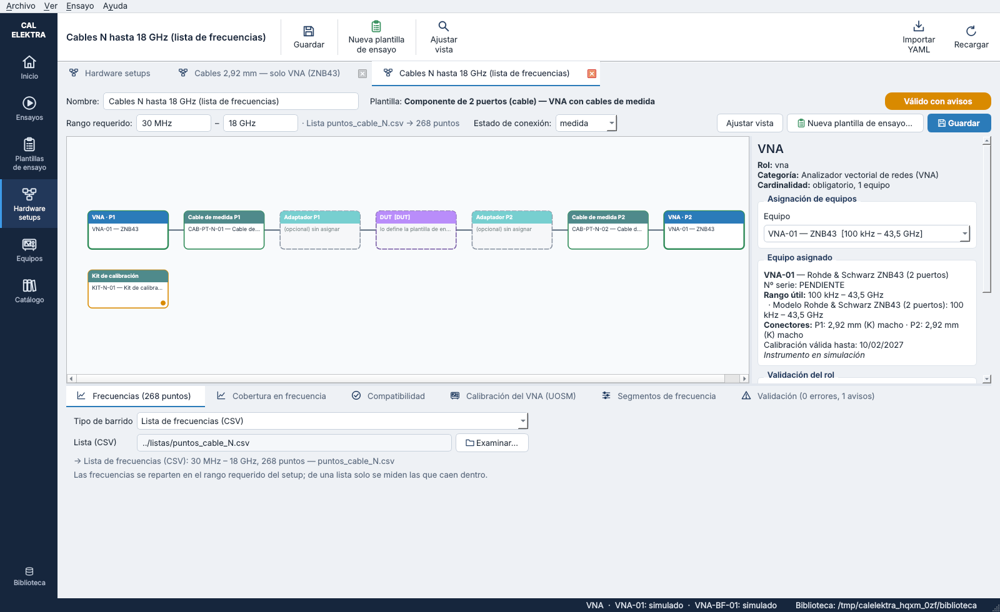 |
| 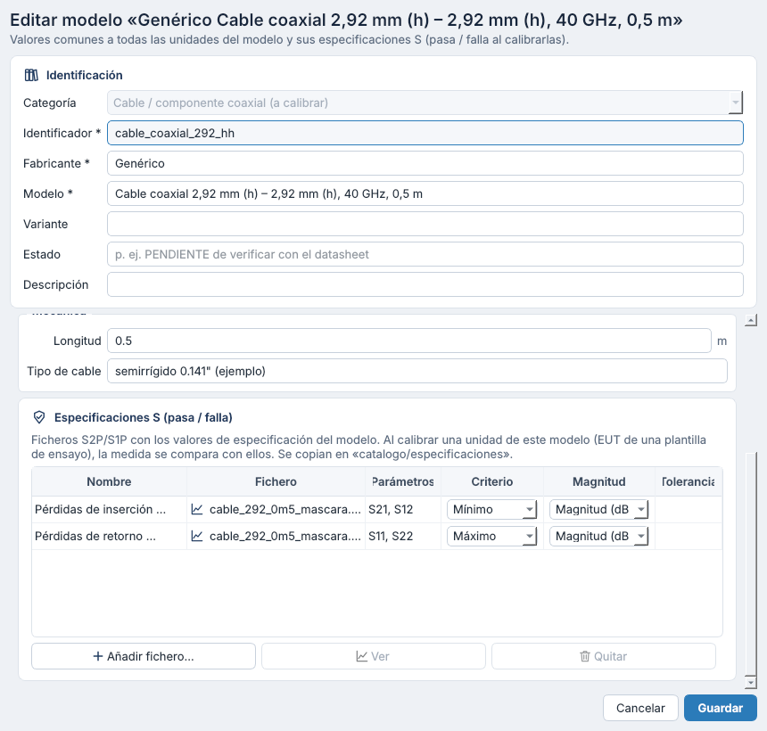 | 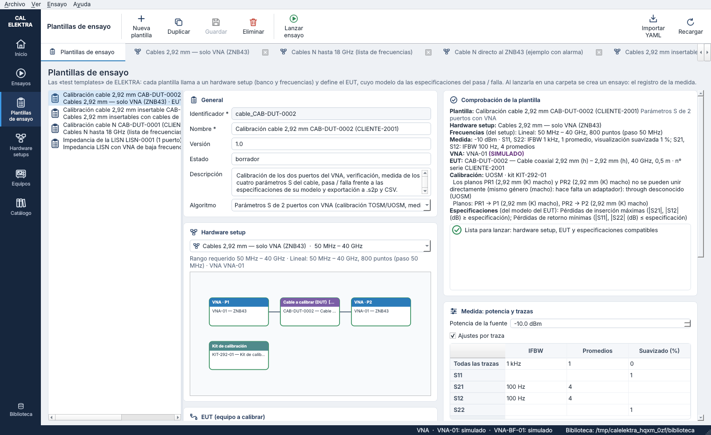 |
| 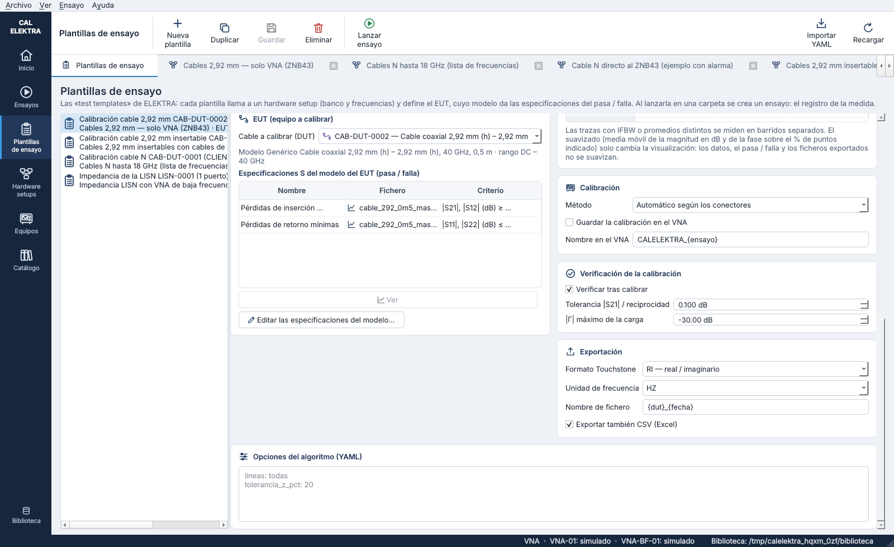 | 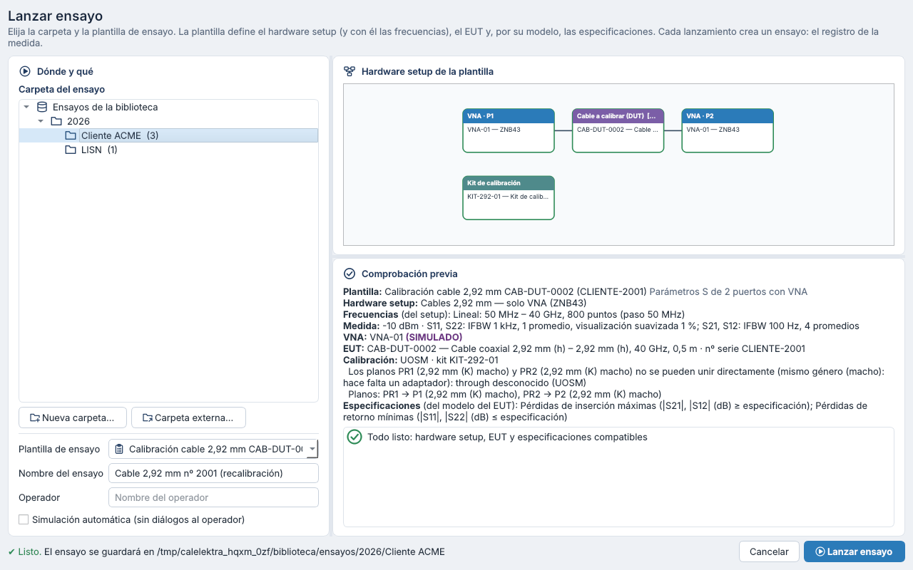 |
| 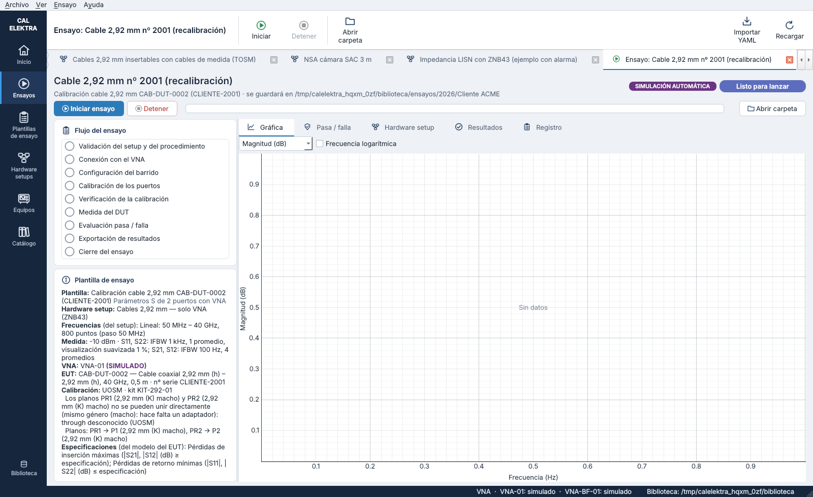 | 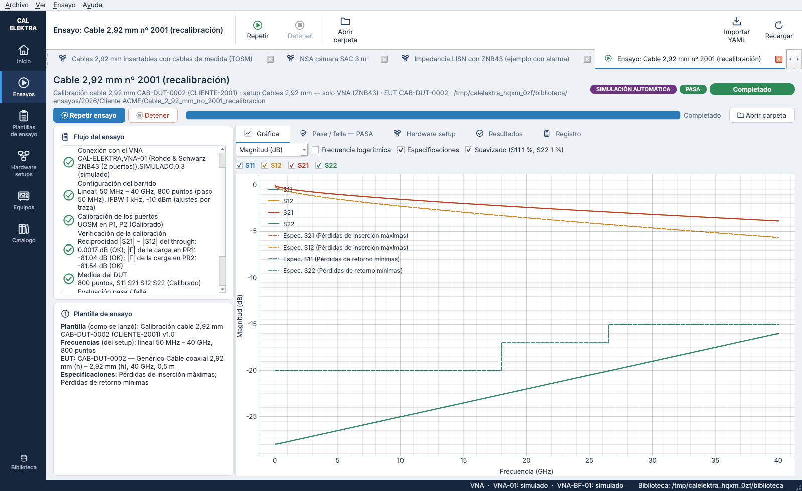 |
| 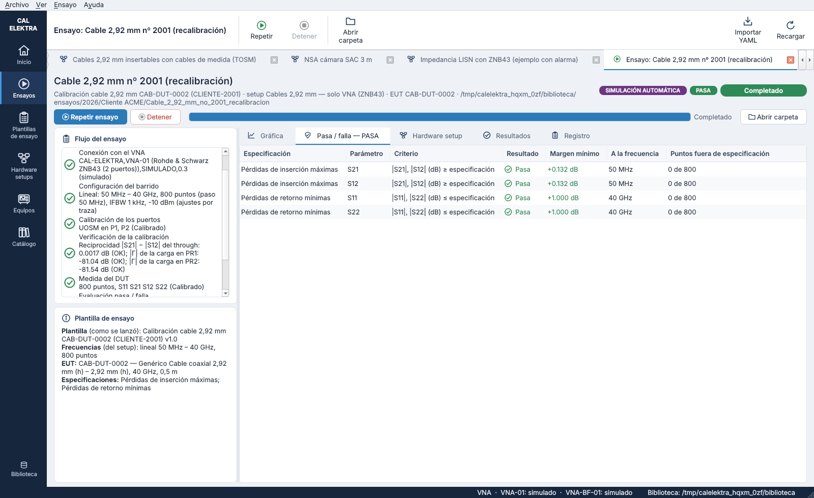 | 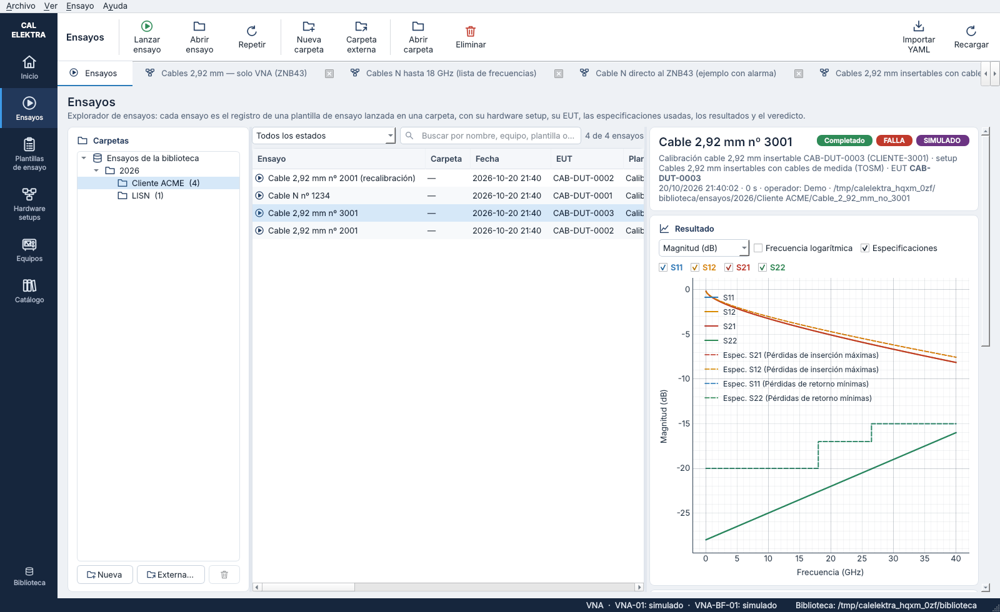 |
