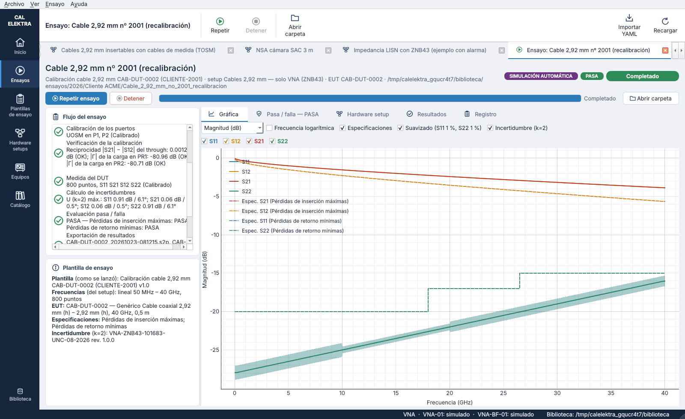
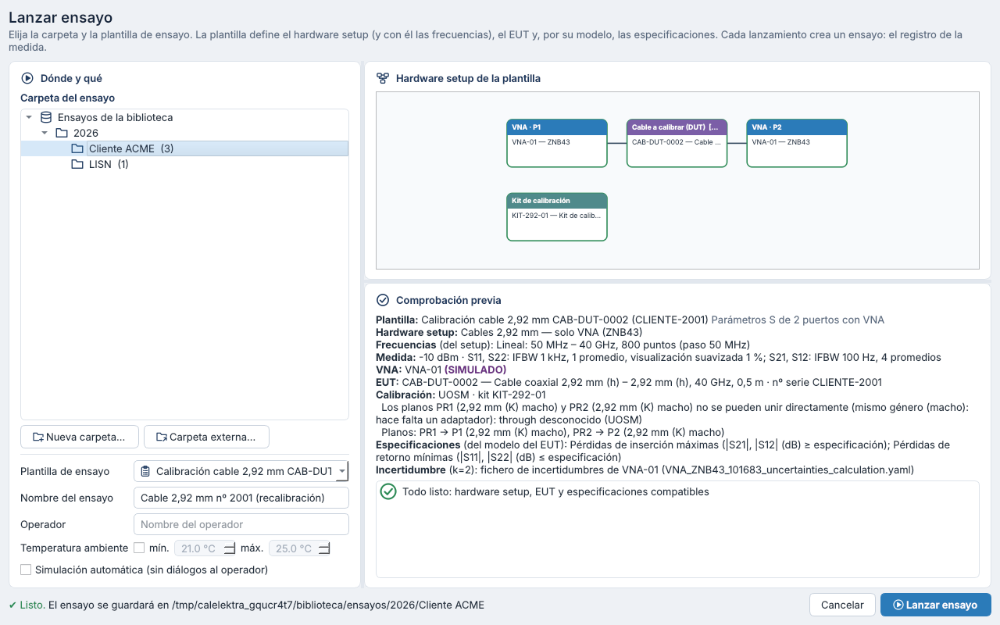
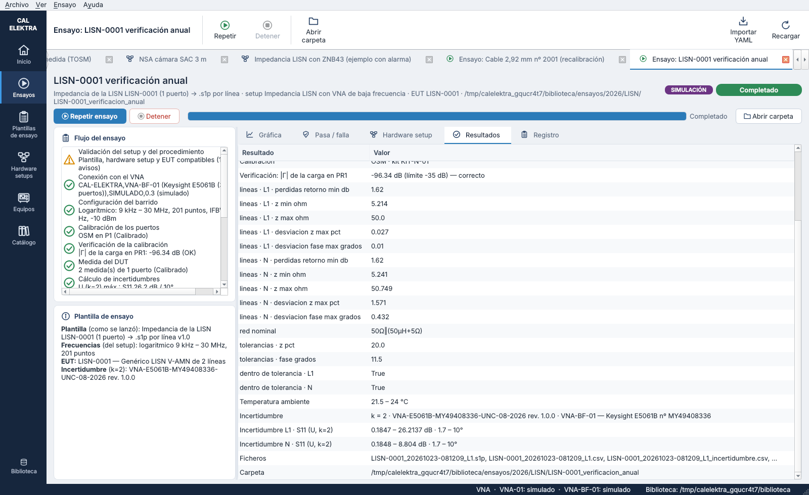
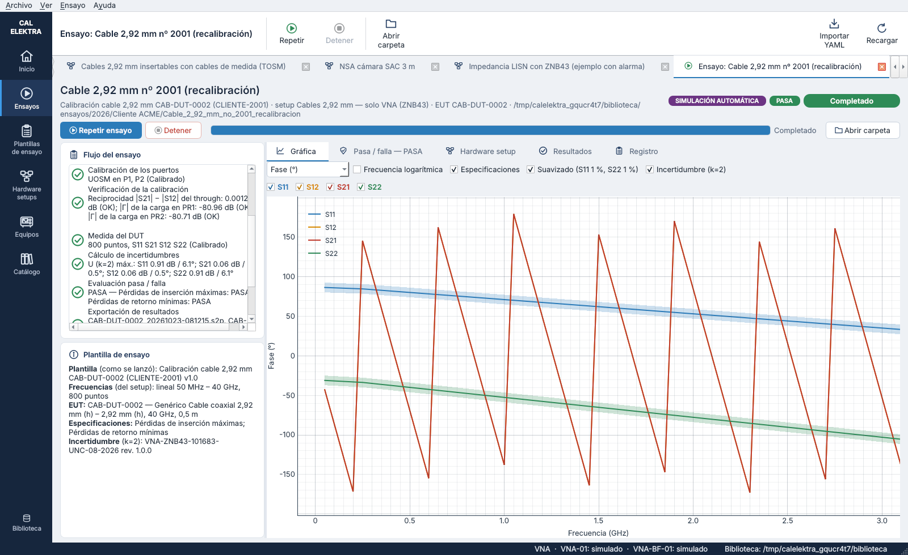
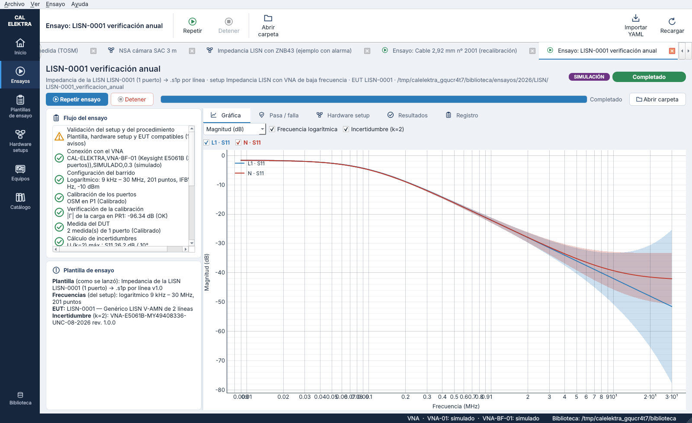
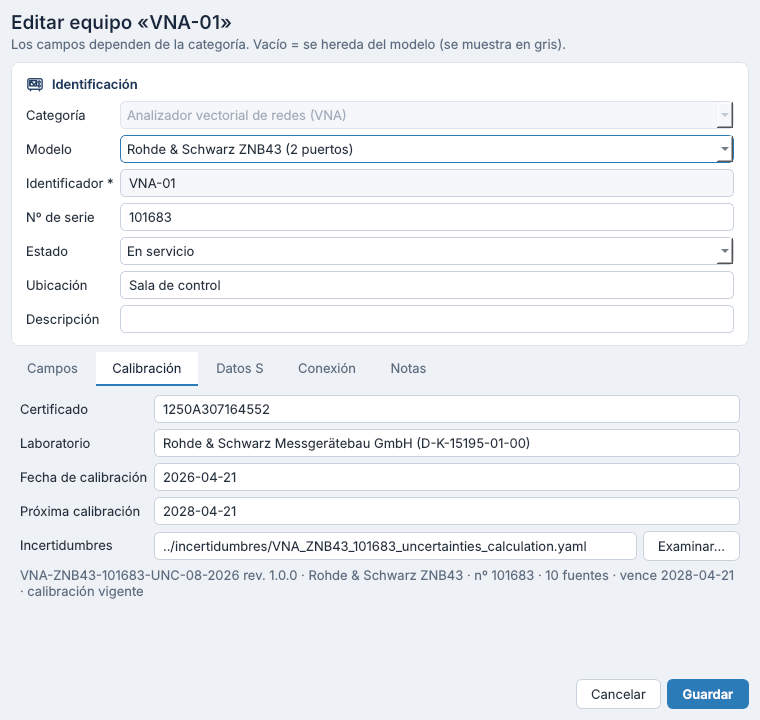
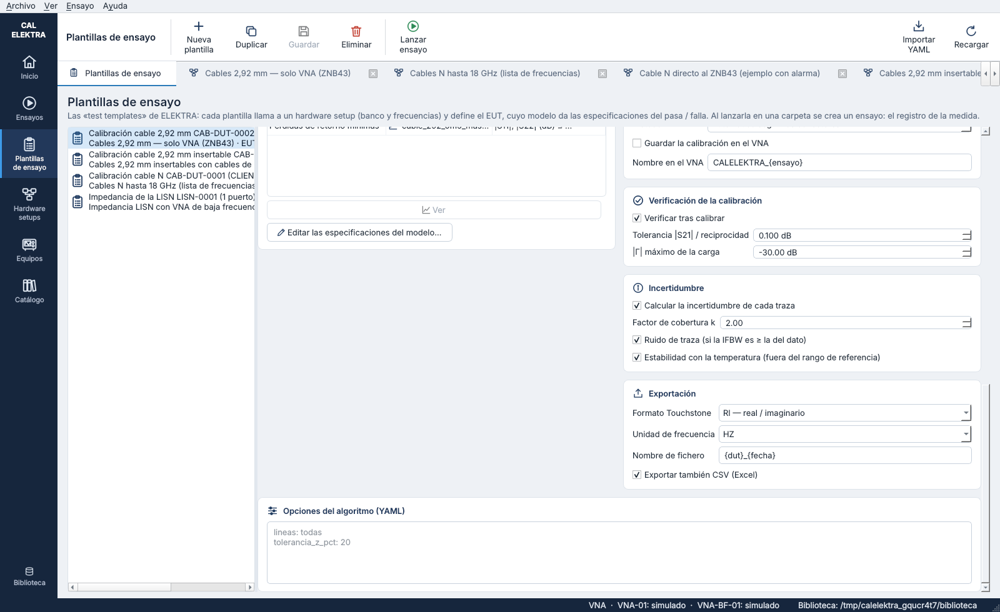

# Paso 7 — Incertidumbre de las medidas con VNA — versión 0.6

Cada traza medida (S11, S21, S12, S22) lleva su **incertidumbre expandida punto a punto**, en magnitud (dB) y en fase (°). Se calcula con el **fichero de incertidumbres de la unidad de VNA** que mide y con el algoritmo de cálculo del laboratorio. Las gráficas la muestran como una **zona sombreada** alrededor de cada traza.

## 1. Ficheros de incertidumbres de los VNA

Los ficheros YAML (`VNA_<modelo>_<nº de serie>_uncertainties_calculation.yaml`) describen **una unidad concreta**: número de serie, certificado de calibración y fecha de vencimiento, condiciones de referencia y la lista `uncertainty_sources`. Esta lista recoge la incertidumbre de transmisión y de reflexión del datasheet por rangos de frecuencia y de nivel, el ruido de traza, la estabilidad con la temperatura y los valores del certificado.

| Equipo | Unidad | Fichero | Calibración |
|---|---|---|---|
| `VNA-01` | R&S ZNB43, nº 101683, 100 kHz – 43,5 GHz, 2,92 mm macho | `catalogo/incertidumbres/VNA_ZNB43_101683_uncertainties_calculation.yaml` | Certificado 1250A307164552, vence el 21/04/2028 |
| `VNA-BF-01` | Keysight E5061B-3L5, nº MY49408336, 5 Hz – 3 GHz, N hembra | `catalogo/incertidumbres/VNA_E5061B_MY49408336_uncertainties_calculation.yaml` | Certificado 5011865A010, **vencido el 30/07/2026** |

- El fichero cuelga del **equipo** del inventario (`incertidumbre: ../incertidumbres/<fichero>.yaml`), no del modelo, porque es de cada unidad. En la ficha del equipo se elige en la pestaña **Calibración** (solo en los VNA). El botón «Examinar…» lo copia a `catalogo/incertidumbres/`.
- Al cargar la biblioteca se comprueba que el fichero exista y se pueda leer, que sea del mismo modelo y que su nº de serie coincida con el del equipo.
- Los ficheros se guardan tal como los genera el laboratorio: claves en inglés y formato propio, sin `formato: calelektra/…`.
- El VNA de baja frecuencia, que figuraba como «modelo pendiente», es la **E5061B**: modelo `keysight_e5061b`. El fichero de especificaciones de ejemplo del ZNB43, que tenía valores ficticios, se ha retirado.

> **La E5061B tiene la calibración vencida** según su certificado (30/07/2026). El inventario lo refleja, así que el setup de la LISN (`lisn_impedancia_VNA-BF`) da un error de calibración caducada y su plantilla no se puede lanzar hasta que se actualicen el certificado del equipo y su fichero de incertidumbres. Los tests y las capturas lanzan esa plantilla con fecha 15/07/2026.

## 2. Algoritmo

`src/calelektra/uncertainty/engine.py` es el script del laboratorio `DEF_vna_uncertainty_s_parameters_calculation.py` adaptado al software, con el mismo algoritmo:

1. Se toman las fuentes de `uncertainty_sources` con `include_in_total` que aplican al parámetro (`applicable_to`).
2. Cada fuente se busca en su rango de frecuencia y, si tiene `level_ranges`, en el rango del nivel medido, en dB o lineal según los límites que use el fichero. **No se extrapola**: un valor fuera de los rangos da NaN.
3. Se pasa a incertidumbre típica: las expandidas como U/k, las RMS tal cual y los coeficientes de temperatura como coeficiente × ΔT / √3. ΔT es lo que la temperatura del ensayo sale del rango de referencia del fichero (18 – 28 °C). Si hace falta, se convierte entre dB y lineal.
4. Las fuentes se combinan por RSS y el resultado se expande con k (2 por defecto).
5. Una fuente con condición de IFBW (`conditions.if_bandwidth_hz`) solo se aplica si la IFBW del ensayo es igual o mayor. Así, el ruido de traza del ZNB43 (dato a 10 kHz) no se suma con IFBW de 1 kHz.

Cambios respecto al script original:

- mensajes en español;
- la fecha de la comprobación de calibración se puede indicar;
- el motor se puede construir con datos ya cargados;
- la línea de comandos es la misma: `python -m calelektra.uncertainty --yaml … --equipment ZNB43 --parameter S21 --frequency-hz 1e9 --value -0.5 --unit dB --if-bandwidth-hz 1000`.

Se ha comprobado que el resultado coincide **exactamente** con el del script original en 122 400 combinaciones de VNA, parámetro, frecuencia, nivel, IFBW, temperaturas y unidad de salida, incluidos los 60 852 casos que dan NaN. Los tests guardan una muestra de esos valores como referencia (`tests/test_uncertainty.py`).

Las trazas completas se calculan como en `processing.py` del laboratorio (`uncertainty/traces.py`):

- **Magnitud.** El valor en dB es el medido y también el nivel que elige los rangos. El resultado es U en dB.
- **Fase.** El valor es la fase en grados y el nivel es la magnitud en dB. El resultado es U en grados.

Si un punto se queda sin incertidumbre, se guarda el primer motivo de cada traza, por ejemplo «S21 a 2 GHz: nivel 0,02 dB fuera de los rangos; el fichero cubre de −60 a 0 dB».

## 3. En los ensayos

- **Plantilla de ensayo.** Nueva tarjeta «Incertidumbre» con: calcular sí o no, factor de cobertura k, ruido de traza y estabilidad con la temperatura (`incertidumbre:` en el YAML).
- **Lanzamiento.** *(Sustituido en la versión 0.7: la temperatura sale de la sonda TPH y la incertidumbre queda pendiente hasta cargarla; ver [`08_condiciones_ambientales_y_paquete.md`](08_condiciones_ambientales_y_paquete.md).)* Se podía anotar la **temperatura ambiente** mínima y máxima. Queda en el registro (`condiciones`) y, si sale de 18 – 28 °C, añade la estabilidad con la temperatura. La comprobación previa avisa si el VNA no tiene fichero de incertidumbres o si las frecuencias salen del rango del fichero.

- **Paso nuevo «Cálculo de incertidumbres»**, después de la medida. Usa la IFBW de cada traza (los ajustes por traza de la plantilla) y avisa de los puntos sin incertidumbre y de la calibración vencida del VNA según su fichero.
- **Registro del ensayo** (`incertidumbre` en `ensayo.yaml`): copia del fichero usado (`incertidumbres/`), documento y revisión, VNA y nº de serie, k, temperaturas y, por medida y traza, la IFBW, U mínima y máxima en dB y en grados, los puntos sin incertidumbre y su motivo.
- **Ficheros**:
  - `<resultado>_incertidumbre.csv` con U (k) de cada punto y traza;
  - columnas `U Sij (dB, k=2)` y `U Sij (°, k=2)` en el CSV de resultados;
  - una línea en los comentarios del Touchstone que remite al CSV. El Touchstone no tiene sitio para la incertidumbre.

## 4. Gráficas

En las gráficas de la ventana del ensayo y del explorador de ensayos, cada traza lleva una **zona sombreada de su color** entre valor − U y valor + U, en magnitud (dB) y en fase (°). La casilla «Incertidumbre (k=2)» la oculta o la muestra.

- La zona se corta donde un punto no tiene incertidumbre y en los saltos de ±180° de la fase.
- Si la plantilla suaviza la visualización, la zona se dibuja alrededor de la traza suavizada.
- En la vista de impedancia |Z| no hay zona: falta la propagación a Z (`calc_Z_from_S` de `math_utils`), que no está entre los ficheros recibidos. **Decisión (0.7):** de momento no se implementa; solo parámetros S.

| | |
|---|---|
|  |  |
|  |  |

## 5. Observaciones sobre los ficheros

| Observación | Efecto |
|---|---|
| La tabla de transmisión del ZNB43 llega hasta 0 dB (`level_max_db: 0`) | Un cable muy corto o un through que, por ruido, mida S21 por encima de 0 dB (p. ej. +0,003 dB) se queda sin incertidumbre en ese punto. El algoritmo no extrapola. **Decisión (0.7):** el algoritmo no cambia; el laboratorio ampliará el YAML de incertidumbres del VNA |
| Reflexión de la E5061B dada en lineal (`magnitude_linear`) | Al pasarla a dB crece mucho cuando |Γ| es pequeño. A −50 dB, 0,008 lineal son unos 26 dB (k = 2). Es lo esperado: en esa zona la magnitud en dB no está determinada |
| Ruido de traza con condición de IFBW | Con IFBW menor que la del dato (10 kHz en el ZNB43, 3 kHz en la E5061B) no se suma, porque el ruido es menor |
| Calibración vencida de la E5061B | El motor avisa y el ensayo la registra. El setup de la LISN no se puede usar hasta actualizar el certificado |

## 6. Ficheros del código

| Fichero | Contenido |
|---|---|
| `uncertainty/engine.py` | Motor del laboratorio adaptado (`UncertaintyEngine.calculate`) |
| `uncertainty/traces.py` | Incertidumbre de trazas completas (`trace_uncertainty`, `dataset_uncertainty`) |
| `uncertainty/__main__.py` | Línea de comandos |
| `catalog/library.py` | `uncertainty_engine(equipo)`, comprobaciones del fichero, copia a `catalogo/incertidumbres/` |
| `procedures/engine.py` | Paso «Cálculo de incertidumbres», CSV y registro |
| `gui/plots.py` | Zona sombreada (`set_uncertainty`) |
| `tests/test_uncertainty.py` | Mismos resultados que el script original, trazas, biblioteca, ensayos, gráficas y línea de comandos |
