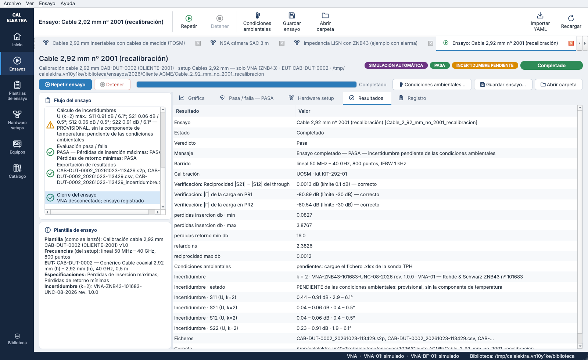
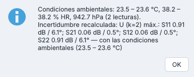
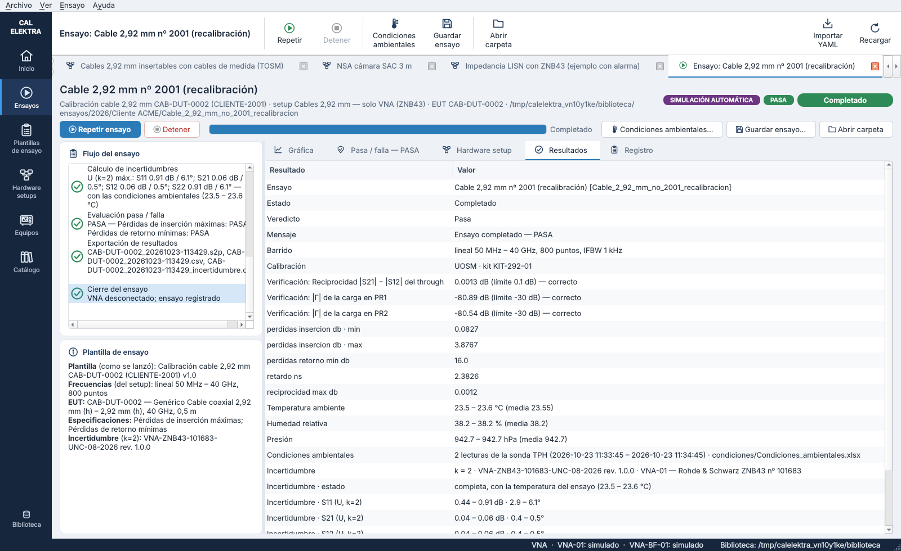
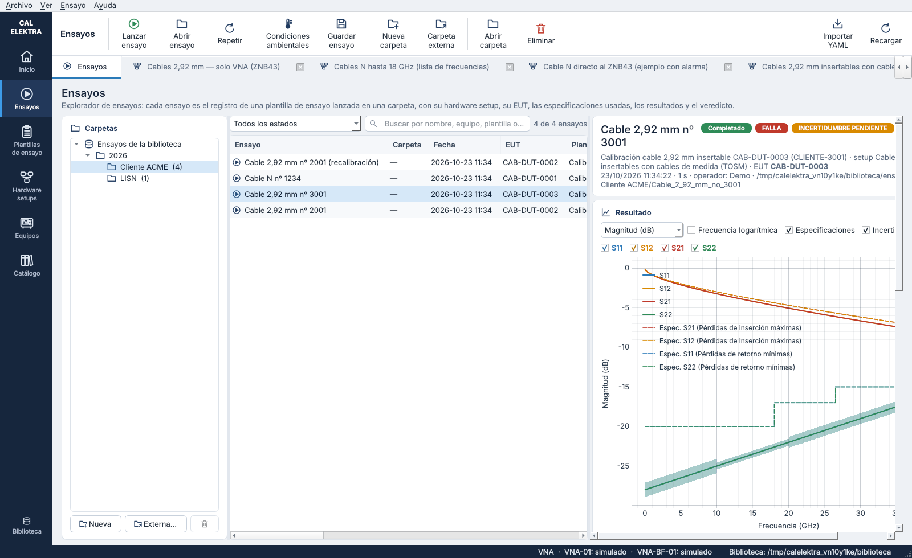
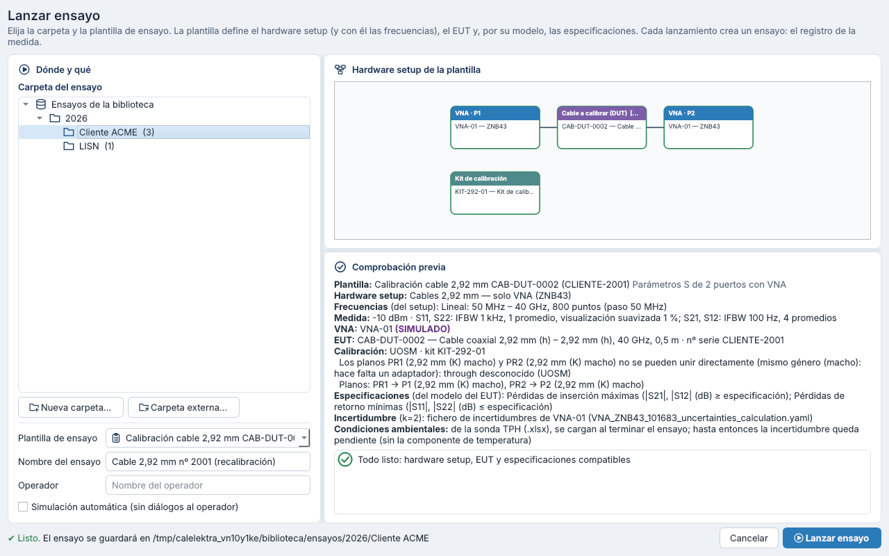

# Paso 8 — Condiciones ambientales de la sonda TPH y paquete del ensayo — versión 0.7

Las condiciones ambientales de un ensayo (temperatura, humedad y presión) salen de la **sonda TPH** del laboratorio. La sonda vuelca sus lecturas en una base de datos SQL y la consulta se exporta a un **.xlsx**. El operador ya no escribe la temperatura al lanzar el ensayo:

1. al terminar el ensayo, la incertidumbre se calcula **sin la componente de temperatura** y queda **pendiente**;
2. cuando se carga el .xlsx de la sonda, se calcula otra vez con la temperatura del ensayo y pasa a **completa**.

Al terminar, toda la información del ensayo se puede guardar en un **.zip**.



## 1. Fichero de la sonda TPH

El .xlsx exportado tiene esta estructura:

| Hoja | Contenido |
|---|---|
| `CABECERA` | `CONSULTA` (nombre de la consulta) y `SQL CODE` |
| `DATOS` | Una fila por lectura con las columnas `DATE`, `T`, `TUNIT`, `P`, `PUNIT`, `H`, `HUNIT` (en el ejemplo, una lectura por minuto en °C, Pa y %) |

Cómo lo lee el programa (`procedures/ambient.py`, `read_tph_workbook`):

- Busca la cabecera en las primeras filas de cada hoja y usa la primera hoja que tenga fecha y temperatura. También acepta los nombres `FECHA`, `TEMPERATURA`, `PRESION`, `HUMEDAD`…
- Las fechas pueden ser celdas de fecha de Excel o texto (`23/10/2026 10:00:45`, `2026-10-23 10:00:45`…). Los números pueden llevar coma decimal.
- Convierte unidades: temperatura en C, K o F a °C; presión en Pa, hPa, mbar, kPa o bar a hPa.
- Las filas sin fecha o sin temperatura se saltan.

**Lecturas de un ensayo.** Se toman las lecturas entre el inicio y el fin del ensayo, más la última lectura anterior o igual al inicio y la primera posterior o igual al fin. Así, un ensayo más corto que el intervalo entre lecturas queda cubierto por las dos que lo rodean. Esas dos lecturas deben estar a **15 minutos como mucho** del inicio y del fin; si no, el fichero «no cubre el ensayo» y no se cambia nada.

En el registro (`condiciones` en `ensayo.yaml`):

```yaml
condiciones:
  estado: cargadas            # «pendiente» hasta que se carga el fichero
  intervalo_ensayo: ['2026-10-23 11:32:51', '2026-10-23 11:33:52']
  lecturas: 3
  lecturas_desde: '2026-10-23 11:32:45'
  lecturas_hasta: '2026-10-23 11:34:45'
  temperatura_c: {min: 23.5, max: 23.6, media: 23.57}
  humedad_pct: {min: 38.1, max: 38.2, media: 38.2}
  presion_hpa: {min: 942.7, max: 942.7, media: 942.7}
  consulta: 'VIRTUAL LAB: Datos sonda TPH'
  fichero: condiciones/Condiciones_ambientales.xlsx   # copia guardada con el ensayo
```

El .xlsx se copia a la carpeta `condiciones/` del ensayo. El original no se ha subido al repositorio porque contiene la consulta SQL interna del laboratorio. Los tests y las capturas usan ficheros sintéticos con la misma estructura (`write_tph_workbook`).

## 2. Incertidumbre pendiente

| Momento | Estado (`incertidumbre.estado`) | Cálculo |
|---|---|---|
| Final del ensayo | `pendiente` | Algoritmo del laboratorio sin temperaturas: las fuentes de estabilidad con la temperatura dan 0. El resto del cálculo es idéntico |
| Condiciones cargadas | `completa` | El mismo algoritmo con la temperatura mínima y máxima de las lecturas del ensayo. Si salen de 18 – 28 °C (rango de referencia del fichero del VNA), se suma la estabilidad con la temperatura (coeficiente × ΔT / √3) |

- Si la temperatura del ensayo queda dentro del rango de referencia, la incertidumbre no cambia; solo pasa de «pendiente» a «completa». Un test comprueba que el CSV de incertidumbre queda idéntico byte a byte.
- Si la plantilla desactiva la estabilidad con la temperatura, la incertidumbre es completa desde el principio; las condiciones se pueden cargar igualmente para el registro.
- El recálculo usa lo que se guardó con el ensayo: la copia del fichero de incertidumbres del VNA (`incertidumbres/`), las trazas del Touchstone sin suavizar, la plantilla tal como se lanzó (IFBW de cada traza, k, opciones) y el mismo día de comprobación de la calibración (`dia_comprobacion`). Reescribe `<resultado>_incertidumbre.csv`, las columnas U del CSV de resultados, la sección `incertidumbre` y el paso «Cálculo de incertidumbres» del registro.
- Mientras está pendiente:
  - el paso queda en **aviso** («PROVISIONAL, sin la componente de temperatura»);
  - el mensaje del ensayo lo indica;
  - la ventana del ensayo y el explorador muestran el distintivo **INCERTIDUMBRE PENDIENTE**;
  - la columna «Estado» del explorador añade «incertidumbre pendiente».

Los ensayos sin incertidumbre muestran **CONDICIONES PENDIENTES** hasta que se cargan.

**Transmisión del ZNB43.** El algoritmo no cambia: la tabla del fichero de incertidumbres llega hasta 0 dB y los puntos con S21 por encima de 0 dB siguen sin incertidumbre. Cuando se amplíe el YAML del VNA, el cálculo lo usará sin tocar el código.

**Impedancia |Z|.** Desde 0.8.4 su incertidumbre se calcula a partir de la de S11 y se recalcula con ella al cargar las condiciones ([`10_algoritmos_de_incertidumbre.md`](10_algoritmos_de_incertidumbre.md)).

## 3. En la interfaz

- **Lanzar ensayo.** Desaparece la temperatura manual. La comprobación previa indica que las condiciones se cargan al terminar.
- **Ventana del ensayo.** Botones y acciones de la cinta:
  - «Condiciones ambientales…» elige el .xlsx, lo carga, recalcula la incertidumbre y vuelve a dibujar las bandas;
  - «Guardar ensayo…» crea el paquete .zip.

  Los dos se activan cuando el ensayo ha terminado.
- **Explorador de ensayos.** Las mismas dos acciones para el ensayo seleccionado. Si ese ensayo está abierto en una pestaña, la pestaña se actualiza.
- **Resultados.** Filas «Temperatura ambiente», «Humedad relativa», «Presión», «Condiciones ambientales» (lecturas y fichero) e «Incertidumbre · estado».
- **Plantilla de ensayo.** La casilla «Estabilidad con la temperatura» explica que la temperatura sale de la sonda TPH.

| | |
|---|---|
|  |  |
|  |  |

## 4. Paquete del ensayo (.zip)

«Guardar ensayo…» (`procedures/package.py`, `save_test_package`) guarda la carpeta completa del ensayo dentro de una carpeta con el nombre del ensayo:

| Fichero | Contenido |
|---|---|
| `resumen_ensayo.txt` | Resumen legible: plantilla, hardware setup y equipos con sus certificados, frecuencias, EUT, **horas de inicio y fin** y duración, condiciones ambientales, estado de la incertidumbre y U por traza, veredicto y lista de ficheros |
| `ensayo.yaml` | El registro completo |
| `hardware_setup.yaml` | El hardware setup tal como se lanzó: setup con el EUT del ensayo, su plantilla de setup y los equipos (`calelektra/hardware_setup_ensayo@0.3`) |
| `plantilla_ensayo.yaml` | La plantilla de ensayo tal como se lanzó |
| `<EUT>_<fecha>.s2p` / `.s1p` | **Las medidas sin suavizado.** El suavizado de la plantilla solo afecta a la visualización |
| `<EUT>_<fecha>.csv`, `…_incertidumbre.csv` | Resultados con U (k) y la incertidumbre de cada punto |
| `condiciones/…xlsx` | Copia del fichero de la sonda |
| `incertidumbres/…yaml`, `especificaciones/…`, `registro.txt` | Fichero de incertidumbres del VNA usado, especificaciones del modelo del EUT y registro de operaciones |

- `hardware_setup.yaml` y `plantilla_ensayo.yaml` se escriben en la carpeta del ensayo durante la validación.
- A los ensayos anteriores a la 0.7, que no los tienen, el paquete se los añade a partir del registro.
- Si las condiciones o la incertidumbre siguen pendientes, el paquete se guarda igual. El resumen lo dice («PENDIENTES») y el programa avisa.

Extracto del resumen:

```
Inicio: 2026-10-23 11:34:52
Fin: 2026-10-23 11:34:53

Condiciones ambientales
  Temperatura: 23.4 – 23.4 °C (media 23.4)
  Humedad: 37 – 37.2 % HR (media 37.1)
  Presión: 942.6 – 942.6 hPa (media 942.6)
  2 lecturas de la sonda TPH (2026-10-23 11:34:52 – 2026-10-23 11:35:52), fichero condiciones/Condiciones_ambientales.xlsx

Incertidumbre
  Estado: completa
  k = 2 · VNA-ZNB43-101683-UNC-08-2026 rev. 1.0.0 · VNA-01 — Rohde & Schwarz ZNB43 nº 101683
  DUT S21: U 0.04 – 0.06 dB, 0.4 – 0.5°
```

## 5. Ficheros del código

| Fichero | Contenido |
|---|---|
| `procedures/ambient.py` | Lectura del .xlsx de la sonda (`read_tph_workbook`), lecturas que cubren un ensayo y sección `condiciones`; `write_tph_workbook` para ficheros sintéticos |
| `procedures/record_uncertainty.py` | Cálculo de la incertidumbre de un ensayo (`compute_uncertainty`), estado pendiente / completa, recálculo (`recalculate_uncertainty`) y carga de condiciones (`load_ambient_conditions`) |
| `procedures/results.py` | CSV de resultados y de incertidumbre (los usan el motor y el recálculo) |
| `procedures/package.py` | Paquete .zip y `resumen_ensayo.txt` |
| `procedures/engine.py` | Copias `hardware_setup.yaml` y `plantilla_ensayo.yaml`; paso de incertidumbre provisional |
| `gui/test_common.py` | Filas de condiciones, distintivo de pendiente, diálogos de carga y de guardado |
| `tests/test_conditions.py` | Lector, cobertura del ensayo, pendiente → completa (valores idénticos dentro del rango; ΔT fuera de él contrastado con el motor), LISN con la E5061B y paquete |

Dependencia nueva: `openpyxl` para leer los .xlsx.
