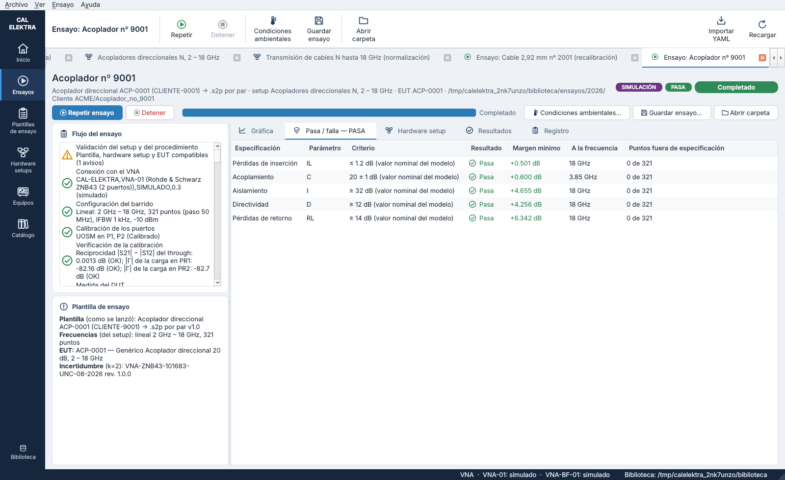
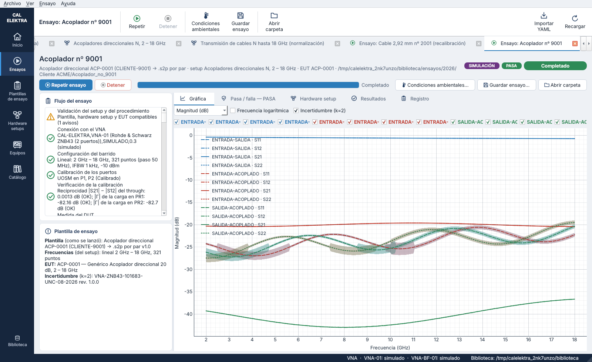
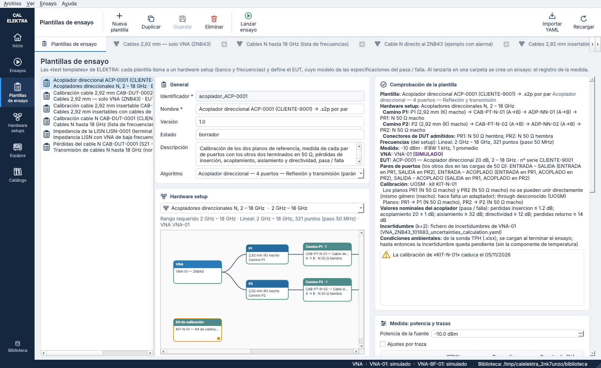
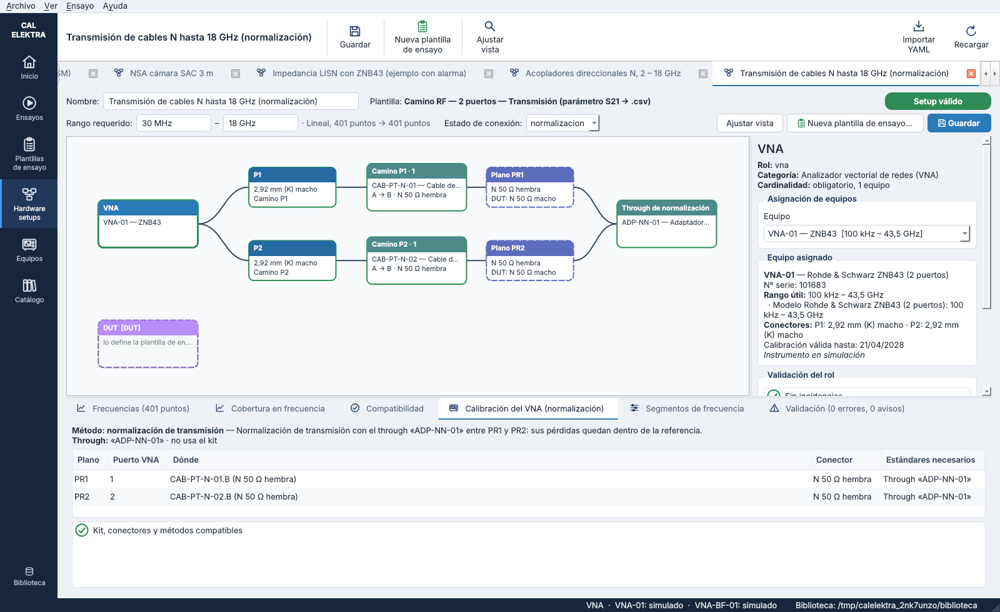
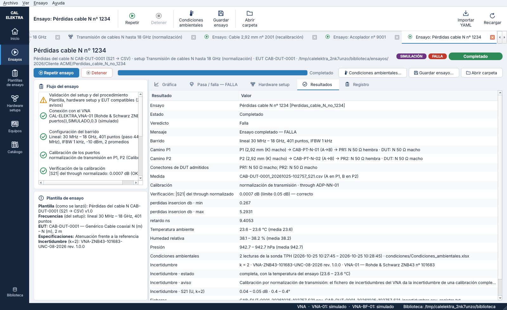

# Paso 9 — Hardware setups con un camino por puerto del VNA y nuevas plantillas — versión 0.8

Todos los hardware setups siguen ahora la misma estructura:

1. **El VNA a la izquierda**, una sola caja, sin separar P1 y P2.
2. De él sale una línea que **se divide en sus puertos** (P1, P2…). Cada puerto muestra su conector.
3. De cada puerto sale un **camino** que extiende el plano de referencia: cables de medida, adaptadores, paths de cámara, preamplificadores…, en orden desde el VNA. El camino adapta el conector del VNA al puerto del DUT.
4. Al final de cada camino está el **plano de referencia** (PR1, PR2…), con su conector y el **conector de DUT que admite**. Así, el hardware setup define qué conectores de DUT se pueden calibrar con él.
5. Después vienen el DUT (o las antenas que terminan los caminos de una cámara) y las cargas que toman los puertos libres del DUT. El resto de roles (kit, through, recinto, mástiles…) va en una fila debajo.


## 1. Caminos

### En la plantilla de setup

```yaml
formato: calelektra/plantilla_setup@0.4
caminos:
  P1:
    etiqueta: Camino TX
    categorias: [cable_medida, path, adaptador, preamplificador]   # equipos admitidos en el camino
    sentido: tx            # tx: del VNA al DUT; rx: del DUT al VNA; ambos (por defecto)
    final: antena_tx       # opcional: rol que termina el camino después del plano (antena)
  P2: { etiqueta: Camino RX, categorias: [...], sentido: rx, final: antena_rx }
algoritmos: [vna_2_puertos]   # ensayos que pueden usar los setups de esta plantilla
estados_conexion:
  medida:
    conexiones:
      - [P1, dut.#1]       # «P1»: final del camino de P1 (plano PR1); «dut.#1»: puerto del DUT medido en P1
      - [dut.#2, P2]
```

El puerto del VNA sale del nombre (P1 → puerto 1) o de `puerto_vna`.

### En el setup configurado

```yaml
formato: calelektra/setup@0.4
caminos:
  P1: [CAB-PT-N-01, ADP-NN-01]                      # desde el VNA hacia el DUT
  P2: [CAB-PT-N-02, { equipo: ADP-NN-02, invertido: true }]
  # P1: []  → camino vacío: el plano queda en el puerto del VNA
```

### Qué hace el programa con los caminos

- **Orientación de cada equipo.**
  - Un equipo de dos puertos se conecta por su primer puerto (A) en el lado del VNA.
  - Si ese puerto no encaja con el conector anterior y el otro sí, se da la vuelta solo. La comprobación lo indica («orientación elegida por los conectores»).
  - `invertido: true` fija la vuelta.
  - Los equipos direccionales (IN/OUT, p. ej. un preamplificador) siguen el `sentido` del camino. En un camino de recepción, la salida va hacia el VNA.
- **Solo equipos de 2 puertos.** Un acoplador o una LISN en un camino es un error.
- **Comprobaciones.** Cada equipo del camino se comprueba como un rol: categoría admitida, en servicio, calibración, datos S de los cables de medida y rango de frecuencia (limita el rango efectivo). También se comprueban los conectores de cada unión: puerto del VNA – equipo 1 – equipo 2 – … – DUT.
- **Expansión.** Internamente, el camino se convierte en roles `P1-1`, `P1-2`…, en las conexiones de su cadena y en el plano de referencia de su final. Las comprobaciones, el diseño de la calibración y la ejecución usan ese setup expandido (`setups/paths.py`).
- **Pestaña «Compatibilidad».** Nuevo grupo «Caminos de los puertos del VNA»: cada camino con su cadena (`P1 (2,92 mm macho) → CAB-PT-N-01 (A→B) → ADP-NN-01 (A→B) → PR1: N macho`) y los **conectores de DUT admitidos**.

**Formato 0.4.** Los setups y las plantillas de setup en formato 0.3 (un rol por cable y adaptador: `cable_p1`, `adaptador_p1`…) ya no se cargan. La biblioteca lo indica con un error que pide volver a crearlos. Los ensayos ya hechos se siguen abriendo.

### En el editor del setup

Al pulsar un puerto, un equipo de un camino o un plano, el panel derecho muestra el camino:

- el puerto del VNA y su conector, los equipos admitidos, el sentido y el rol final;
- el plano de referencia con su conector y el conector de DUT admitido;
- la lista ordenada de equipos, con los botones **Añadir al final**, **Subir**, **Bajar**, **Invertir** y **Quitar**.

Cada cambio vuelve a validar el setup y redibuja el diagrama.

## 2. Las seis plantillas de hardware setup

| Plantilla | Caminos | Calibración | Ensayo (algoritmo) | Resultado |
|---|---|---|---|---|
| **Camino RF — 2 puertos — Reflexión y transmisión** (`camino_rf_2p_s`) | P1, P2 | TOSM si los planos se unen; si no, UOSM (kit del setup) | `vna_2_puertos` | .s2p + CSV |
| **Camino RF — 2 puertos — Transmisión** (`camino_rf_2p_s21`) | P1, P2 | **Normalización de transmisión**: through entre PR1 y PR2 (plano o el *through de normalización* del setup; sin kit) | `vna_transmision` | **CSV de S21** |
| **Medida de impedancia — Reflexión en 1 puerto** (`impedancia_1p`) | P1 | OSM en PR1 | `vna_1_puerto` | .s1p + CSV con \|Z\| |
| **Acoplador direccional — 4 puertos** (`acoplador_4p`) | P1, P2 + cargas de 50 Ω | TOSM / UOSM | `vna_acoplador` | un .s2p por par + CSV del acoplador |
| **SAC — NSA** (`sac_nsa`) | TX y RX, que terminan en sus antenas (por segmento) | Normalización con el through (V_DIRECTA) | — (pendiente) | — |
| **SAC — S_VSWR** (`sac_svswr`) | TX (omnidireccional) y RX (bocina) | — | — (pendiente) | — |

En los setups de cámara, el preamplificador va dentro del camino de recepción y las antenas terminan los caminos. El plano de referencia queda en el conector de la antena, que es donde se une el through de la normalización.

## 3. Ensayos

- **Puertos del EUT en cada camino.** Por defecto se usa el orden de la categoría del EUT (A en PR1 y B en PR2 de un cable; EUT de una LISN). La plantilla de ensayo puede cambiarlo (`puertos_eut: [B, A]`). La comprobación dice qué puerto va en cada plano y avisa si los conectores no encajan.
- **Transmisión (S21 → .csv).**
  - Calibración: normalización con el through. El operador une los planos o conecta el through de normalización, cuyas pérdidas quedan dentro de la referencia.
  - Verificación: el through normalizado debe dar |S21| ≈ 0 dB.
  - Medida: solo S21.
  - Resultado: `<EUT>_<fecha>.csv` con frecuencia, S21 en dB y grados y su incertidumbre.
  - Pasa / falla: frente a las especificaciones S21 del modelo; las de S12 no se evalúan.
  - Incertidumbre: se calcula con el fichero del VNA, con el aviso de que ese fichero supone una calibración completa de 2 puertos.

  La normalización no corrige el desajuste de los puertos. En el ejemplo, el cable N falla su especificación de ±0,5 dB por unas centésimas, y con el ensayo de 2 puertos pasa.
- **Impedancia en 1 puerto (S11 → .s1p).** Genérica: carga, antena, LISN… Se mide el puerto del EUT en el plano PR1 (el terminal EUT de la LISN, al final del adaptador de la LISN) y se calcula |Z|. Desaparece lo específico de la LISN: líneas, puerto receptor y red nominal.
- **Acoplador direccional por pares.**
  - Una calibración (TOSM/UOSM) y una medida por cada par de puertos que elige la plantilla de ensayo. Por defecto: entrada–salida, entrada–acoplado y salida–acoplado.
  - En cada par, el primer puerto va en PR1, el segundo en PR2 y los otros dos en las cargas de 50 Ω del setup. El operador recibe la conexión exacta de cada par.
  - Resultados: pérdidas de inserción (IL), acoplamiento (C), aislamiento (I, de salida a acoplado o de entrada a aislado), directividad (D = I − C) y pérdidas de retorno (RL).
  - Pasa / falla: frente a los **valores nominales del modelo**. La categoría nueva «acoplador» tiene los campos de acoplamiento nominal ± tolerancia, IL máxima, aislamiento mínimo, directividad mínima y RL mínima.
  - Ficheros: un .s2p (y CSV) por par y `<EUT>_<fecha>_acoplador.csv` con IL, C, I, D y RL.

| | |
|---|---|
|  |  |
|  |  |

## 4. Lo que queda en los registros

- **`ensayo.yaml`**
  - `setup.caminos` (como en el setup) y `setup.conectores_dut_admitidos`.
  - `caminos`, cada camino resuelto con:
    - puerto del VNA y su conector;
    - cada equipo en orden: id, modelo, nº de serie, certificado, datos S, lado VNA / lado DUT y sus conectores;
    - plano, conector del plano y conector de DUT admitido.
  - `equipos`: los del camino llevan `camino` y `posicion`.
  - `medidas`: cada medida con su fichero, su formato y el puerto del EUT en cada camino (y los puertos en carga del acoplador).
- **`hardware_setup.yaml`** (`calelektra/hardware_setup_ensayo@0.4`): el setup con sus caminos, la plantilla de setup, los caminos resueltos y los equipos.
- **`resumen_ensayo.txt`**: los caminos con sus equipos y certificados, los conectores de DUT admitidos y cada medida con sus puertos.
- **Comentarios de los Touchstone**: una línea por camino.



## 5. Biblioteca de ejemplo

| Setup | Plantilla | Caminos | DUT admitido |
|---|---|---|---|
| `cable_vna_292` | 2 puertos S | vacíos (puertos 2,92 mm macho del ZNB43) | 2,92 mm hembra / hembra |
| `componente_292_tosm` | 2 puertos S | cable de medida 2,92 mm en cada puerto | 2,92 mm hembra / macho |
| `cable_N_18G`, `cable_N_26G_alarma` | 2 puertos S | cable de medida 2,92 mm – N hembra | N macho / macho |
| `cable_vna_N_alarma` | 2 puertos S | vacíos con kit N (alarma de conectores) | 2,92 mm hembra |
| `transmision_N_18G` | Transmisión | cables N; through ADP-NN-01 | N macho / macho |
| `acoplador_N_18G` | Acoplador | cable N + adaptador N macho–macho; cargas LOAD-N-01/02 | N hembra / hembra |
| `lisn_impedancia_VNA-BF`, `lisn_impedancia_VNA-01` | Impedancia 1 puerto | cable de medida + adaptador de la LISN | terminales |
| `sac_nsa_3m`, `sac_svswr_3m` | SAC | path TX / path RX, antenas al final | N hembra (antenas) |

Equipos nuevos:

- `ACP-0001`: acoplador de 20 dB y 2 – 18 GHz, modelo `acoplador_n_20db`;
- `LOAD-N-02`: segunda carga de 50 Ω;
- `ADP-NN-02`: segundo adaptador N macho – N macho.

Plantillas de ensayo nuevas: `transmision_CAB-DUT-0001` y `acoplador_ACP-0001`. `lisn_LISN-0001` es ahora una medida de impedancia genérica.

## 6. Pendiente y decisiones

- **NSA y S_VSWR.** Tienen su setup con caminos, pero aún no tienen algoritmo de ensayo. Faltan los detalles de CISPR 16-1-4: factores de antena, barrido de alturas y posiciones.
- **Kit de calibración.** Uno por setup: los dos planos deben ser de la misma familia de conector, o mecánicamente compatibles.
- **Normalización en el ZNB.** El adaptador R&S la define como `FTRans` (`SENS:CORR:COLL:METH:DEF …,FTR,1,2`) y adquiere el through con `THR`. Como el resto del adaptador, falta probarlo con el equipo.

## 7. Ficheros del código

| Fichero | Contenido |
|---|---|
| `setups/model.py` | `caminos` en plantillas (`PathDefinition`) y setups (`PathItem`), `algoritmos`, formato 0.4 |
| `setups/paths.py` | Caminos resueltos (orientación, conectores, plano, conector de DUT admitido), expansión en roles y conexiones, texto para los registros |
| `setups/analysis.py` | Validación sobre el setup expandido; grupo «Camino» y conectores de DUT admitidos |
| `setups/connections.py` | Normalización de transmisión (through plano o through del setup) |
| `procedures/engine.py` | Puertos del EUT por camino, pares del acoplador, normalización, mensajes al operador con los planos, exportación de los cuatro algoritmos, caminos en el registro |
| `procedures/coupler.py` | IL, C, I, D y RL del acoplador y su pasa / falla frente a los valores nominales |
| `procedures/results.py` | CSV de S21 (escritura y lectura), CSV del acoplador |
| `instruments/` | Método `normalizacion` en el VNA simulado y en el adaptador R&S; acoplador simulado |
| `gui/setup_diagram.py`, `gui/setup_editor.py` | Diagrama con la estructura común y panel de edición de caminos |
| `gui/procedures_view.py` | Puertos del EUT y pares del acoplador en la plantilla de ensayo |
| `tests/test_paths.py`, `tests/test_engine.py`, `tests/test_gui.py` | Caminos, ensayos de transmisión y acoplador, editor |
