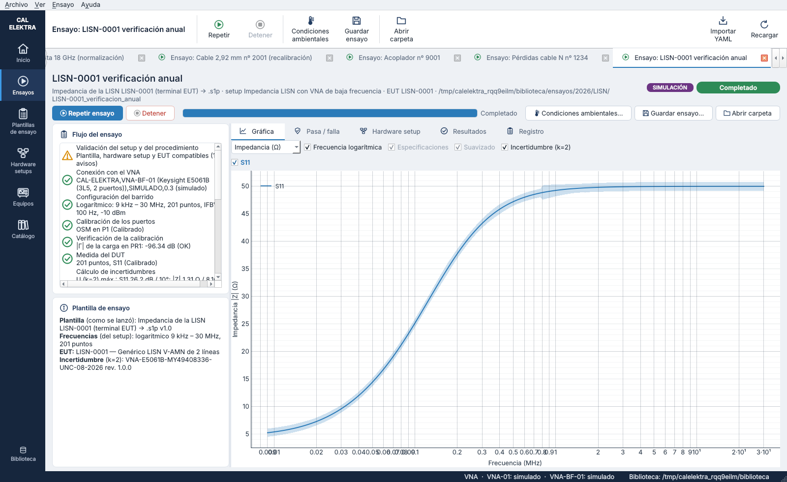

# Algoritmos y fórmulas del cálculo de incertidumbres — versiones 0.8.4, 0.10 y 0.11

Este documento reúne todo lo que CAL-ELEKTRA calcula sobre incertidumbre y cómo lo calcula:

- la incertidumbre de los parámetros S, con el algoritmo del laboratorio;
- la componente de temperatura;
- las conversiones a las unidades de las gráficas;
- la incertidumbre de la impedancia, nueva en 0.8.4;
- los resultados de un cable por sentido (VSWR, pérdida de inserción y retardo de grupo) y su incertidumbre, nuevos en 0.10;
- la incertidumbre con dependencias de los ficheros de METAS VNA Tools (`.sdatb`, `.sdatcv`), nueva en 0.11.

Cada sección indica el código que la implementa y los tests que la comprueban.

| Magnitud | Cómo se obtiene | Código |
|---|---|---|
| U de S11, S21, S12 y S22 (dB y °) | Algoritmo del laboratorio sobre el fichero de incertidumbres de la unidad de VNA | `uncertainty/engine.py`, `uncertainty/traces.py` |
| Componente de temperatura | ΔT a partir de las lecturas de la sonda TPH; incertidumbre «pendiente» hasta cargarlas | `procedures/record_uncertainty.py` |
| U en VSWR y en pérdidas (RL, TL) | Conversión de la U de los parámetros S | `gui/plots.py` |
| U de \|Z\| y ∠Z | Propagación a partir de la U de S11 | `uncertainty/impedance.py` |
| U del VSWR, de la pérdida de inserción y del retardo de grupo de un cable (Fwd y Rev) | A partir de la U de S11, S21, S12 y S22 (§5) | `procedures/cable_results.py` |
| u y covarianzas de los datos de un `.sdatb` o un `.sdatcv` | Propagación lineal del presupuesto de METAS (§6) | `sdata/unclib.py`, `sdata/model.py` |

## 1. Notación

| Símbolo | Significado |
|---|---|
| Γ = ρ·e^{jφ} | Coeficiente de reflexión medido (S11), módulo ρ = \|Γ\| y fase φ |
| M = 20·log10 ρ | Magnitud en dB |
| u, U | Incertidumbre típica y expandida, U = k·u |
| k | Factor de cobertura de la plantilla de ensayo (2 por defecto) |
| U_dB, U_ρ, U_φ | U de la magnitud en dB, de la magnitud lineal y de la fase |
| Z = Z₀·(1+Γ)/(1−Γ) | Impedancia vista en el puerto, Z₀ = 50 Ω |

Todas las incertidumbres del registro, de los CSV y de las gráficas son **expandidas**, con el k de la plantilla.

## 2. Parámetros S: algoritmo del laboratorio

`uncertainty/engine.py` es el script del laboratorio `DEF_vna_uncertainty_s_parameters_calculation.py` con el mismo cálculo. Da los mismos resultados en 122 400 combinaciones, incluidos los NaN (ver [`07_incertidumbres.md`](07_incertidumbres.md)), y no se cambia sin comprobarlo contra el script.

### 2.1 El fichero de incertidumbres

Es de cada unidad de VNA (`incertidumbre` del equipo, en `catalogo/incertidumbres/`). Su lista `uncertainty_sources` tiene una entrada por fuente:

| Clave | Uso |
|---|---|
| `include_in_total` | Solo cuentan las fuentes con `true` |
| `applicable_to` | Parámetros a los que se aplica (S11, S21…) |
| `unit`, `unit_family` | Unidad del valor: dB, grados, lineal, dB/K, °/K, °/GHz/K |
| `uncertainty_type` | `expanded`, `rms_standard_deviation` o `coefficient` (temperatura) |
| `coverage_factor`, `distribution`, `sensitivity_coefficient` | k de la fuente, distribución (rectangular…) y coeficiente de sensibilidad |
| `frequency_ranges`, `selection_rule` | Bloques por frecuencia y regla para elegir el bloque |
| `level_ranges` (o `reflection_coefficient_ranges`) | Rangos de nivel dentro de un bloque, en dB o lineales |
| `conditions.if_bandwidth_hz` | IFBW mínima para que la fuente se aplique |

### 2.2 Qué fuentes se aplican

Para un parámetro, una frecuencia f y un valor medido, una fuente cuenta si cumple todo esto:

1. Tiene `include_in_total`.
2. Su `applicable_to` contiene el parámetro.
3. No es ruido de traza con el ruido de traza desactivado en la plantilla, ni estabilidad con la temperatura con esa opción desactivada.
4. Es de la familia de la salida:
   - una fuente de magnitud sirve para la magnitud en dB y en lineal (se convierte, §2.5);
   - una de fase, para la fase.
5. Si tiene condición de IFBW, la IFBW de la traza es igual o mayor que la de la condición. Si no lo es, la fuente se deja fuera sin invalidar el total. Así, el ruido de traza del ZNB43, que es un dato a 10 kHz, no se suma con IFBW de 1 kHz.

### 2.3 Búsqueda del valor

**Bloque de frecuencia** (`selection_rule`):

| Regla | Bloque elegido |
|---|---|
| `range_match` (por defecto) | El primero cuyo rango contiene f |
| `exact_match_required` | El de `frequency_hz` igual a f |
| `nearest_lower` | El de inicio más alto que no supera f |
| `interpolation_linear` | El que contiene f. Si ninguno lo contiene, el de centro inmediatamente inferior. El valor se toma de ese bloque y no se interpola, como en el script |

**Rango de nivel** (si el bloque tiene `level_ranges`):
- **Magnitud:** el nivel es el propio valor medido.
- **Fase:** el nivel es la magnitud del parámetro en dB.
- **Unidad:** el nivel se pasa a la de los límites del fichero, dB o lineal, según qué claves tengan (`level_min_db`, `level_min_linear`…).

**Sin extrapolación:** si la frecuencia o el nivel quedan fuera de todos los rangos de una fuente aplicable, o la frecuencia está fuera del rango del equipo, el resultado es **NaN**. El motivo se guarda («nivel −62 dB fuera de los rangos; el fichero cubre de −60 a 0 dB»).

### 2.4 Incertidumbre típica de cada fuente

Con v el valor leído del fichero, k_s el factor de cobertura de la fuente y c_s su coeficiente de sensibilidad:

```
expandida                 u = v / k_s
desviación típica (RMS)   u = v
coeficiente (temperatura) a = v · ΔT                    (dB/K o °/K)
                          a = v · f[GHz] · ΔT           (°/GHz/K)
                          u = a / √3   si la distribución es rectangular,   u = a / k_s   si no
siempre                   u ← |c_s| · u
```

ΔT es lo que la temperatura del ensayo sale del rango de referencia del fichero (`temperature_range_c`, 18 – 28 °C si no lo indica):

```
ΔT = max(0, T_ref,mín − T_mín, T_máx − T_ref,máx)
```

Con ΔT = 0, la fuente de temperatura da 0 y no se lista.

### 2.5 Conversión entre dB y lineal

Cuando una fuente está en una unidad y la salida en otra, se convierte su incertidumbre típica con la derivada en el valor nominal x (lineal). Pasa con la reflexión pedida en dB de un fichero que la da en lineal, con las fuentes `magnitude_all`, con el ruido de traza y con la temperatura en dB/K cuando la salida es lineal:

```
lineal → dB:   u_dB  = 20 / (ln10 · x) · u_lin
dB → lineal:   u_lin = ln10 · x / 20 · u_dB
```

Por eso, cuando |Γ| es pequeño, la U de la reflexión en dB crece mucho aunque la U lineal sea constante. En la E5061B, a −51,5 dB (|Γ| = 0,0027), U = 0,008 en lineal equivale a U = 26,2 dB.

### 2.6 Combinación y expansión

```
u_c = √( Σ u_i² )          (fuentes independientes, RSS)
U   = k · u_c              (k de la plantilla)
```

Si alguna fuente aplicable queda fuera de sus rangos (§2.3), u_c y U son NaN. Si la fecha del ensayo es posterior a `calibration_due_date` del fichero, el resultado lleva el aviso de VNA fuera de calibración.

### 2.7 Punto a punto en las trazas

`uncertainty/traces.py`, como `processing.py` del laboratorio. Para cada traza y cada frecuencia:

| Componente | Valor | Nivel | Resultado |
|---|---|---|---|
| Magnitud | M = 20·log10\|S\| | M | U en dB |
| Fase | ∠S en grados | M (dB) | U en grados |

- La IFBW es la de cada traza (ajustes de trazas de la plantilla).
- Solo se calculan las trazas del algoritmo: S21 en la transmisión, S11 en la impedancia.
- El primer motivo de cada traza sin incertidumbre queda en el registro.

### 2.8 Temperatura: incertidumbre pendiente y completa

`procedures/record_uncertainty.py` y [`08_condiciones_ambientales_y_paquete.md`](08_condiciones_ambientales_y_paquete.md).

- **Al terminar el ensayo:** la incertidumbre queda **pendiente**. Se calcula sin temperatura (ΔT = 0) y es igual a la completa salvo la estabilidad con la temperatura.
- **Al cargar el .xlsx de la sonda TPH:** T_mín y T_máx son las de las lecturas del intervalo del ensayo, y todo se recalcula con ellas (estado **completa**). El recálculo usa lo guardado con el ensayo:
  - la copia del fichero del VNA;
  - las trazas sin suavizar;
  - la plantilla tal como se lanzó;
  - el mismo día de comprobación de la calibración.
- **Impedancia:** también se recalcula, porque se obtiene de la U de S11 (§4).

## 3. Conversiones para las gráficas

Las gráficas no calculan incertidumbre nueva: transforman la U de los parámetros S a la unidad elegida. La zona sombreada va del límite inferior al superior de cada punto. Se corta donde un punto no tiene incertidumbre y en los saltos de ±180° de la fase.

| Unidad | Traza | Zona |
|---|---|---|
| Magnitud (dB) | M | M ± U_dB |
| Fase (°) | ∠S | ∠S ± U_φ |
| VSWR (reflexiones) | VSWR(ρ) = (1+ρ)/(1−ρ), con media móvil del 1 % de los puntos (§5.1) | Alrededor de la traza suavizada, la anchura de cada punto: [VSWR(ρ·10^(−U_dB/20)), VSWR(ρ·10^(+U_dB/20))] − VSWR(ρ), exacta y no simétrica; NaN si el límite superior llega a ρ ≥ 1 |
| Pérdidas RL, TL (acoplador) | L = −20·log10\|S\| | L ± U_dB (la misma anchura que la magnitud) |
| Impedancia (Ω, dBΩ, ∠Z) | \|Z\|, 20·log10\|Z\|, ∠Z | Los límites de §4, que no son simétricos donde la cota es exacta |
| Retardo de grupo (ns), transmisiones | τ_g de §5.3, con media móvil del 1 % de los puntos | τ_g ± U_φ/(360°·f) (§5.3) |

- Las especificaciones de reflexión en dB se dibujan en VSWR como VSWR(10^(v/20)). El RL mínimo del acoplador, RL_mín, se dibuja como VSWR(10^(−RL_mín/20)).
- Si la plantilla suaviza la visualización, la zona se dibuja alrededor de la traza suavizada. La U no se suaviza.
- El VSWR y el retardo de grupo se suavizan siempre (0.10.2), como en los certificados del laboratorio; el suavizado de la plantilla solo afecta a las otras unidades.
- El **pasa / falla no usa la incertidumbre**: compara el valor medido con el límite (aceptación simple).

## 4. Incertidumbre de la impedancia (nueva en 0.8.4)

`uncertainty/impedance.py`. La usa la medida de impedancia en 1 puerto (algoritmo `vna_1_puerto`; la LISN del ejemplo). Las decisiones aprobadas son:

- la tangencial nunca menor que la radial (§4.3);
- cota exacta donde el primer orden no vale (§4.6);
- magnitud y fase sin correlación;
- Z₀ = 50 Ω.

### 4.1 Datos de partida

Para cada punto:
- el Γ medido;
- U de su magnitud, en dB (es lo que guarda el ensayo) o en lineal;
- U de su fase en grados.

Todas tienen el mismo k. Se busca U de |Z| (en Ω y en dBΩ) y de ∠Z (en °), con

```
Z = Z₀ · (1 + Γ) / (1 − Γ),     Z₀ = 50 Ω
```

### 4.2 Paso 1 — magnitud en lineal

```
U_ρ = ρ · (ln10 / 20) · U_dB  ≈  0,1151 · ρ · U_dB          (si la magnitud viene en dB)
U_ρ = U_lin                                                (si viene en lineal)
U_φ[rad] = U_φ[°] · π / 180
```

Es la misma derivada del motor (§2.5). Cuando el fichero da la reflexión en lineal, el motor obtiene U_dB de U_lin con la derivada inversa, y este paso la recupera exactamente. Por eso partir de dB o de lineal da el mismo resultado; un test lo comprueba con los 26,2 dB → 0,008 de la E5061B.

### 4.3 Paso 2 — componentes radial y tangencial

Un error de Γ tiene una parte radial (del módulo) y otra tangencial (de la fase):

```
δΓ = e^{jφ} · (δρ + j·ρ·δφ)
```

```
U_radial     = U_ρ
U_tangencial = U_t = max(ρ · U_φ[rad], U_ρ)
```

**Decisión D1.** La tangencial no es nunca menor que la radial: el error del VNA (directividad, adaptación, seguimiento) es un vector de fase cualquiera.

**Por qué:** cerca de la adaptación (|Γ| ≲ U_ρ), el fichero de la E5061B limita U_φ a 10°. Con eso, la región de Γ sería una franja estrecha en la dirección de un φ casi arbitrario, y U(|Z|) dependería de esa dirección. En el ejemplo saldría 0,93 Ω a 1,2 MHz, 0,24 Ω a 5,9 MHz y 0,05 Ω a 30 MHz.

**Efecto:** donde |Γ| es grande, ρ·U_φ ya es del orden de U_ρ en ese fichero (0,0246 frente a 0,0220 a 9 kHz), así que la regla solo cambia los puntos cerca de la adaptación.

### 4.4 Paso 3 — sensibilidades

```
dZ/dΓ = 2·Z₀ / (1 − Γ)²
δZ / Z = 2·δΓ / (1 − Γ²)

B = 2·e^{jφ} / (1 − Γ²) = b_r + j·b_i        ⇒      δZ / Z = B · (δρ + j·ρ·δφ)
```

Como ln Z = ln|Z| + j·∠Z, la parte real de δZ/Z es el error relativo del módulo y la imaginaria el error de la fase:

```
δ|Z| / |Z| = b_r·δρ − b_i·ρ·δφ
δ∠Z        = b_i·δρ + b_r·ρ·δφ
```

B no tiene singularidad en Γ = 0. Crece cerca del abierto (Γ → 1) y del cortocircuito (Γ → −1), donde Z es muy sensible a Γ.

### 4.5 Paso 4 — primer orden (GUM)

Ley de propagación de incertidumbres con δρ y δφ independientes. La propagación es lineal y todas las U tienen el mismo k, así que se propaga directamente la U expandida:

```
U_rel  = U(|Z|) / |Z| = √[ (b_r·U_ρ)² + (b_i·U_t)² ]
U(∠Z)  = √[ (b_i·U_ρ)² + (b_r·U_t)² ]                       [rad]

U(|Z|) [Ω]    = |Z| · U_rel
U(|Z|) [dBΩ]  = (20 / ln10) · U_rel  ≈  8,686 · U_rel
U(∠Z) [°]     = (180 / π) · U(∠Z)
```

Forma equivalente partiendo de dB, con A = ρ·B = 2Γ/(1−Γ²) = a_r + j·a_i (sin la regla D1):

```
U_rel = √[ (a_r · 0,1151·U_dB)² + (a_i · U_φ[rad])² ]
U(∠Z) = √[ (a_i · 0,1151·U_dB)² + (a_r · U_φ[rad])² ]
```

Con correlación r entre δρ y ρ·δφ habría que sumar los términos cruzados ∓2·r·b_r·b_i·U_ρ·U_t (módulo) y ±2·r·b_r·b_i·U_ρ·U_t (fase). **Decisión:** r = 0, igual que el motor combina las fuentes.

### 4.6 Paso 5 — cota exacta donde el primer orden no vale

El primer orden supone que la región de Γ es pequeña frente a la distancia al abierto (|1−Γ|) y al cortocircuito (|1+Γ|). Con r = U_t (el radio de la región, porque U_t ≥ U_ρ), el criterio es:

```
primer orden   si   r ≤ 0,1 · min(|1 − Γ|, |1 + Γ|)
cota exacta    si no
```

**Cota exacta (decisión D2).**

1. Se toma Γ en el disco |Γ − Γ₀| ≤ r.
2. La transformación Γ → Z es de Möbius: Z = Z₀·(−1 + 2/ζ) con ζ = 1 − Γ.
3. La inversión 1/ζ lleva un círculo que no pasa por el origen a otro círculo. Para el disco |ζ − ζ₀| ≤ r, con ζ₀ = 1 − Γ₀ y d = |ζ₀|² − r² > 0, la imagen 1/ζ es el disco de centro conj(ζ₀)/d y radio r/d.
4. Por tanto, Z recorre el disco de centro y radio:

```
Z_c = Z₀ · ( −1 + 2·conj(ζ₀) / d )
R   = 2·Z₀·r / d
```

y los límites son

```
|Z|  ∈  [ max(|Z_c| − R, 0) ,  |Z_c| + R ]
∠Z   ∈  ∠Z_c ± arcsin(R / |Z_c|)                         (si R < |Z_c|)

U+(|Z|) = |Z_c| + R − |Z|          U−(|Z|) = |Z| − max(|Z_c| − R, 0)
U±(|Z|) [dBΩ] = 20·log10 de los límites respecto a |Z|
U±(∠Z) = distancia de ∠Z a cada límite de fase
```

- **No simétricos:** Z₀ = Z(Γ₀), la impedancia medida, está dentro del disco imagen pero no en su centro.
- **Conservadores:** el disco usa r en todas las direcciones.
- **Sin cota:** con d ≤ 0 el disco contiene el abierto (Z puede ser infinita). El punto queda sin incertidumbre (NaN).
- **Fase indeterminada:** con R ≥ |Z_c| el disco imagen contiene Z = 0. Queda sin incertidumbre de fase y U−(dBΩ) es infinita.

### 4.7 Comprobación

**Fórmulas de primer orden frente a Monte Carlo** (400 000 muestras gaussianas de ρ y φ; U relativa de |Z| y U de ∠Z, sin la regla D1, para comprobar solo la propagación):

| Caso | \|Z\| | U_rel fórmula | U_rel Monte Carlo | U(∠Z) fórmula | U(∠Z) Monte Carlo |
|---|---|---|---|---|---|
| Γ = −0,818 + 0,02j (U_ρ 0,004, U_φ 0,5°) | 5,04 Ω | 0,0244 | 0,0244 | 2,45° | 2,44° |
| Γ = 0,3 ∠ 40° (0,005, 1°) | 78,4 Ω | 0,0104 | 0,0104 | 0,59° | 0,59° |
| \|Γ\| = 0,01 (0,003, 15°) | 50,8 Ω | 0,0057 | 0,0056 | 0,32° | 0,32° |
| Γ = 0,95 ∠ 10° (0,01, 1°) | 548 Ω | 0,094 | 0,097 | 3,55° | 3,58° |
| **Γ = 0,99 ∠ 2° (0,01, 1°)** | **2753 Ω** | **0,47** | **1,75** | **17,1°** | **26,4°** |

El primer orden coincide en todo salvo junto al abierto. Ahí r/|1−Γ| ≈ 0,26 y el criterio pasa a la cota exacta.

**Cota exacta frente a un muestreo denso del disco** (400 000 puntos; r = max(U_ρ, ρ·U_φ)):

| Γ (U_ρ, U_φ) | Primer orden | Cota exacta | Muestreo |
|---|---|---|---|
| 0,3 ∠ 40° (0,01, 2°) | 78,39 ± 1,66 Ω, ± 1,21° | 76,75 … 80,08 Ω; 21,75 … 24,18° | 76,75 … 80,08 Ω |
| 0,95 ∠ 10° (0,01, 0,6°) | 548,4 ± 31,9 Ω, ± 3,33° | 518,3 … 582,2 Ω; 70,19 … 76,85° | 518,3 … 582,2 Ω |
| 0,99 ∠ 2° (0,01, 0,6°) | 2753 ± 794 Ω, ± 16,5° | 2136 … 3866 Ω; 57,1 … 90,6° | 2136 … 3865 Ω |
| 0,0027 (0,008, 10°) | 50,10 ± 0,80 Ω, ± 0,92° | 49,30 … 50,91 Ω; −0,63 … 1,21° | 49,30 … 50,91 Ω |

Los tests (`tests/test_uncertainty_impedance.py`) repiten estas comprobaciones:
- primer orden frente a Monte Carlo con la regla D1 (tolerancia 3 %);
- dB frente a lineal;
- independencia de φ cerca de la adaptación;
- cota exacta frente al muestreo del disco;
- puntos sin cota.

### 4.8 Ejemplo: LISN-0001 con la E5061B (k = 2, incertidumbre pendiente)

| Frecuencia | S11 | U de S11 | Z | U(\|Z\|) | U (dBΩ) | U(∠Z) | Método |
|---|---|---|---|---|---|---|---|
| 9 kHz | −1,62 dB ∠ 174,6° | 0,230 dB · 1,70° | 5,21 Ω ∠ 26,5° | +0,746 / −0,728 Ω | +1,162 / −1,306 dB | +8,069 / −8,158° | exacta |
| 45,6 kHz | −2,48 dB ∠ 154,5° | 0,196 dB · 1,70° | 13,34 Ω ∠ 56,2° | ±0,722 Ω | ±0,470 dB | ±2,716° | 1.er orden |
| 231 kHz | −9,94 dB ∠ 112,5° | 0,273 dB · 2,00° | 39,94 Ω ∠ 33,2° | ±0,819 Ω | ±0,178 dB | ±1,080° | 1.er orden |
| 812 kHz | −20,23 dB ∠ 96,7° | 0,714 dB · 8,00° | 48,89 Ω ∠ 11,0° | ±1,311 Ω | ±0,233 dB | ±0,920° | 1.er orden |
| 1,17 MHz | −23,37 dB ∠ 94,7° | 1,025 dB · 8,00° | 49,45 Ω ∠ 7,7° | ±0,931 Ω | ±0,164 dB | ±0,914° | 1.er orden |
| 30 MHz | −51,53 dB ∠ 90,1° | 26,214 dB · 10,00° | 50,00 Ω ∠ 0,3° | ±0,800 Ω | ±0,139 dB | ±0,917° | 1.er orden |

- **Cota exacta:** 17 de los 201 puntos, de 9 kHz a 17,2 kHz. Ahí Z está cerca del cortocircuito, r ≈ 0,024 y |1+Γ| ≈ 0,18.
- **Máximo de U(|Z|):** 1,31 Ω a 812 kHz. Allí Γ es casi imaginario y el fichero da U_φ = 8°, así que la componente tangencial (ρ·U_φ = 0,014) actúa directamente sobre |Z|.
- **A 30 MHz:** los 26,2 dB de U de S11 son solo el efecto de expresar U_ρ = 0,008 en dB sobre un |Γ| de −51,5 dB. La impedancia queda en 50,0 ± 0,8 Ω.



### 4.9 Dónde queda

- **Registro** (`incertidumbre.medidas[].impedancia`):
  - `z0_ohm`;
  - `U_ohm`, `U_dbohm` y `U_grados` (mínimo y máximo de la mayor de U+ y U−);
  - `puntos`, `puntos_cota_exacta` y `puntos_sin_incertidumbre`.

  El paso «Cálculo de incertidumbres» añade «|Z| … Ω / …°» y el número de puntos con cota exacta.
- **CSV:** `<resultado>_incertidumbre.csv` y el CSV de resultados `.csv` añaden estas columnas:
  - `U+ |Z| (Ω, k=2)`, `U− |Z| (Ω, k=2)`;
  - `U+ |Z| (dBΩ, k=2)`, `U− |Z| (dBΩ, k=2)`;
  - `U+ ∠Z (°, k=2)`, `U− ∠Z (°, k=2)`;
  - `Z: cota exacta (1 = sí)`.

  En los puntos de primer orden, U+ = U−.
- **Gráfica:** la medida de impedancia sombrea la zona en «Impedancia (Ω)», «Impedancia (dBΩ)» y «Fase (°)». Se calcula sobre la traza mostrada, suavizada si la plantilla lo pide.
- **Otros:** la tabla «Resultados» de la ventana del ensayo y del explorador y el `resumen_ensayo.txt` del paquete.
- **Recálculo:** al cargar las condiciones ambientales se recalcula con la nueva U de S11.

## 5. Resultados de un cable por sentido (nuevo en 0.10)

`procedures/cable_results.py`, en los ensayos de parámetros S (`vna_2_puertos`). Como en el certificado del laboratorio, los resultados van por **sentido** de la señal:

| Sentido | VSWR del puerto | Pérdida de inserción y retardo de grupo |
|---|---|---|
| Fwd | Puerto 1: S11 | S21 |
| Rev | Puerto 2: S22 | S12 |

Las U de partida son las de las trazas (§2.7), expandidas con el k de la plantilla: U_dB y U_φ de cada parámetro. Los resultados también son expandidos.

### 5.1 VSWR

```
ρ      = |Sii|
VSWR   = (1 + ρ) / (1 − ρ)
U_ρ    = ρ · ln10/20 · U_dB(Sii)                 (el paso 1 de §4.2)
U_VSWR = dVSWR/dρ · U_ρ = 2·U_ρ / (1 − ρ)²       (primer orden, simétrica)
```

- **U_dB(Sii)** es la de la propia reflexión, con el rango de nivel del fichero del VNA elegido con |Sii|: S11 en Fwd y **S22 en Rev**.
- **VSWR mostrado** (gráficas, tablas y figuras del certificado): el VSWR de cada punto con media móvil de int(0,01·N) puntos, ventana [k − n/2, k + (n − 1)/2] y extremos reflejados (`smoothed` y `moving_average` de `core/networks.py`), como el laboratorio. U_VSWR, el veredicto y los márgenes son los de cada punto.
- La gráfica del programa dibuja en «VSWR» la anchura exacta de §3, que no es simétrica; en reflexiones pequeñas coincide con ±U_VSWR. Las figuras del certificado dibujan ±U_VSWR, como las del laboratorio.

**Comparación con el certificado del laboratorio** ([`13_certificado_de_cables.md`](13_certificado_de_cables.md) §8.2): su columna «Incertidumbre VSWR» sale de ρ·ln10/20·U_dB/(1 − ρ)², sin el factor 2 de la derivada, y en Rev elige el rango de U_dB con el nivel de |S11|. El laboratorio ha confirmado que las dos son errores de su certificado (0.10.2): la fórmula buena es la de arriba, la del programa, con el factor 2 y el rango de S22 en Rev.

### 5.2 Pérdida de inserción

```
IL   = 20·log10 |Sji|         (dB, negativa, como en el certificado)
U_IL = U_dB(Sji)
```

Reproduce el certificado de ejemplo: 0,0400 dB hasta 10 GHz y 0,0500 dB por encima con el ZNB43.

### 5.3 Retardo de grupo

```
τ_g(f) = −dφ/dω = −(1/360°)·dφ/df          φ: fase de Sji desenrollada
U_τ    = U_φ(Sji) / (360°·f)               (s; en el registro y el certificado, en ns)
```

- **Cálculo** (`core/networks.py`, `group_delay`, desde 0.10.2), el de los certificados del laboratorio, en las gráficas, los resultados y el certificado:
  1. el retardo entre cada punto y el anterior, −Δφ/Δω (`step_delay`; el primer punto toma el del segundo);
  2. su media móvil de n = int(0,01·N) puntos, con ventana [k − n/2, k + (n − 1)/2] y los extremos reflejados (`smoothed`, `moving_average`). Con 5299 puntos, n = 52; con menos de 200, n = 1 y no se suaviza.

  Con puntos igualmente espaciados, la media de n retardos entre puntos es la diferencia de fase en n pasos: el formato «delay» de un VNA con una apertura del 1 % de los puntos. Hasta 0.10.1 era un ajuste por mínimos cuadrados en `informe.apertura_retardo` pasos; esa clave ya no se usa.
- **Desenrollado:** la fase se desenrolla contra el retardo de toda la traza (`transmission_delay`). Así una lista de frecuencias con pasos donde un cable largo gira más de media vuelta no se confunde. Con pasos de menos de media vuelta es el desenrollado normal.
- **Incertidumbre:** la de la fase convertida en tiempo a esa frecuencia, sin suavizar. Reproduce el certificado de ejemplo: U_φ = 0,4° da 0,1111 ns a 10 MHz y 0,0009 ns a 1,3 GHz.
- Donde falta la fase de un punto, el retardo es NaN, y también en las medias que lo incluyen.

### 5.4 Límites

Los de la especificación por fórmula del cable ([`11_especificacion_de_cables_por_formula.md`](11_especificacion_de_cables_por_formula.md)), dentro de su rango nominal: VSWR_máx(f) y −IL_máx(f). El pasa / falla de cada punto compara el valor medido con el límite y no usa la incertidumbre, como el resto del programa.

### 5.5 Dónde queda

- **Registro**, `resultados.sentidos.Fwd` y `.Rev`:
  - `vswr_max` y `frecuencia_vswr_max`;
  - `perdida_insercion_peor_db`;
  - `retardo_grupo_ns` (media, mínimo y máximo);
  - `margen_vswr` y `margen_perdida_insercion_db`, los mínimos;
  - `U_vswr_max`, `U_perdida_insercion_max_db` y `U_retardo_grupo_max_ns`;
  - `suavizado_pct` (1) y `suavizado_puntos`, junto a `Fwd` y `Rev`.
- **CSV** `<resultado>_fwd_rev.csv`, punto a punto y por sentido: VSWR, VSWR suavizado, U, límite; pérdida de inserción, U, límite; retardo de grupo (suavizado) y U.
- **Recálculo:** al cargar las condiciones ambientales se reescriben el CSV y `sentidos` con la nueva U.
- **Gráfica:** la unidad «Retardo de grupo (ns)» (§3).
- **Certificado del cable:** [`13_certificado_de_cables.md`](13_certificado_de_cables.md).

## 6. Incertidumbre con dependencias: los ficheros de METAS VNA Tools (nuevo en 0.11)

Un `.sdatb` no guarda incertidumbres, sino su presupuesto: la propagación lineal (LinProp) de METAS UncLib.

- Cada valor x_e depende de unas entradas i, a través de una sensibilidad J_ei. Un valor es la parte real o imaginaria de un parámetro S o de la Zr de un puerto.
- Cada entrada tiene su distribución, y de ella sale su incertidumbre típica u_i.

Ver el formato en [`14_parametros_s_con_incertidumbre_metas.md`](14_parametros_s_con_incertidumbre_metas.md).

### 6.1 Incertidumbre típica y covarianza

```
u(x_e)²       = Σ_i (J_ei · u_i)²
cov(x_a, x_b) = Σ_i J_ai · J_bi · u_i²          V = J · diag(u²) · Jᵀ
```

- Dos valores están correlacionados si comparten entradas.
- Dos ficheros, también: una entrada es la misma en los dos si tiene el mismo identificador. Es el caso de un patrón y de una medida calibrada con él (`cross_covariance`).
- Las incertidumbres de esta sección son típicas (k = 1).

### 6.2 Incertidumbre típica de cada distribución

Es la de los comentarios del esquema XML de METAS UncLib (Data Formats §1.2):

| Distribución | u_i |
|---|---|
| Normal estándar, y las entradas de la versión 1 | 1 |
| Normal (μ, σ) | σ |
| Uniforme estándar | 1/√12 |
| Uniforme (a, b) | (b − a)/√12 |
| Trapecio curvilíneo (a, b, d) | √((b − a)²/12 + d²/9) |
| Trapezoidal (a, b, β) | (b − a)·√((1 + β²)/24) |
| Triangular (a, b) | (b − a)/√24 |
| Arcoseno (a, b) | (b − a)/√8 |
| Gamma (a, b) | √a · b |
| Chi cuadrado (k) | √(2k) |
| t de Student (μ, σ, ν) | σ·√(ν/(ν − 2)) |
| t de Student de n muestras | s/√n · √((n − 1)/(n − 3)), con s la desviación típica de las muestras |
| Elección aleatoria entre muestras | Desviación típica de las muestras (supuesto: los documentos no la dan) |

### 6.3 De una matriz de covarianza a entradas (lectura de un `.sdatcv`)

Un `.sdatcv` da, en cada frecuencia k, los valores y su matriz de covarianza C_k (2N² × 2N², en el orden del fichero). Para tenerlos como un `.sdatb`:

1. Se separan los grupos de valores correlacionados: los que unen covarianzas no nulas. Así, dos parámetros sin correlación no comparten entradas.
2. En cada grupo G, C_G = Q·Λ·Qᵀ (valores y vectores propios).
3. Cada valor propio λ_j > 10⁻¹⁵·λ_max da una entrada normal estándar, con las sensibilidades q_j·√λ_j.

Con esas entradas, J·Jᵀ = Q·Λ·Qᵀ = C_G: la covarianza se reproduce exactamente.

- Los valores propios negativos, que vienen del redondeo del fichero, cuentan como cero.
- Cada frecuencia tiene sus propias entradas: un `.sdatcv` no guarda la correlación entre frecuencias.
- Las entradas se nombran como en VNA Tools: `Data Set <fichero> Frequency Index: k, Contribution: c`.

### 6.4 Comprobación

- **Ejemplo de METAS UncLib:** c = √(a² + b²), con a = 3 ± 0,3 y b = 4 ± 0,4, da u = 0,3671511950137164, el mismo valor que METAS.
- **Carga de VNA Tools:** la u de cada parte coincide con la diagonal de `point_covariance`.
- **Ida y vuelta por `.sdatcv`:** devuelve la misma covarianza en cada frecuencia (rtol 10⁻⁹).
- **Adaptador:** su covarianza con la carga, a través de las entradas comunes, no es nula.

## 7. Ficheros del código y tests

| Fichero | Contenido |
|---|---|
| `uncertainty/engine.py` | Algoritmo del laboratorio (§2.1 – 2.6) |
| `uncertainty/traces.py` | Trazas punto a punto (§2.7) |
| `uncertainty/impedance.py` | Incertidumbre de Z (§4): `impedance_uncertainty`, `ImpedanceUncertainty`, `impedance_text` |
| `procedures/record_uncertainty.py` | Cálculo de un ensayo, estado pendiente / completa y recálculo con la sonda TPH (§2.8); llama a la de Z en `vna_1_puerto` |
| `procedures/results.py` | Columnas de U en los CSV (`uncertainty_columns`, `impedance_columns`) |
| `gui/plots.py` | Zonas sombreadas y conversiones (§3), retardo de grupo |
| `procedures/cable_results.py` | Resultados de un cable por sentido y su U (§5) |
| `core/networks.py` | `group_delay`, `step_delay`, `smoothed` y `transmission_delay` (§5.3) |
| `sdata/unclib.py` | Números con dependencias, u de las distribuciones, covarianza y `cross_covariance` (§6.1 – 6.2), entradas a partir de una covarianza (§6.3) |
| `sdata/model.py` | `standard_uncertainty` y `point_covariance` de los parámetros S |
| `tests/test_uncertainty.py` | Motor frente al script del laboratorio; incertidumbre del ensayo de la LISN, con Z |
| `tests/test_uncertainty_impedance.py` | Fórmulas de §4 frente a Monte Carlo y al muestreo del disco |
| `tests/test_conditions.py` | Pendiente / completa y recálculo, también de Z |
| `tests/test_cable_certificate.py` | Retardo de grupo, resultados por sentido con su U y sus límites frente al certificado del laboratorio |
| `tests/test_sdata.py` | §6 con los ficheros de VNA Tools del laboratorio y los ejemplos de METAS |
