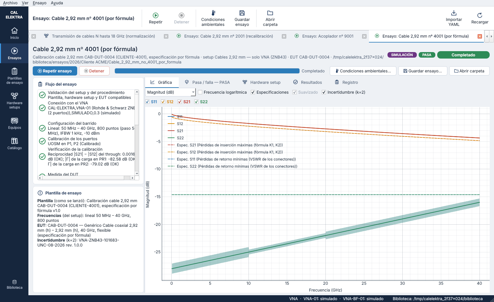
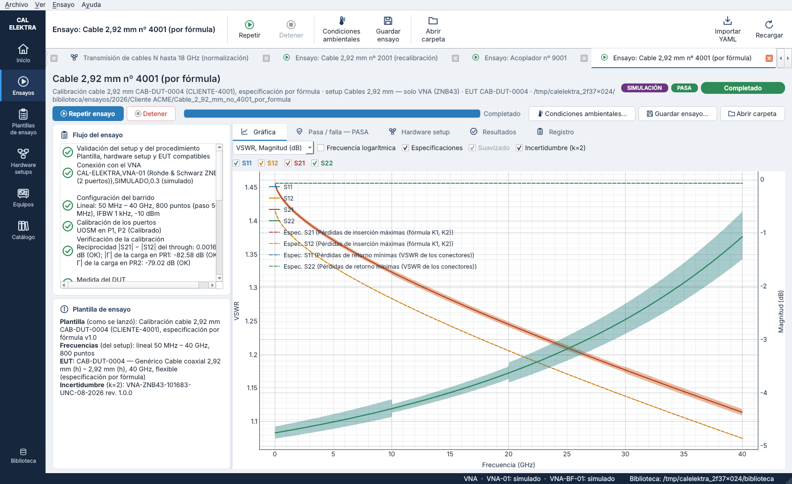
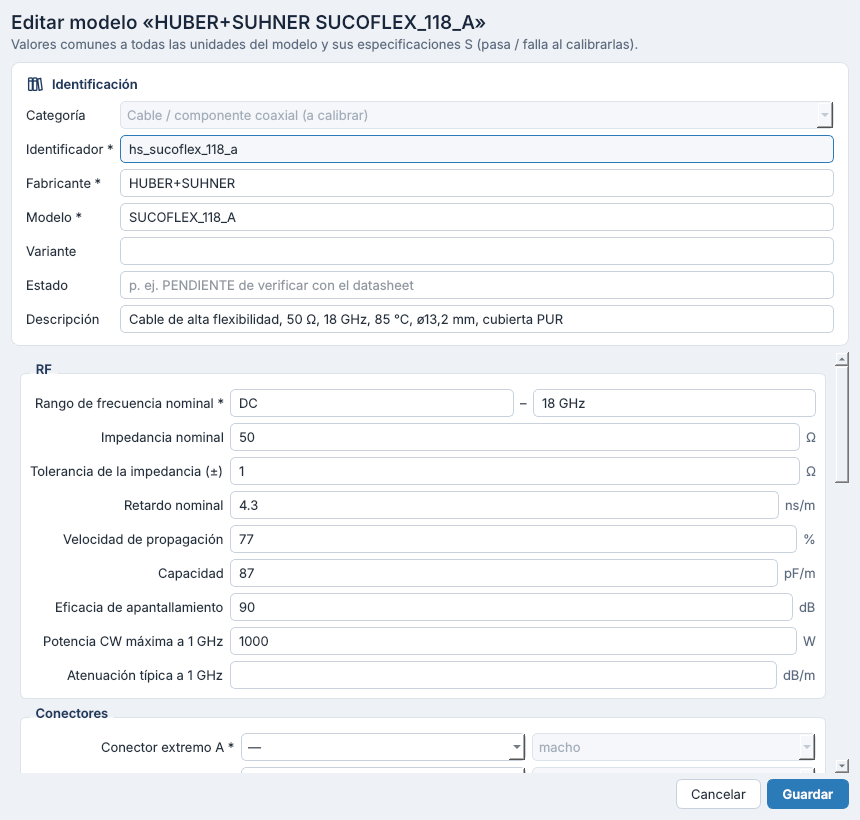
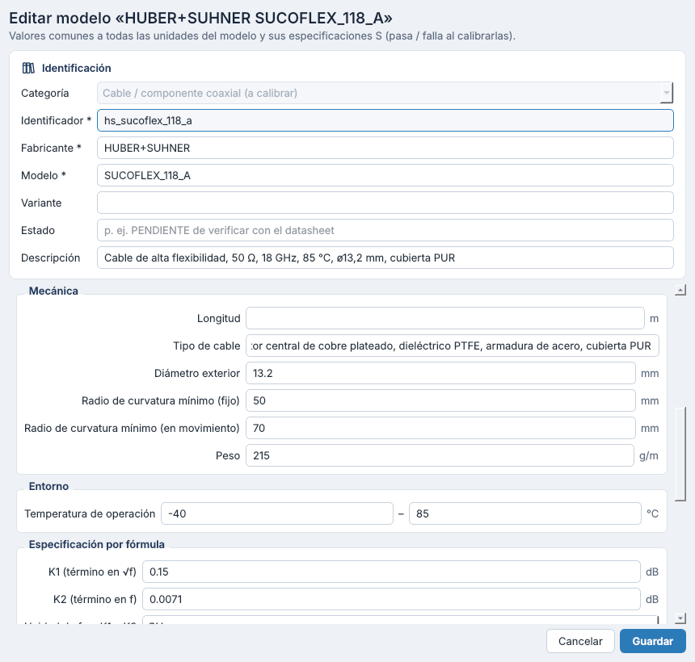
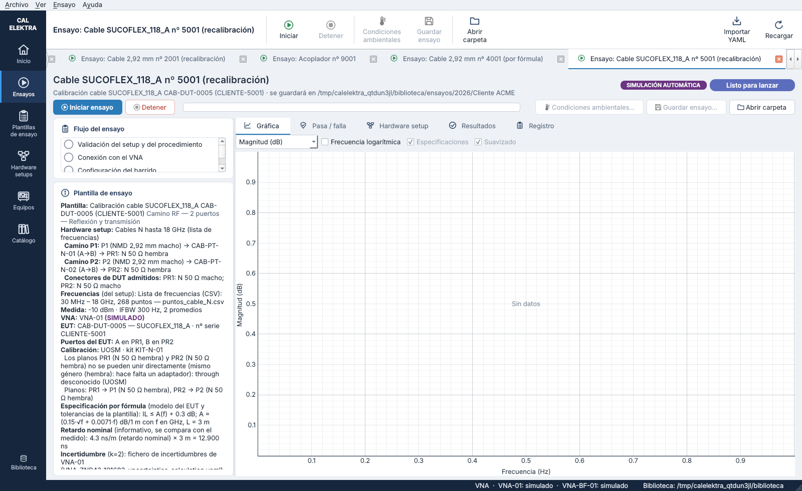
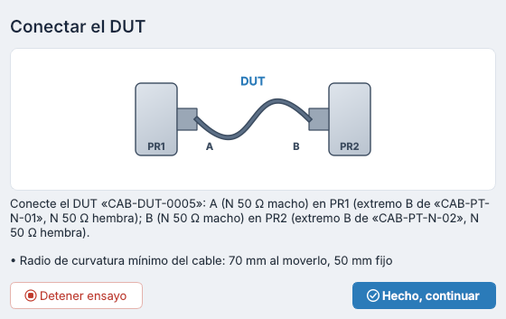

# Especificación de cables por fórmula (K1, K2 y VSWR de los conectores) y datos de la hoja — versiones 0.9 y 0.9.1

Hasta ahora, el pasa / falla de un cable se daba con **ficheros S2P** del modelo: la máscara de las pérdidas de inserción máximas y de las pérdidas de retorno mínimas, siempre en negativo (|S21| ≥ máscara, |S11| ≤ máscara).

Ahora hay una **segunda forma**: los datos de la hoja del fabricante.
- **En el modelo del cable:** los coeficientes K1 y K2 de la atenuación y el VSWR de sus conectores.
- **En cada unidad:** su longitud.
- **En la plantilla de ensayo:** las tolerancias que dan los límites del pasa / falla.

Las dos formas pueden convivir en un mismo modelo; entonces se evalúan las dos.

## 1. Datos del modelo del cable

Campos nuevos de la categoría «cable», en el grupo **Especificación por fórmula** del modelo:

| Campo | Clave YAML | Valores |
|---|---|---|
| K1 (término en √f) | `k1_atenuacion` | dB por la longitud de referencia |
| K2 (término en f) | `k2_atenuacion` | dB por la longitud de referencia |
| Unidad de f en K1 y K2 | `unidad_frecuencia_k` | `Hz`, `kHz`, `MHz`, `GHz` |
| K1 y K2 por cada | `longitud_normalizacion_k` | `1 m`, `100 m`, `1 ft`, `100 ft`, `1 in` |
| VSWR del conector A | `vswr_conector_a` | VSWR (≥ 1) |
| VSWR del conector B | `vswr_conector_b` | VSWR; si no se indica, el del conector A |

La **longitud del cable** es su campo «Longitud» (`longitud_m`, en metros). Lo normal es darla en cada unidad del inventario; si no, vale la del modelo.

```yaml
# catalogo/modelos/cable_coaxial_292_hh_k.yaml (extracto)
campos:
  k1_atenuacion: 0.26              # dB/100 ft por √MHz
  k2_atenuacion: 0.00091           # dB/100 ft por MHz
  unidad_frecuencia_k: MHz
  longitud_normalizacion_k: 100 ft
  vswr_conector_a: 1.15
  vswr_conector_b: 1.15
```

## 2. Tolerancias de la plantilla de ensayo

| Tolerancia | Clave YAML | Límite |
|---|---|---|
| Pérdidas de inserción (dB) | `tolerancias_cable.perdidas_insercion_db` | IL_máx(f) = A(f) + t_IL |
| VSWR (%) | `tolerancias_cable.vswr_pct` | VSWR_máx = VSWR_cable · (1 + t_VSWR / 100) |

```yaml
# procedimientos/cable_CAB-DUT-0004.yaml (extracto)
tolerancias_cable:
  perdidas_insercion_db: 0.5   # IL máx. = A(f) + 0,5 dB
  vswr_pct: 10                 # VSWR máx. = VSWR del cable · 1,10
```

- En el editor de plantillas están en la tarjeta del EUT, en «Especificación por fórmula (cables): tolerancias». Ahí también se ve la fórmula y el VSWR del cable del EUT elegido.
- «— (sin tolerancia)» deja el límite en el valor nominal. La comprobación avisa: «La plantilla no fija las tolerancias del cable».
- Valen para los ensayos de parámetros S (`vna_2_puertos`) y de transmisión (`vna_transmision`). En la transmisión solo se mide S21, así que solo se evalúan las pérdidas de inserción.

## 3. Cálculo

### 3.1 Atenuación nominal

```
A(f) = ( K1·√(f/u) + K2·(f/u) ) · L / L_ref                 [dB]
```

| Símbolo | Significado |
|---|---|
| f | Frecuencia medida (Hz) |
| u | Unidad de f de los coeficientes: 1 Hz, 1 kHz, 1 MHz o 1 GHz |
| L | Longitud del cable (m) |
| L_ref | Longitud de referencia de los coeficientes, en metros: 1 m, 100 m, 0,3048 m (1 ft), 30,48 m (100 ft) o 0,0254 m (1 in) |

K1 es el término del conductor (efecto pelicular, ∝ √f) y K2 el del dieléctrico (∝ f), como en las hojas de datos.

**Ejemplo:** K1 = 0,26 y K2 = 0,00091 dB/100 ft con f en MHz, cable de 1,5 m, a 40 GHz (f/u = 40 000):

```
A = (0,26·200 + 0,00091·40 000) · 1,5 / 30,48 = 88,4 · 0,04921 = 4,350 dB
IL_máx = 4,350 + 0,5 = 4,850 dB        →  |S21|, |S12| ≥ −4,850 dB
```

### 3.2 VSWR del cable (suma lineal de las reflexiones)

Cada conector devuelve una parte de la onda:

```
|Γ_i| = (VSWR_i − 1) / (VSWR_i + 1)
```

La reflexión es pequeña, así que se supone que el primer conector deja pasar toda la onda. El cable devuelve lo que refleja el primer conector más lo que refleja el segundo, que vuelve entero. En el peor caso las dos están en fase y se suman linealmente:

```
|Γ_cable|  = |Γ_A| + |Γ_B|
VSWR_cable = (1 + |Γ_cable|) / (1 − |Γ_cable|)
VSWR_máx   = VSWR_cable · (1 + t_VSWR / 100)
|Γ_máx|    = (VSWR_máx − 1) / (VSWR_máx + 1)
RL_mín     = −20·log10 |Γ_máx|                 →  |S11|, |S22| ≤ −RL_mín
```

La segunda reflexión no se atenúa con la ida y vuelta por el cable. Es la decisión tomada: el peor caso, independiente de la frecuencia.

**Ejemplo:** conectores de VSWR 1,15:

```
|Γ_A| = |Γ_B| = 0,15 / 2,15 = 0,06977      →  |Γ_cable| = 0,13953
VSWR_cable = 1,13953 / 0,86047 = 1,3243
VSWR_máx = 1,3243 · 1,10 = 1,4568           →  |Γ_máx| = 0,18592  →  RL_mín = 14,61 dB
```

### 3.3 Pasa / falla

- Se evalúa dentro del **rango de frecuencia nominal** del cable (su `rango_frecuencia`), con los mismos criterios que los ficheros S2P:
  - pérdidas de inserción: margen = |S21| (dB) − (−IL_máx(f)) ≥ 0;
  - pérdidas de retorno: margen = −RL_mín − |S11| (dB) ≥ 0.
- La evaluación da dos especificaciones, cada una con sus parámetros (S21 y S12; S11 y S22), con resultado y margen mínimo:
  - «Pérdidas de inserción máximas (fórmula K1, K2)»;
  - «Pérdidas de retorno mínimas (VSWR de los conectores)».
- El veredicto del ensayo junta estas y las de los ficheros S2P, si las hay: FALLA si alguna falla, PASA si todas pasan y NO EVALUADO en otro caso.
- Como en el resto del programa, el pasa / falla compara el valor medido con el límite y **no usa la incertidumbre**.

### 3.4 Datos que faltan

La comprobación previa avisa de lo que no se puede evaluar, y el resto se evalúa igual:

| Falta | Efecto |
|---|---|
| La longitud del cable, la unidad de f o la longitud de referencia | No se evalúan las pérdidas de inserción |
| El VSWR de los conectores | No se evalúan las pérdidas de retorno |
| \|Γ_A\| + \|Γ_B\| ≥ 1 (VSWR muy altos) | No se evalúan las pérdidas de retorno |
| Las tolerancias en la plantilla | Los límites son los valores nominales (aviso) |

## 4. Dónde se ve

- **Comprobación de la plantilla y ventana del ensayo**:
  - línea «Especificación por fórmula» con la fórmula, la longitud, el VSWR de los conectores y el del cable, y los límites;
  - las curvas límite en la gráfica desde el principio del ensayo: discontinuas, en dB y en VSWR.
- **Tabla «Pasa / falla»:** una fila por especificación y parámetro, con el criterio, por ejemplo «IL ≤ A(f) + 0,5 dB; A = (0,26·√f + 0,00091·f) dB/100 ft con f en MHz, L = 1,5 m» o «VSWR ≤ 1,457 (RL ≥ 14,61 dB): conectores 1,15 y 1,15 → cable 1,324 + 10 %».
- **Registro del ensayo** (`especificacion_cable`): lo que se usó, para dibujar los límites después y para la trazabilidad:
  - K1 y K2, sus unidades, la longitud y el VSWR de los conectores;
  - las tolerancias;
  - el VSWR del cable, el VSWR máximo, el RL mínimo y el rango nominal.

## 5. Ejemplo de la biblioteca

| Pieza | Fichero |
|---|---|
| Modelo | `catalogo/modelos/cable_coaxial_292_hh_k.yaml`: cable 2,92 mm (h) – (h) flexible; K1 = 0,26, K2 = 0,00091 dB/100 ft con f en MHz; conectores de VSWR 1,15 |
| Unidad | `catalogo/equipos/CAB-DUT-0004.yaml`: 1,5 m |
| Plantilla | `procedimientos/cable_CAB-DUT-0004.yaml`: setup «Cables 2,92 mm — solo VNA (ZNB43)»; +0,5 dB y +10 % |

Con el VNA simulado el ensayo **PASA**:
- pérdidas de inserción con un margen mínimo de +0,49 dB a 39,9 GHz;
- pérdidas de retorno con +1,39 dB a 40 GHz.

Sin tolerancias **FALLA**, porque la pérdida medida queda unas centésimas por encima de A(f). Los tests lo comprueban.

| | |
|---|---|
|  |  |
|  |  |

## 6. Datos de la hoja del cable (versión 0.9.1)

El modelo de un cable puede llevar más datos de su hoja de datos. Son los que da, por ejemplo, la del HUBER+SUHNER SUCOFLEX_118_A (*Preliminary data sheet*, documento PIM-P44906 de 02/10/2026). El PDF no se guarda en la biblioteca: el modelo lo cita en sus `documentos`.

Son campos nuevos de la categoría «cable», todos del **modelo** (`nivel: modelo`):

| Campo | Clave YAML | Grupo | Uso |
|---|---|---|---|
| Impedancia nominal (Ω) | `impedancia_nominal_ohm` | RF | Aviso si no es la impedancia de referencia del VNA (§ 6.3) |
| Tolerancia de la impedancia (± Ω) | `tolerancia_impedancia_ohm` | RF | Margen de ese aviso |
| Retardo nominal (ns/m) | `retardo_ns_m` | RF | Retardo nominal del cable, que se compara con el medido (§ 6.1) |
| Velocidad de propagación (%) | `velocidad_propagacion_pct` | RF | Da el retardo nominal si falta el anterior; si están los dos, se comprueba que concuerden |
| Capacidad (pF/m) | `capacidad_pf_m` | RF | Informativo |
| Eficacia de apantallamiento (dB) | `apantallamiento_db` | RF | Informativo |
| Potencia CW máxima a 1 GHz (W) | `potencia_cw_1ghz_w` | RF | Informativo; como en las hojas, P(f) = P(1 GHz) / √f[GHz] |
| Diámetro exterior (mm) | `diametro_mm` | Mecánica | Informativo |
| Radio de curvatura mínimo, fijo y en movimiento (mm) | `radio_curvatura_estatico_mm`, `radio_curvatura_dinamico_mm` | Mecánica | Se recuerda al operador al conectar el cable (§ 6.4) |
| Peso (g/m) | `peso_g_m` | Mecánica | Informativo |
| Temperatura de operación (°C) | `temperatura_operacion_c` | Entorno | Informativo (rango) |
| Grupo de conectores | `grupo_conectores` | Conectores | Informativo: los conectores que admite el cable según su fabricante (p. ej. U98) |

La **atenuación típica** de la hoja, a·√f + b·f, es la especificación por fórmula del apartado 3.1, con K1 = a y K2 = b en sus unidades. En el SUCOFLEX_118_A son a = 0,15 y b = 0,0071 dB/m con f en GHz:

```yaml
# catalogo/modelos/hs_sucoflex_118_a.yaml (extracto)
campos:
  k1_atenuacion: 0.15              # a de la hoja: dB/m por √GHz
  k2_atenuacion: 0.0071            # b de la hoja: dB/m por GHz
  unidad_frecuencia_k: GHz
  longitud_normalizacion_k: 1 m
  impedancia_nominal_ohm: 50
  tolerancia_impedancia_ohm: 1
  retardo_ns_m: 4.3
  velocidad_propagacion_pct: 77
  radio_curvatura_estatico_mm: 50
  radio_curvatura_dinamico_mm: 70
```

Un modelo de cable lleva sus conectores y el VSWR de estos (`vswr_conector_a`, `vswr_conector_b`), nunca la unidad: el mismo cable con otros conectores es **otro modelo**. El del ejemplo es el SUCOFLEX_118_A con conectores N macho (grupo U98). La hoja del cable no da el VSWR de los conectores; sin él no se evalúan las pérdidas de retorno.

### 6.1 Retardo nominal (informativo)

```
τ'    = retardo_ns_m                                 [ns/m]
τ'    = 10⁹ / (v/100 · c) = 333,564 / v              (sin retardo, con la velocidad de propagación v en %)
τ_nom = τ' · L                                       [ns]
```

| Símbolo | Significado |
|---|---|
| τ' | Retardo nominal por metro |
| v | Velocidad de propagación (% de c) |
| c | 299 792 458 m/s |
| L | Longitud del cable (`longitud_m`) |

- **Ambos datos.** Si el modelo da el retardo y la velocidad, manda el retardo. La comprobación previa avisa si difieren en más de un 2 %. Ejemplo de aviso: «Retardo nominal de «CAB-…»: el retardo nominal (4 ns/m) no concuerda con la velocidad de propagación (77 % → 4,332 ns/m)». En el SUCOFLEX_118_A, 4,3 ns/m y 77 % (→ 4,332 ns/m) difieren un 0,7 %, así que concuerdan.
- **Sin retardo nominal.** No lo hay si falta la longitud, o si faltan a la vez el retardo y la velocidad.
- **Ensayos.** Vale para los de parámetros S (`vna_2_puertos`) y los de transmisión (`vna_transmision`).
- **Veredicto.** Es **solo informativo**: no entra en el pasa / falla.

El registro del ensayo guarda en `resultados`:

| Clave | Contenido |
|---|---|
| `retardo_ns` | Retardo medido τ_med (§ 6.2) |
| `retardo_nominal.ns_por_metro` | τ' |
| `retardo_nominal.origen` | «retardo nominal» o «velocidad de propagación v %» |
| `retardo_nominal.longitud_m` | L |
| `retardo_nominal.nominal_ns` | τ_nom |
| `retardo_nominal.diferencia_ns` | τ_med − τ_nom |
| `retardo_nominal.diferencia_pct` | 100 · (τ_med − τ_nom) / τ_nom |
| `retardo_nominal.longitud_estimada_m` | τ_med / τ': la longitud que corresponde al retardo medido con el τ' de la hoja |

La comprobación de la plantilla y la ventana del ensayo lo anuncian en la línea «Retardo nominal (informativo, se compara con el medido): 4.3 ns/m (retardo nominal) × 3 m = 12.900 ns». La tabla de resultados lo muestra en las filas «retardo nominal · …».

### 6.2 Retardo medido

El retardo medido es la pendiente de la fase de S21, τ = −dφ/dω. Se ajusta por mínimos cuadrados en toda la banda.

Hasta la versión 0.9.0, la fase se desenvolvía punto a punto en toda la banda. Con una lista de frecuencias de pasos grandes, un cable largo gira más de media vuelta entre dos puntos; con pasos de 100 MHz, eso pasa a partir de 5 ns. El desenvolvimiento se confundía (*aliasing*). Por ejemplo, el cable N de 2 m del ejemplo daba −0,16 ns en lugar de 9,53 ns: lo mide el setup «Cables N hasta 18 GHz (lista de frecuencias)», con pasos de 10 MHz hasta 1 GHz y de 100 MHz después.

Ahora `transmission_delay` (`core/networks.py`) calcula el retardo así:

1. **Primer retardo τ₁.** Se ajusta en el tramo más largo de puntos con el paso más fino Δf. Resuelve retardos de hasta 1/(2·Δf): 50 ns con pasos de 10 MHz.
2. **Corrección.** Se quita τ₁ a toda la banda y se desenvuelve la fase que queda, que ya cambia poco de un punto a otro. Su pendiente corrige τ₁.
3. **Paso demasiado grueso.** Si ni el paso más fino basta, el retardo es ambiguo en múltiplos de 1/Δf. Cuando el retardo nominal es mayor que 0,4/Δf, se toma el candidato más cercano a él.

Con una rejilla uniforme de pasos finos, el resultado es el de antes. Los ensayos ya guardados no cambian.

### 6.3 Impedancia nominal

La comprobación previa avisa si `impedancia_nominal_ohm` difiere de la impedancia de referencia del VNA (`impedancia_ref_ohm`) en más de la tolerancia (`tolerancia_impedancia_ohm`; 0 si no se da). El aviso no impide el ensayo:

> «CAB-…» es de 75 Ω y el VNA mide con 50 Ω: las pérdidas de retorno medidas incluyen el desajuste de impedancias

Por ejemplo, un cable de 75 Ω perfecto medido en 50 Ω refleja |Γ| = 25/125 = 0,2 en cada extremo (VSWR 1,5).

### 6.4 Radio de curvatura

La petición «Conectar el DUT» añade el radio de curvatura mínimo del modelo: «Radio de curvatura mínimo del cable: 70 mm al moverlo, 50 mm fijo».

### 6.5 Simulación

Con el VNA simulado, el cable:
- se propaga a su velocidad de propagación, o a la de su retardo nominal; si no tiene ninguno de los dos, al 70 %;
- pierde la atenuación nominal A(f) de K1 y K2 si el modelo no da la atenuación típica a 1 GHz (`atenuacion_db_m_1ghz`).

Así, el SUCOFLEX_118_A simulado se propaga al 77 % (4,332 ns/m), un poco más lento que los 4,3 ns/m de su hoja, y se ve la diferencia.

### 6.6 Ejemplo: SUCOFLEX_118_A

| Pieza | Fichero |
|---|---|
| Modelo | `catalogo/modelos/hs_sucoflex_118_a.yaml`: hasta 18 GHz, 50 ± 1 Ω, 4,3 ns/m, 77 %, 87 pF/m, apantallamiento de 90 dB, 1000 W a 1 GHz, ø13,2 mm, curvatura mínima de 50 mm fijo y 70 mm en movimiento, 215 g/m, de −40 °C a +85 °C, conectores N macho (grupo U98); K1 = 0,15 y K2 = 0,0071 dB/m con f en GHz |
| Unidad | `catalogo/equipos/CAB-DUT-0005.yaml`: 3 m |
| Plantilla | `procedimientos/cable_CAB-DUT-0005.yaml`: setup «Cables N hasta 18 GHz (lista de frecuencias)»; IL máx. = A(f) + 0,3 dB |

La fórmula reproduce la tabla de atenuación de la hoja: A = 0,157 dB/m a 1 GHz y 0,764 dB/m a 18 GHz.

Con el VNA simulado, el ensayo **PASA**:
- pérdidas de inserción con un margen mínimo de +0,30 dB (S21 a 9,4 GHz);
- no se evalúan las pérdidas de retorno, porque la hoja no da el VSWR de los conectores;
- retardo medido de 12,996 ns frente a 12,900 ns nominales (4,3 ns/m × 3 m): +0,096 ns (+0,74 %), longitud estimada de 3,022 m.

| | |
|---|---|
|  |  |
|  |  |
|  | |

## 7. Ficheros del código

| Fichero | Contenido |
|---|---|
| `procedures/cable_specs.py` | `CableSpecification`: atenuación nominal, VSWR del cable, límites, curvas, evaluación y registro; `cable_specification` a partir de los campos. `CableDelay` y `cable_delay`: retardo nominal y su comparación con el medido |
| `core/networks.py` | `transmission_delay`: retardo medido de una transmisión (§ 6.2) |
| `procedures/model.py` | `CableTolerances` (`tolerancias_cable` de la plantilla) |
| `procedures/engine.py` | Comprobación previa (`RunPlan.cable_spec`, `RunPlan.cable_delay`, aviso de impedancia), paso «Evaluación pasa / falla», radio de curvatura en la petición al operador y `retardo_nominal` del registro |
| `instruments/simulation.py` | Cable simulado con su velocidad de propagación y su atenuación nominal |
| `procedures/specs.py` | `entries_verdict`: veredicto de todas las evaluaciones del registro |
| `gui/procedures_view.py` | Tolerancias en el editor de plantillas |
| `gui/test_common.py` | Línea de la comprobación y curvas límite (del plan y del registro) |
| `tests/test_cable_specs.py` | Unidades, suma de reflexiones, datos que faltan, evaluación, ensayo de ejemplo, retardo medido y nominal, ejemplo SUCOFLEX_118_A y aviso de impedancia |
