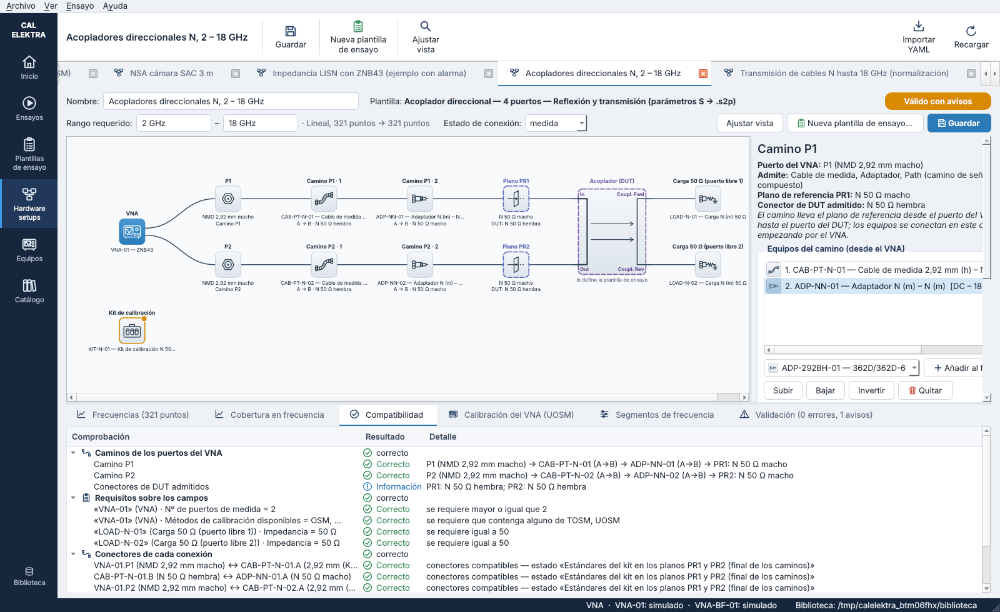
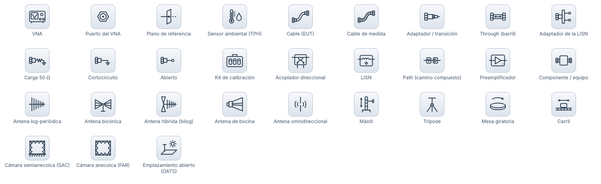
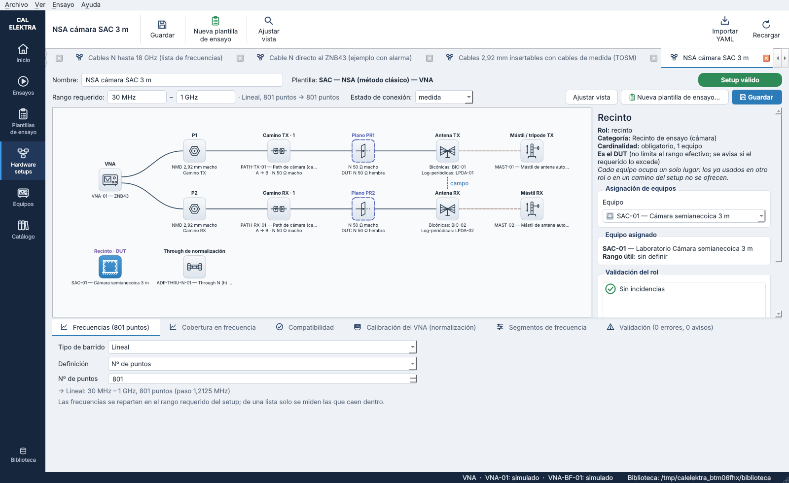
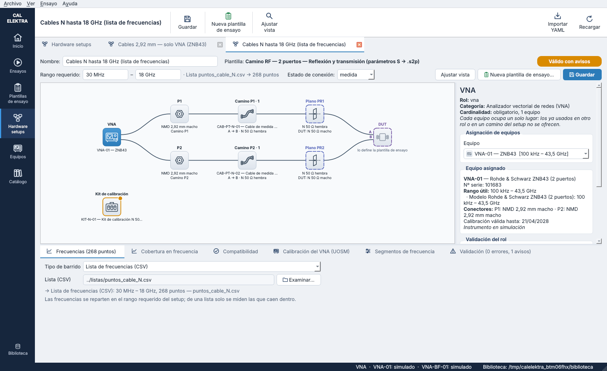
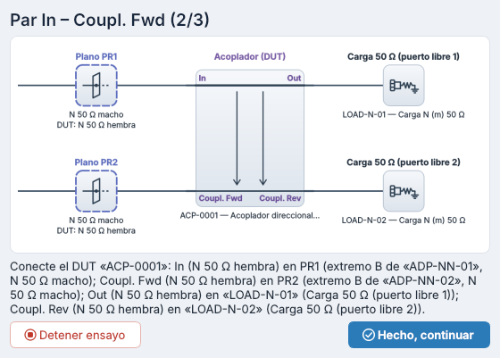
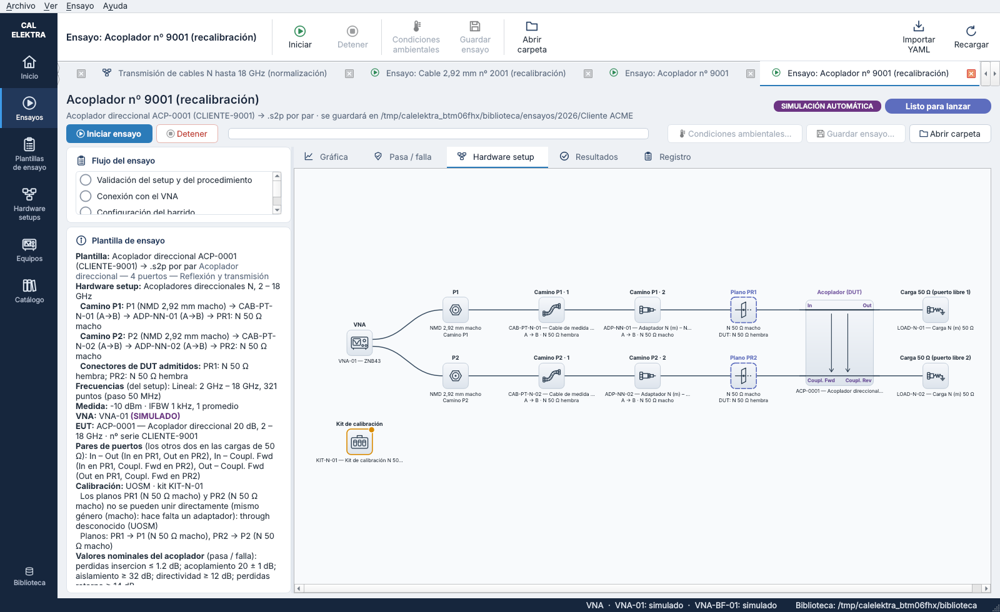

# Iconos de los equipos y conexiones en los hardware setups — versión 0.9.2

Los diagramas de los hardware setups se dibujan ahora como en ELEKTRA. Cada equipo es el **icono de su familia** sobre una tesela clara, con el nombre del rol encima y el equipo y sus conectores debajo. Las conexiones unen los lados de las teselas.

El estilo lo eligió el laboratorio entre tres propuestas:
- **tesela clara** (la elegida);
- solo línea;
- tesela del color de la familia.

Además, un **acoplador direccional** se dibuja con sus cuatro puertos, conectados a donde van en la realidad (§ 3). Al calibrarlo, cada par de puertos se ve con sus conexiones (§ 4).

## 1. Iconos

Son dibujos de líneas sencillas en un solo tono, hechos con QPainter en una rejilla de 48 × 48 (`gui/equipment_icons.py`), sin ficheros de imagen. El icono sale de la **categoría** del equipo y, cuando cambia el dibujo, de su campo **`tipo`**:

| Categoría | Icono |
|---|---|
| `vna` | VNA: pantalla con una traza y los puertos |
| `cable` | Cable (EUT) |
| `cable_medida` | Cable de medida (con malla) |
| `adaptador` | Según `tipo`: `coaxial` → adaptador / transición; `through` → barril; `lisn` → adaptador de la LISN |
| `carga` | Según `tipo`: `carga_50`, `cortocircuito` o `abierto` |
| `kit_calibracion` | Maletín con los estándares |
| `acoplador` | Acoplador direccional |
| `lisn` | LISN: línea de red con su bobina y el puerto de medida |
| `path` | Path: camino con varios componentes |
| `preamplificador` | Amplificador |
| `antena` | Según `tipo`: bicónica, log-periódica, híbrida, bocina u omnidireccional (S_VSWR); sin tipo, log-periódica |
| `posicionador` | Según `tipo`: mástil, trípode, mesa giratoria o carril |
| `recinto` | Según `tipo`: cámara semianecoica (SAC), anecoica (FAR) o emplazamiento abierto (OATS) |
| `sensor_ambiental` | Sonda TPH: termómetro y humedad |

Hay además tres iconos que no son de una categoría:
- el **puerto del VNA** y el **plano de referencia**, que son nodos del diagrama;
- **componente / equipo**, para una categoría sin icono propio o para un rol que admite familias con iconos distintos y aún no tiene equipo. Es el caso del EUT de la plantilla de impedancia, que puede ser una carga, una antena, una LISN…

## 2. Los nodos del diagrama

| Parte | Contenido |
|---|---|
| Rótulo (arriba) | El rol: VNA, P1, Camino P1 · 1, Plano PR1, Acoplador (DUT)…; el DUT en morado y los planos en índigo |
| Tesela | El icono del equipo asignado o, sin equipo, el de la categoría del rol |
| Texto (debajo) | El equipo (ID — modelo) y, en los caminos, el sentido y el conector del lado del DUT |

El estado del rol se ve en la tesela:

| Estado | Tesela |
|---|---|
| Correcto | Borde gris fino |
| Sin equipo | Borde discontinuo e icono gris: rojo si el rol es obligatorio, gris si es opcional, morado si es el DUT (lo pone la plantilla de ensayo) |
| Aviso o error de la validación | Borde y punto naranja (aviso) o rojo (error) |
| Plano de referencia | Siempre con borde índigo discontinuo |
| Seleccionado | Tesela azul con el icono en blanco, como en ELEKTRA |

- **Conexiones.** Llegan a los lados de las teselas. Si varias llegan al mismo lado, se reparten a lo largo de él.
- **Puertos del EUT.** Se nombran donde llega su conexión, por ejemplo A y B de un cable. Si el rol admite familias con puertos de nombres distintos y aún no tiene equipo, no se nombran: los nombra la plantilla de ensayo al elegir el EUT.
- **Editor de setups.** La lista «Equipos del camino» y los selectores de equipos llevan el icono de cada equipo.
- **Recolocar nodos.** La acción del mismo nombre vuelve a la colocación automática y olvida los nodos movidos a mano. Úsela si un setup guardado con nodos movidos antes de esta versión se ve descolocado: los nodos tienen ahora otro tamaño.

| | |
|---|---|
|  |  |

## 3. El acoplador direccional, con sus puertos

Cuando el EUT es un acoplador de cuatro puertos conectado a dos planos, se dibuja como una caja con sus dos líneas:
- la **línea principal** (In – Out), más gruesa;
- la **línea acoplada** (Coupl. Fwd – Coupl. Rev);
- unas flechas que indican el acoplamiento entre las dos.

Cada puerto va en una esquina, con su nombre, y su conexión llega a ella. Las reglas son:

1. **Izquierda: los planos.** Los dos puertos conectados a los planos van a la izquierda, el de PR1 arriba y el de PR2 abajo.
2. **Derecha: las cargas.** Los dos puertos que van a las cargas de 50 Ω van a la derecha, cada uno enfrente de su carga.
3. **Orientación de las líneas.** Si los dos puertos de los planos son los extremos de una misma línea (In – Out), las líneas son verticales. Si no, son horizontales, y la línea del puerto de PR1 va arriba.
4. **Extremos.** In y Coupl. Fwd están en el mismo extremo del acoplador; Out y Coupl. Rev, en el otro.

| Par | PR1 | PR2 | Cargas de 50 Ω | Líneas |
|---|---|---|---|---|
| In – Out | In | Out | Coupl. Fwd y Coupl. Rev | Verticales |
| In – Coupl. Fwd | In | Coupl. Fwd | Out y Coupl. Rev | Horizontales |
| Out – Coupl. Fwd | Out | Coupl. Fwd | In y Coupl. Rev | Horizontales |

En el editor de setups, el estado de conexión «medida» de la plantilla «Acoplador direccional — 4 puertos» es el primer par: In en PR1, Out en PR2 y los acoplados en las cargas.

## 4. Al calibrar un acoplador

- **Petición al operador.** La de cada par («Par In – Coupl. Fwd (2/3)») muestra el acoplador conectado como para ese par: los planos, el acoplador con sus puertos y las cargas. Es el mismo dibujo que el diagrama, cortado al final de los caminos (`connection_picture`), y va encima del texto con los conectores.
- **Pestaña «Hardware setup» de la ventana del ensayo.** Muestra el setup completo con las conexiones del par que se está conectando. Al terminar el ensayo, vuelve al setup tal como está definido.
- **Petición del motor.** Cada petición de conexión dice para qué medida es (`PromptRequest.measurement`: «DUT» o el par, «In-Out»…).

| | |
|---|---|
|  |  |

## 5. Ficheros del código

| Fichero | Contenido |
|---|---|
| `gui/equipment_icons.py` | Los iconos: dibujos, `glyph_for` (categoría y tipo → icono), `paint_icon`, `paint_tile` e `icon_pixmap` |
| `gui/setup_diagram.py` | Nodos con icono, conexiones a las teselas, nombres de los puertos del EUT, el acoplador con sus puertos (`coupler_layout`) y el dibujo de la conexión del EUT (`connection_picture`) |
| `gui/setup_editor.py` | Iconos en la lista de equipos del camino y en los selectores; «Recolocar nodos» |
| `gui/test_window.py` | El dibujo de cada par en la petición al operador y en la pestaña «Hardware setup» |
| `procedures/engine.py` | `PromptRequest.measurement` |
| `tools/capturas.py` | La lámina de iconos (`15_iconos_equipos.png`) y las capturas de los pares |
| `tests/test_equipment_icons.py` | Icono de cada categoría y tipo, dibujo de todos, esquinas del acoplador, diagramas de ejemplo, pares del acoplador, ventana del ensayo y «Recolocar nodos» |
