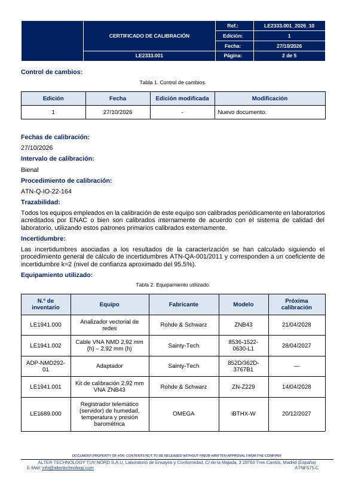
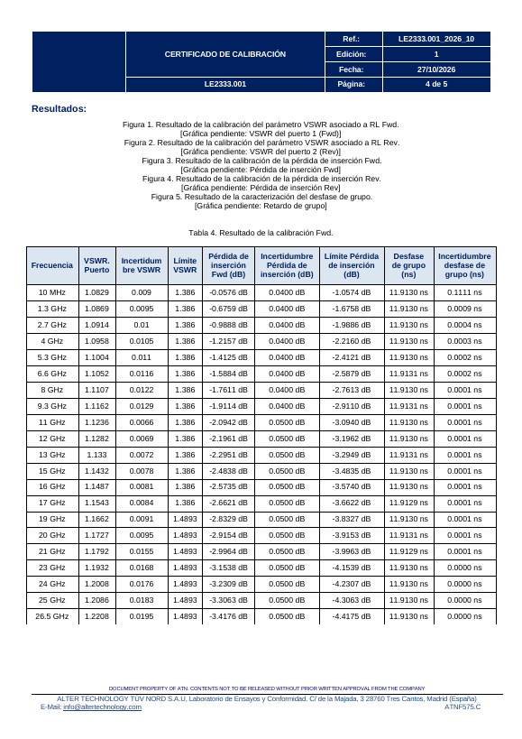
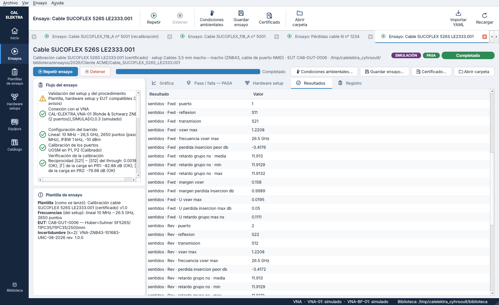
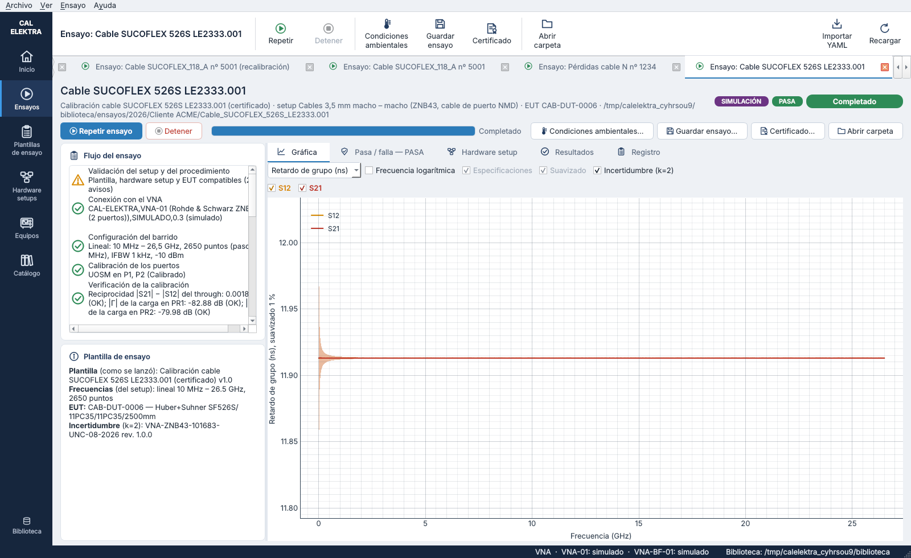
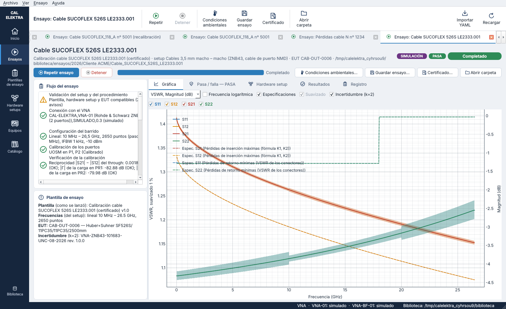
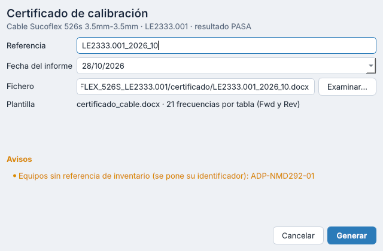
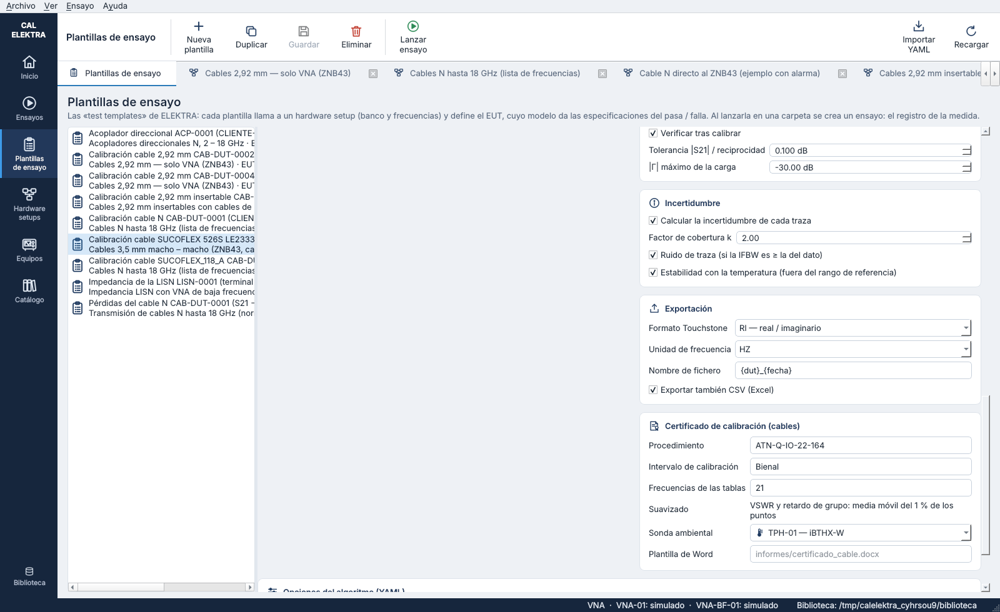
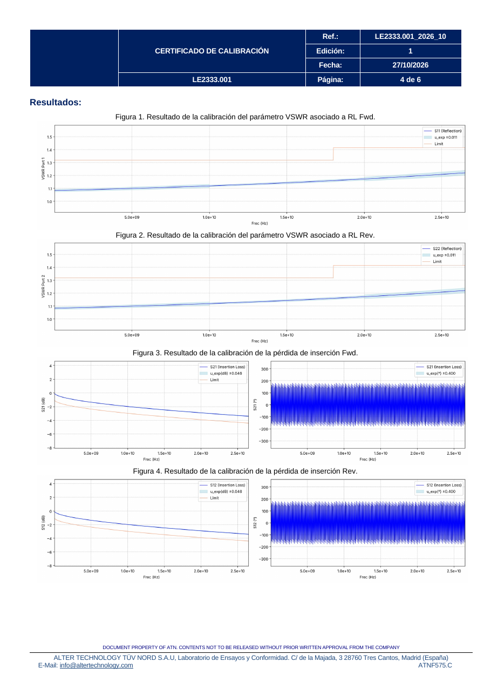
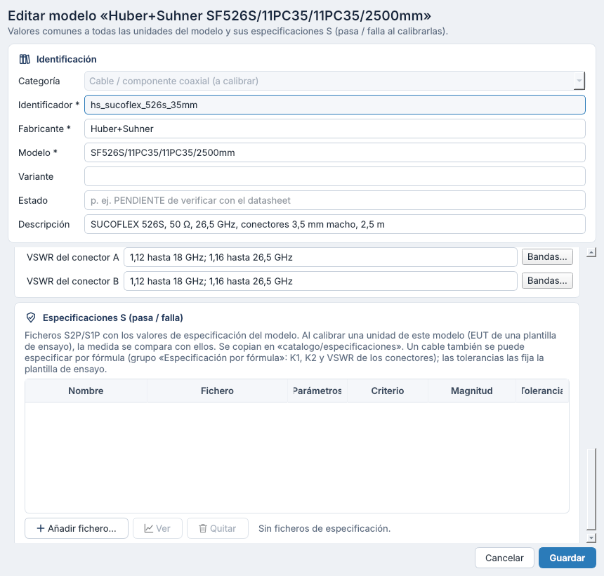
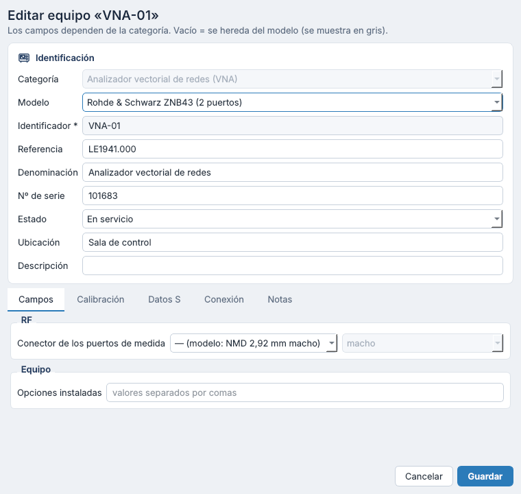

# Certificado de calibración de cables — versiones 0.10 a 0.10.2

Esta versión calcula todo lo que da el certificado de calibración de un cable del laboratorio y lo genera en Word con su plantilla:

1. **Resultados por sentido** (Fwd y Rev): el VSWR de cada puerto, la pérdida de inserción en los dos sentidos y el retardo de grupo, cada uno con su incertidumbre (§1).
2. **Retardo de grupo en las gráficas:** la unidad «Retardo de grupo (ns)», el paso de fase a tiempo (§2).
3. **Certificado en Word** con la plantilla del laboratorio, desde la ventana del ensayo o el explorador (§3).
4. **VSWR de los conectores por bandas**, introducidas en una tabla, con la tolerancia sobre el VSWR del cable ensamblado ([`11_especificacion_de_cables_por_formula.md`](11_especificacion_de_cables_por_formula.md)).
5. **Referencia de inventario y denominación** de cada equipo, por ejemplo LE2333.001 (§6).

Las gráficas del certificado tienen el formato de las del laboratorio (§4).

**0.10.1.** Con el S2P de vuestro certificado LE2333.001_2026_10, el programa reproduce exactamente sus tablas Fwd y Rev (§8). Además:
- la tolerancia del VSWR vuelve a aplicarse al cable ensamblado;
- las bandas de VSWR se introducen en una tabla;
- las filas de un barrido logarítmico van espaciadas logarítmicamente;
- el diálogo del certificado carga el Excel de la sonda si faltan las condiciones;
- los pies de las figuras 1 y 2 quedan confirmados (Fwd = S11).

**0.10.2.**
- **Suavizado del 1 %, siempre**, del VSWR y del retardo de grupo: en las tablas y las gráficas del certificado y en las gráficas del programa (§2, §3.5). Ya no es un ajuste: `informe.suavizado_pct` y `informe.apertura_retardo` se leen y se ignoran.
- **Las cinco gráficas del certificado**, con el formato del código de gráficas del laboratorio (§4).
- **Incertidumbre del VSWR:** el laboratorio confirma el factor 2 de la derivada y, en Rev, el rango de nivel de S22. El programa ya la calculaba así; ahora un test lo comprueba (§8.2).

| | |
|---|---|
|  |  |

## 1. Resultados por sentido

Los calcula `procedures/cable_results.py` en todo ensayo de parámetros S (`vna_2_puertos`), al exportar la medida:

| Sentido | VSWR | Pérdida de inserción y retardo de grupo |
|---|---|---|
| Fwd | Puerto 1 (S11) | S21 |
| Rev | Puerto 2 (S22) | S12 |

Las fórmulas, también las de la incertidumbre, están en [`10_algoritmos_de_incertidumbre.md`](10_algoritmos_de_incertidumbre.md) §5. Los límites son los de la especificación por fórmula del cable, dentro de su rango nominal.

Dónde quedan:
- **CSV** `<resultado>_fwd_rev.csv`, junto al .s2p: punto a punto, por sentido, el valor, su U y su límite. El VSWR va dos veces, el del punto y el suavizado al 1 %; el retardo de grupo, suavizado.
- **Registro**, `resultados.sentidos`: el VSWR máximo y dónde, la pérdida de inserción peor, el retardo de grupo (media, mínimo y máximo), los márgenes mínimos, las U máximas y el suavizado (`suavizado_pct: 1`, `suavizado_puntos`). Se ve en la pestaña «Resultados».
- **Veredicto y márgenes:** con el VSWR de cada punto, sin suavizar.
- **Condiciones ambientales:** al cargarlas se recalcula la incertidumbre y se reescriben el CSV y `sentidos`.



## 2. Retardo de grupo en las gráficas

Las gráficas de parámetros S tienen una unidad más: **«Retardo de grupo (ns)»**.
- Solo se dibujan las transmisiones (S21, S12).
- El retardo es el del laboratorio: −Δφ/Δω entre puntos consecutivos, con media móvil del 1 % de los puntos (§3.5; `group_delay` de `core/networks.py`). Con puntos igualmente espaciados es el formato de retardo de un VNA con una apertura del 1 % de los puntos. El eje lo indica: «Retardo de grupo (ns), suavizado 1 %».
- La fase se desenrolla con el retardo de toda la traza, así que una lista de frecuencias con pasos grandes no se confunde.
- La zona sombreada es la incertidumbre del retardo, U_φ / (360°·f). Es grande a baja frecuencia: 0,11 ns a 10 MHz con 0,4° de fase.
- Las especificaciones no se dibujan sobre el retardo.
- **El VSWR también se dibuja siempre suavizado al 1 %** («VSWR, suavizado 1 %»), con la banda de incertidumbre de cada punto alrededor. El suavizado de la plantilla de ensayo (ajustes de trazas) sigue valiendo para las magnitudes en dB y la fase.

| | |
|---|---|
|  |  |

## 3. El certificado

### 3.1 Cómo se genera

- **Acción «Certificado…»:** en la ventana del ensayo y en el explorador de ensayos. Está activa en los ensayos de parámetros S completados.
- **Diálogo:**
  - **Referencia:** la «Ref.» del encabezado y el título del documento. Por defecto es `<referencia del EUT>_<año>_<mes>` del ensayo, por ejemplo `LE2333.001_2026_10`, como el título de la plantilla del laboratorio.
  - **Fecha del informe:** por defecto, hoy.
  - **Fichero:** por defecto, `<carpeta del ensayo>/certificado/<referencia>.docx`.
  - **Avisos:** lo que falta en los datos (§3.6).
  - **«Cargar el Excel de la sonda TPH…»**, si el ensayo aún no tiene las condiciones ambientales. Las condiciones se calculan del mismo .xlsx con el que se completa la incertidumbre: el mínimo y el máximo de las lecturas que cubren el ensayo. Al cargarlo se recalcula la incertidumbre y se actualizan los datos del certificado.
- **Gráficas:** se dibujan al generar el certificado y quedan también como PNG en `<referencia>_figuras/`, junto al .docx (§4).
- **Registro:** guarda `resultados.certificado` (referencia, fecha, fichero, plantilla, `suavizado_pct` y la carpeta de las `figuras`) y añade el fichero a `ficheros`, así que el .zip del ensayo lo incluye.
- **Código:** `generate_certificate(biblioteca, ensayo, fichero, referencia, fecha, figuras)` de `procedures/report.py`. `prepare_certificate` da los datos y los avisos sin escribir nada.



### 3.2 La plantilla de Word

La plantilla es `informes/certificado_cable.docx` de la biblioteca: la plantilla `Plantilla-cables.docx` del laboratorio con etiquetas de [docxtpl](https://docxtpl.readthedocs.io) (Jinja) donde van los datos. El formato es el del laboratorio: portada, encabezado, pie, tablas, estilos y notas al pie.

Cambios respecto al original:

| Original | En la plantilla |
|---|---|
| Datos del ejemplo (LE2333.001, fechas, condiciones, tablas…) | Etiquetas `{{ … }}` (§3.4) |
| Campo DATE en el encabezado y en el control de cambios: Word lo cambia cada vez que se abre | La fecha del informe, fija |
| «Ref.» vacía («[Título]») | La referencia del certificado, también en las propiedades del documento |
| Filas de las tablas de equipos y de resultados | Una fila que se repite (``) |
| Gráficas del ejemplo | `{{ figuras.… }}`: las gráficas del ensayo (§4) |
| Saltos de página manuales | «Salto de página anterior» en «Requisitos de calibración», «Resultados» y la tabla Rev: una tabla más larga ya no deja una página en blanco |
| Numeración guardada de las figuras y tablas (Figura 5 dos veces, Tablas 5 y 5) | Figuras 1 – 5 y Tablas 1 – 5 |
| La tabla Rev decía «Pérdida de inserción Fwd (dB)» | «Pérdida de inserción Rev (dB)» |

- **Editar la plantilla:** el laboratorio puede editarla en Word manteniendo las etiquetas. Cada etiqueta debe quedar entera, con el mismo formato.
- **Otra plantilla:** una plantilla de ensayo puede usar otra con `informe.plantilla`, relativa a la biblioteca. Si no existe, se usa la de la biblioteca.

### 3.3 Ajustes de la plantilla de ensayo: `informe`

Lo que el certificado necesita y el ensayo no dice:

```yaml
# procedimientos/cable_CAB-DUT-0006.yaml (extracto)
informe:
  procedimiento: ATN-Q-IO-22-164
  intervalo: Bienal
  frecuencias: 21              # filas de las tablas Fwd y Rev
  sonda_ambiental: TPH-01
```

| Clave | Contenido |
|---|---|
| `plantilla` | Plantilla de Word, relativa a la biblioteca. Por defecto, `informes/certificado_cable.docx` |
| `procedimiento` | Procedimiento de calibración del laboratorio |
| `intervalo` | Intervalo de calibración del EUT: Anual, Bienal… |
| `frecuencias` | Filas de las tablas: un número n o una lista (§3.5). Por defecto, 21 |
| `sonda_ambiental` | Equipo de la sonda de las condiciones ambientales; va en la tabla de equipos |

- **Editor:** están en la tarjeta **«Certificado de calibración (cables)»** del editor de plantillas de ensayo, visible en los ensayos de parámetros S. La tarjeta recuerda el suavizado, que no es un ajuste.
- **Claves de 0.10.1:** `apertura_retardo` y `suavizado_pct` se leen y se ignoran; al guardar la plantilla desaparecen.



### 3.4 Variables de la plantilla

| Variable | Contenido | De dónde sale |
|---|---|---|
| `referencia_certificado` | «Ref.» y título | El diálogo |
| `fecha_informe` | Fecha del informe (dd/mm/aaaa) | El diálogo |
| `eut.referencia`, `eut.instrumento`, `eut.fabricante`, `eut.modelo`, `eut.serie` | Portada y encabezado | El EUT del registro: referencia, denominación, fabricante y modelo de su modelo, nº de serie |
| `fecha_calibracion` | Fecha del ensayo; dos fechas si empezó y acabó en días distintos | Registro |
| `intervalo`, `procedimiento` | — | `informe` de la plantilla de ensayo |
| `k`, `nivel_confianza` | k = 2 y «95,5%» | Incertidumbre del registro |
| `equipos[]`: `inventario`, `nombre`, `fabricante`, `modelo`, `proxima_calibracion` | Tabla de equipos | Los equipos del setup (el EUT no) y la sonda ambiental |
| `rango.inicio`, `rango.fin` | Requisitos de calibración | Rango medido |
| `rango_criterios.inicio`, `.fin` | Criterios de aceptación | Rango medido dentro del nominal del cable |
| `tolerancia_perdida`, `tolerancia_vswr` | «1 dB», «5%» | `tolerancias_cable` |
| `cable.a`, `cable.b`, `cable.unidad`, `cable.por`, `cable.unidad_f`, `cable.longitud` | Nota 1: «a = 0,229 dB/m y b = 0,0071 dB/m… 2,5 m» | Especificación del cable del registro |
| `nota_vswr` | Nota 2: el VSWR de los conectores y el máximo, por bandas | Especificación del cable del registro |
| `ambiente.temperatura`, `.humedad`, `.presion` (`min`, `max`) | Condiciones ambientales; presión en Pa | Condiciones del registro (sonda TPH) |
| `figuras.vswr_fwd`, `.vswr_rev`, `.perdida_fwd`, `.perdida_rev`, `.retardo` | Figuras 1 a 5 | Las gráficas del ensayo (§4) |
| `fwd[]`, `rev[]`: `frecuencia`, `vswr`, `u_vswr`, `limite_vswr`, `perdida`, `u_perdida`, `limite_perdida`, `retardo`, `u_retardo` (y `frecuencia_medida`, `pasa`) | Tablas Fwd y Rev | §1, en las frecuencias del certificado (§3.5) |
| `resultado_final` | PASA, FALLA, NO EVALUADO… | Veredicto del registro |

- **Formatos, como en la plantilla del laboratorio:**
  - columnas de VSWR con 4 decimales y sin ceros finales (1.0748, 1.386);
  - pérdidas en dB y retardos en ns con 4 decimales (-0.0630 dB, 11.0643 ns);
  - en las tablas, punto decimal; en el texto, coma.
- **Nota del VSWR:** con el ejemplo dice, con el formato del certificado del laboratorio: «Entre 10 MHz y 18 GHz, el VSWR máximo declarado de cada conector es 1,12:1. Entre 18 y 26,5 GHz, el VSWR máximo declarado de cada conector es 1,16:1. El VSWR medido no deberá superar 1,32:1 entre 10 MHz y 18 GHz, ni 1,42:1 entre 18 y 26,5 GHz.» Con la tolerancia sobre cada conector (`vswr_sobre: conectores`) dice 1,39:1 y 1,49:1, como vuestro certificado de ejemplo. Si los dos conectores declaran valores distintos, da los de cada uno.

### 3.5 Las filas de las tablas

- **Con un número n** (`frecuencias: 21`, el valor por defecto): n frecuencias entre el inicio y el fin del barrido, redondeadas a dos cifras significativas salvo la primera y la última.
  - **Barrido lineal** (o lista): igualmente espaciadas. Con 21 de 10 MHz a 26,5 GHz salen exactamente las del certificado del laboratorio: 10 MHz, 1,3, 2,7, 4, 5,3, 6,6, 8, 9,3, 11, 12, 13, 15, 16, 17, 19, 20, 21, 23, 24, 25 y 26,5 GHz.
  - **Barrido logarítmico:** espaciadas logarítmicamente. Por ejemplo, de 9 kHz a 3 GHz: 9, 17, 32, 61, 110, 220, 410 y 770 kHz, 1,5 MHz… 840 MHz, 1,6 y 3 GHz.
- **Con una lista** (`frecuencias: [10 MHz, 1 GHz, …]`): las de la lista dentro del rango medido.
- **Valores de cada fila:** los del punto medido más cercano. La fila lleva la frecuencia nominal; su variable `frecuencia_medida` da la del punto usado.
- **Suavizado, siempre:** el VSWR y el retardo de grupo de las filas se suavizan como en los certificados del laboratorio:
  - VSWR del punto y retardo entre puntos consecutivos, −Δφ/Δω (`step_delay`);
  - media móvil de n = int(0,01 · N) puntos, con ventana [k − n/2, k + (n − 1)/2] y los extremos reflejados (`moving_average`, como `scipy.ndimage.uniform_filter1d`). Con N = 5299, n = 52; con menos de 200 puntos, n = 1: sin suavizado;
  - la pérdida de inserción, las incertidumbres y la columna `pasa` son las del punto, sin suavizar.

### 3.6 Avisos

El diálogo y el mensaje final avisan, para revisar el certificado antes de emitirlo, de:
- el EUT o algún equipo sin referencia de inventario: se pone su identificador;
- la sonda ambiental de la plantilla, si no está en el inventario;
- las condiciones ambientales sin cargar, o la incertidumbre pendiente o no calculada;
- un cable sin especificación por fórmula: sin límites;
- el procedimiento o el intervalo sin indicar en la plantilla de ensayo;
- sin gráficas, si falta matplotlib: cada figura queda como el texto «[Gráfica: …]».

## 4. Las gráficas del certificado

Las dibuja `procedures/figures.py` con matplotlib, con el formato del código de gráficas del laboratorio (`graphics.py` de sus herramientas de S2P). Solo se ha tomado el formato: los valores son los de las tablas (§1, §3.5).

| Figura | Pie | Contenido |
|---|---|---|
| 1 (`vswr_fwd`) | VSWR asociado a RL Fwd | VSWR del puerto 1 (S11), suavizado: «VSWR Port 1», «S11 (Reflection)» |
| 2 (`vswr_rev`) | VSWR asociado a RL Rev | VSWR del puerto 2 (S22), suavizado: «VSWR Port 2», «S22 (Reflection)» |
| 3 (`perdida_fwd`) | Pérdida de inserción Fwd | S21 en dB con su límite y su fase en grados, una al lado de la otra: «S21 (Insertion Loss)» |
| 4 (`perdida_rev`) | Pérdida de inserción Rev | Lo mismo con S12 |
| 5 (`retardo`) | Desfase de grupo | Retardo de grupo de S21 (ns), suavizado: «S21 (Transmision)» |

- **Formato:**
  - figura de 16 × 4 pulgadas a 300 ppp, colocada con el ancho de las de la plantilla (184,6 mm);
  - la medida en azul (0,9), su incertidumbre expandida como banda azul claro con la media en la leyenda («u_exp ±0.011», «u_exp(dB) ±0.046»…), el límite en salmón («Limit»);
  - eje «Frec (Hz)» con marcas 5.0e+09, rejilla discontinua, escala lineal o logarítmica según el barrido;
  - donde hay límites (el rango nominal del cable), los ejes como los del laboratorio: x en ese rango; y con media amplitud de la traza por encima y por debajo, más 0,1 / 0,3 en el VSWR y 3 en dB y grados; en el retardo, de 0,7 a 1,3 veces su mínimo.
- **Ficheros:** `<referencia>_figuras/figura_1_vswr_fwd.png` … `figura_5_retardo.png`, junto al .docx. El argumento `figuras` de `generate_certificate` puede sustituir cualquiera por otro PNG.
- **Pies de las figuras 1 y 2:** las gráficas siguen a los pies, confirmados por el laboratorio: Fwd es el puerto 1 (S11) y Rev el puerto 2 (S22), como en las tablas. En la plantilla de ejemplo estaban al revés.
- **Del código del laboratorio no se ha integrado** lo que no es formato, a la espera de que lo confirméis:
  - la línea de tolerancia del retardo, ±20 % de un retardo nominal;
  - la banda «Tolerance ±x dB» alrededor de un S2P de referencia (su modo `limit`), y los límites leídos de otros S2P: aquí el límite es el de la especificación por fórmula del cable;
  - las gráficas de impedancia y las de S11 / S22 en dB y fase, que el certificado no usa.



## 5. Ejemplo de la biblioteca: SUCOFLEX 526S LE2333.001

Es el cable del certificado de ejemplo del laboratorio:

| Pieza | Fichero |
|---|---|
| Modelo | `catalogo/modelos/hs_sucoflex_526s_35mm.yaml`: SF526S/11PC35/11PC35/2500mm, conectores 3,5 mm macho; a = 0,229 y b = 0,0071 dB/m con f en GHz; VSWR de los conectores 1,12 hasta 18 GHz y 1,16 hasta 26,5 GHz |
| EUT | `catalogo/equipos/CAB-DUT-0006.yaml`: referencia LE2333.001, nº de serie 682138001 |
| Setup | `hardware_setups/configurados/cable_35_nmd.yaml`: ZNB43 (LE1941.000) con el cable de puerto NMD (LE1941.002) en P1 y la transición NMD en P2; kit ZN-Z229 (LE1941.001); 10 MHz – 26,5 GHz con paso de 10 MHz |
| Plantilla de ensayo | `procedimientos/cable_CAB-DUT-0006.yaml`: +1 dB y +5 % sobre el cable ensamblado; `informe` con ATN-Q-IO-22-164, Bienal, 21 frecuencias y la sonda TPH-01 (OMEGA iBTHX-W, LE1689.000) |
| Plantilla de Word | `informes/certificado_cable.docx` |

- **Resultado:** con el VNA simulado el ensayo **PASA** y el certificado sale como el del laboratorio, con los datos de la simulación.
- **Límites:** la pérdida de inserción coincide con la del certificado del laboratorio (−1,0574 dB a 10 MHz y −4,4175 dB a 26,5 GHz). El VSWR máximo, con el 5 % sobre el cable ensamblado, es 1,3181 hasta 18 GHz y 1,4152 hasta 26,5 GHz; vuestro certificado de ejemplo da 1,386 / 1,4893, que salen aplicando el 5 % a cada conector (`vswr_sobre: conectores`, [`11_especificacion_de_cables_por_formula.md`](11_especificacion_de_cables_por_formula.md) §3.2).
- **Incertidumbres:** la de la pérdida de inserción (0,04 / 0,05 dB) y la del retardo (0,1111 ns a 10 MHz) también coinciden.
- **Datos sintéticos:** el cable de puerto NMD lleva un S2P sintético de ejemplo. La transición NMD no tiene referencia de inventario, y el certificado avisa.



## 6. Referencia y denominación de los equipos

Cada equipo del inventario tiene dos campos nuevos:

| Campo | Clave YAML | Uso |
|---|---|---|
| Referencia | `referencia` | Nº de inventario del laboratorio, normalmente LENNNN.NNN. «Referencia del equipo» del EUT y «N.º de inventario» de la tabla de equipos |
| Denominación | `denominacion` | Nombre en el inventario y en los certificados: «Instrumento» del EUT y «Equipo» de la tabla |

- Se editan en la ficha del equipo; una copia de un equipo no copia la referencia, porque es otra unidad.
- El inventario las muestra y las busca.
- El registro del ensayo las guarda con cada equipo, junto con el fabricante y el modelo (`referencia`, `denominacion`, `fabricante`, `designacion`). Los registros anteriores las toman de la biblioteca.



## 7. Ficheros del código

| Fichero | Contenido |
|---|---|
| `procedures/cable_results.py` | Resultados por sentido, su U y sus límites; CSV `_fwd_rev`; filas del certificado (`report_rows`, `report_frequencies`) |
| `core/networks.py` | `group_delay`: retardo entre puntos (`step_delay`) con la media móvil del 1 % (`smoothed`, `moving_average`, `SMOOTHING_PCT`) |
| `core/bands.py` | Valores por bandas de frecuencia (`BandValues`) |
| `procedures/report.py` | Datos del certificado, formatos, avisos y generación con docxtpl |
| `procedures/model.py` | `informe` de la plantilla de ensayo (`ReportSettings`) |
| `gui/certificate_dialog.py` | Diálogo «Certificado de calibración» y la acción de la ventana del ensayo y del explorador |
| `gui/plots.py` | Unidad «Retardo de grupo (ns)»; VSWR y retardo suavizados al 1 % |
| `procedures/figures.py` (0.10.2) | Las cinco gráficas del certificado, con el formato del laboratorio |
| `biblioteca_ejemplo/informes/certificado_cable.docx` | La plantilla de Word del laboratorio, con etiquetas |
| `tests/test_cable_certificate.py` | Retardo de grupo, resultados por sentido frente al certificado del laboratorio, U del VSWR de cada puerto, filas, formatos, nota del VSWR, certificado del ejemplo con sus gráficas, ventana del ensayo y referencia de los equipos |
| `gui/bands_dialog.py` | Tabla de las bandas de un campo «número por bandas» (botón «Bandas…») |

## 8. Comparación con el certificado LE2333.001_2026_10

Datos: el S2P del ZNB43 con el que se hizo el certificado (10 MHz – 26,5 GHz con paso de 5 MHz, 5299 puntos, Touchstone 2.0). Es una medida del laboratorio y no está en el repositorio.

### 8.1 Las tablas Fwd y Rev

| Columna | Filas iguales al certificado (de 42) | Cómo se calcula |
|---|---|---|
| Pérdida de inserción | 42 | 20·log10 \|S21\| (Fwd) y \|S12\| (Rev) del punto más cercano, sin suavizar |
| VSWR | 42; sin suavizar difiere hasta 0,13 | VSWR de S11 (Fwd) y S22 (Rev), media móvil de 52 puntos (§3.5) |
| Retardo de grupo | 42; con la apertura de 10 pasos de 0.10.1 difería hasta 0,08 ns | Retardo entre puntos consecutivos, media móvil de 52 puntos |
| U de la pérdida de inserción y del retardo | 42 | U_dB(Sji) y U_φ(Sji) / (360°·f) |
| U del VSWR | 36 son la mitad que las del programa; 6, distintas (§8.2): el certificado tenía dos errores | — |

### 8.2 Incertidumbre del VSWR

La columna «Incertidumbre VSWR» del certificado sale, en las 42 filas, de:

```
U_VSWR = ρ · ln10/20 · U_dB / (1 − ρ)²        ρ = |Sii| del punto, sin suavizar
```

Tiene dos diferencias con la del programa, U_VSWR = 2 · ρ · ln10/20 · U_dB / (1 − ρ)² ([`10_algoritmos_de_incertidumbre.md`](10_algoritmos_de_incertidumbre.md) §5.1):

1. **Falta el factor 2 de la derivada** dVSWR/dρ = 2/(1 − ρ)². La U del certificado es la mitad, como si fuera k = 1, aunque el certificado declara k = 2.
2. **En Rev, el rango de nivel del fichero del VNA se elige con \|S11\|**, no con \|S22\|. Cambia U_dB en 4; 5,3; 12; 13; 23 y 25 GHz: por ejemplo, a 4 GHz, \|S22\| = −26,6 dB pero \|S11\| = −22,4 dB, y se toma 0,23 dB en lugar de 0,91 dB.

**Revisión del laboratorio (0.10.2):** las dos son errores del certificado. El programa ya calculaba U_VSWR con el factor 2 y, en cada sentido, con U_dB del nivel de su propia reflexión (S11 en Fwd, S22 en Rev), porque la incertidumbre de cada traza se calcula con el nivel de esa traza (`uncertainty/traces.py`). El test `test_vswr_uncertainty_of_each_port_at_its_own_level` lo comprueba con el fichero del ZNB43: S11 a −28 dB y S22 a −20 dB caen en rangos distintos, y U_VSWR de Rev usa el de S22.

En las gráficas del certificado, la media de la banda de incertidumbre del VSWR es, por eso, el doble que en las del laboratorio: con LE2333.001, «u_exp ±0.011» en Rev frente a ±0.006.

