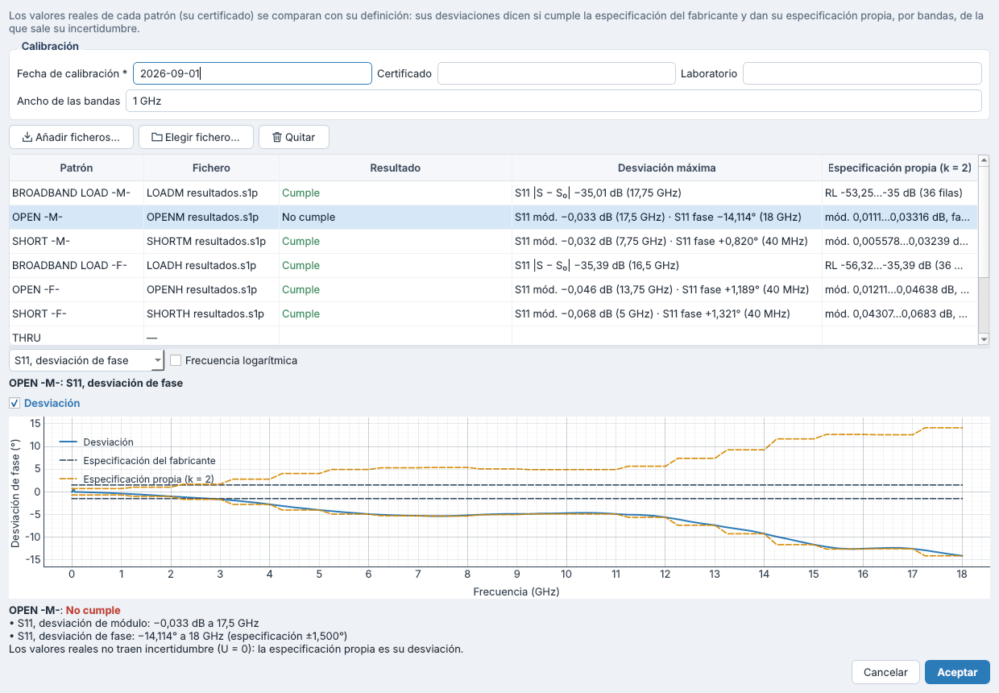
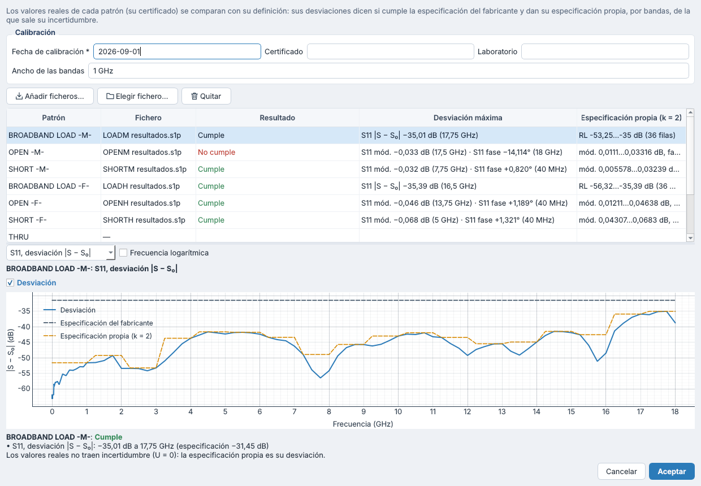
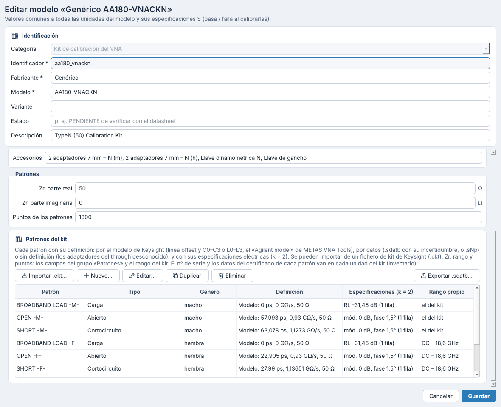
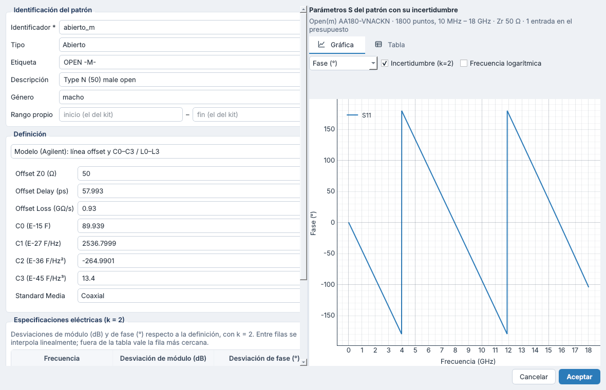
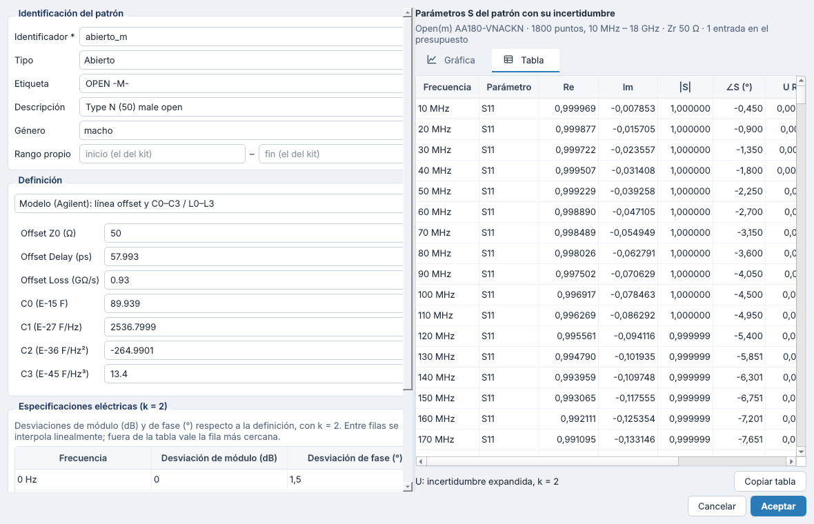
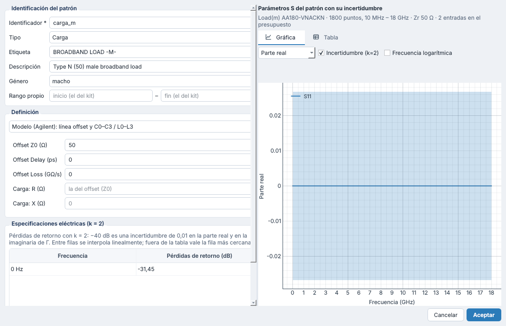
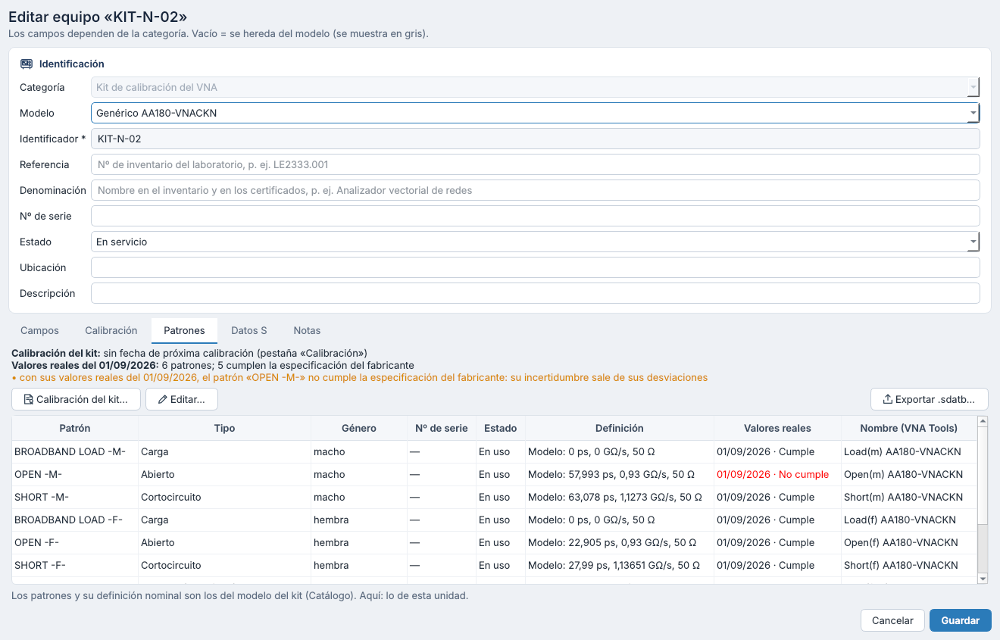
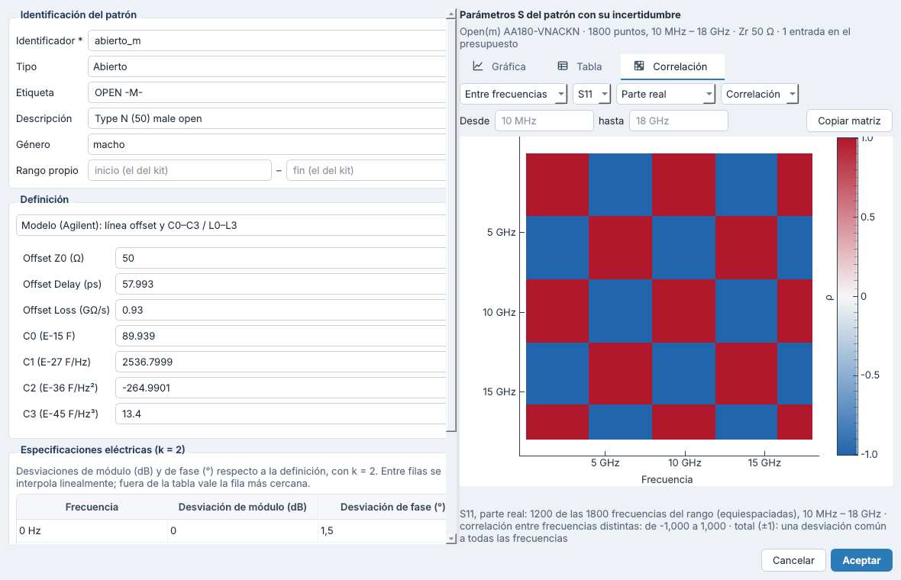
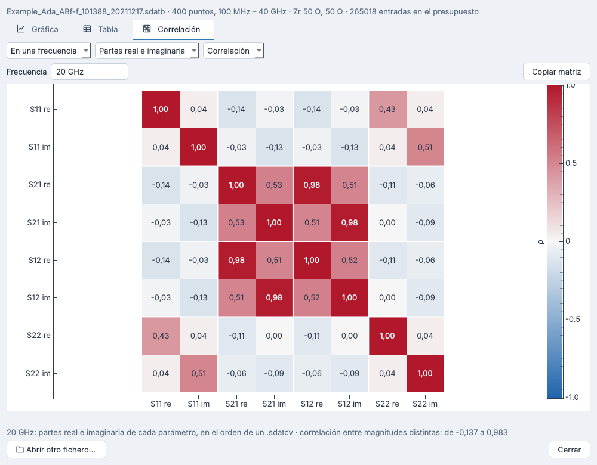

# Kits de calibración: alta y definición de sus patrones — versiones 0.12 a 0.12.3

## 1. Qué cambia

- **El kit es un conjunto de patrones con identidad.**
  - En el modelo del kit, cada patrón lleva su tipo, su género, su definición y sus especificaciones eléctricas (k = 2).
  - En cada unidad del kit, cada patrón lleva su nº de serie, su estado y, si su certificado lo caracteriza, sus propios datos.
- **Tres maneras de definir un patrón**, como en METAS VNA Tools (manual §4.6):
  - importarlo de un fichero de kit de Keysight (`.ckt`);
  - escribirlo a mano con el modelo de Keysight («Agilent model»);
  - darlo por datos: un `.sdatb`, con su incertidumbre, o un Touchstone `.sNp`.
- **Vista:** cada patrón se ve en una **gráfica** y una **tabla** con su incertidumbre (k = 2), y en la **correlación** de esa incertidumbre, entre frecuencias o en una frecuencia (0.12.2).
- **Setups:** el análisis usa los patrones del kit (qué géneros tienen abierto, cortocircuito y carga en uso) y avisa de su estado (P9).
- **Calibración del kit** (0.12.3): los valores reales de cada patrón, de su certificado, se comparan con su definición. Sus desviaciones dicen si cumple la especificación del fabricante y dan su especificación propia, de la que sale su incertidumbre (§6).

## 2. Modelo y unidad

Se sigue la regla de toda la biblioteca: **el modelo da lo común a todas las unidades** y **cada unidad lo suyo**.

| Dato del alta | Dónde va | Nota |
|---|---|---|
| Identificación | Unidad: identificador, referencia (LE) y denominación | Como cualquier equipo |
| Modelo, fabricante | Modelo | |
| Nº de serie | Unidad (del kit), y uno por patrón en la pestaña «Patrones» | |
| Familia de puertos | Modelo: «Familia de conector» | |
| Comentarios | Modelo: descripción; unidad: notas | |
| Zr real / Zr imag | Modelo: campos «Zr, parte real» y «Zr, parte imaginaria» (grupo «Patrones») | 50 Ω y 0 por defecto |
| Start / Stop | Modelo: «Rango de frecuencia (inicio – fin)» | Es el rango del kit, el mismo que limita los setups |
| Nº de puntos | Modelo: «Puntos de los patrones» | 1800 por defecto; solo para calcular, ver y exportar los patrones del modelo |
| Patrones y su definición nominal | Modelo: tarjeta «Patrones del kit» | La del fabricante (`.ckt`, hoja de datos) |
| Nº de serie, estado y datos de cada patrón | Unidad: pestaña «Patrones» | Los datos de su certificado sustituyen a los del modelo |

El modelo no está definido en DC. Por eso, un rango que empieza en DC empieza un paso por encima: DC – 18 GHz con 1800 puntos da 10 MHz, 20 MHz… 18 GHz.

## 3. Los patrones

### 3.1 Tipos

| Tipo | Puertos | Definición posible |
|---|---|---|
| Abierto | 1 | Modelo (C0–C3), datos o ninguna |
| Cortocircuito | 1 | Modelo (L0–L3), datos o ninguna |
| Carga | 1 | Modelo (línea offset terminada en una carga, por defecto de impedancia Z0), datos o ninguna |
| Through (delay/thru) | 2 | Modelo (la línea offset), datos o ninguna |
| Adaptador | 2 | Datos o ninguna: el through desconocido de la UOSM |

Cada patrón tiene:
- un identificador dentro del kit (`abierto_m`, `carga_h`, `through_hm`…);
- una etiqueta (como lo nombra el VNA o el `.ckt`, p. ej. `OPEN -M-`), una descripción y su género (dos en los de 2 puertos);
- opcionalmente, un rango propio.

### 3.2 Por el modelo de Keysight («Agilent model»)

Los campos de VNA Tools, en sus unidades:

| Campo | Unidad |
|---|---|
| Offset Z0 | Ω |
| Offset Delay | ps |
| Offset Loss | GΩ/s |
| C0, C1, C2, C3 (abierto) | 10⁻¹⁵ F, 10⁻²⁷ F/Hz, 10⁻³⁶ F/Hz², 10⁻⁴⁵ F/Hz³ |
| L0, L1, L2, L3 (cortocircuito) | 10⁻¹² H, 10⁻²⁴ H/Hz, 10⁻³³ H/Hz², 10⁻⁴² H/Hz³ |
| Impedancia de la carga (carga) | R y X en Ω; vacía: la de Z0 |

- Las fórmulas están en [`10_algoritmos_de_incertidumbre.md`](10_algoritmos_de_incertidumbre.md) §7.
- Solo patrones coaxiales. Desde 0.12.1 no hay opción de guía de onda («Standard Media», «Cutoff Frequency», «Height / Width Ratio»): el laboratorio no calibra en guía. Un YAML con `medio: guia` da error.

### 3.3 Por datos

- **`.sdatb`:** los valores y la incertidumbre del fichero, con todo su presupuesto. No se le añaden especificaciones: el fichero ya trae su incertidumbre.
- **Touchstone `.sNp`:** los valores, más la incertidumbre de las especificaciones eléctricas del patrón (como hace VNA Tools con las «Electrical Specifications»).
- **Puertos que se usan:** p. ej. el puerto 2 de un `.s2p` para un patrón de 1 puerto. Vacío: todos.
- **Copia en la biblioteca:** el fichero se copia en `catalogo/patrones/<kit>/` con su SHA-256, su referencia (el certificado o el laboratorio) y su fecha.

### 3.4 Especificaciones eléctricas (k = 2)

Una tabla con una fila por frecuencia. Entre filas se interpola linealmente y, fuera de la tabla, vale la fila más cercana.

| Tipo | Columnas |
|---|---|
| Abierto, cortocircuito | Desviación de módulo (dB) y de fase (°) |
| Carga | Pérdidas de retorno (dB): −40 dB es una incertidumbre de 0,01 en la parte real y en la imaginaria de Γ |
| Through | Pérdidas de retorno de las reflexiones; desviación de módulo (dB) y de fase (°) de la transmisión |

Cómo se convierten en incertidumbre: [`10_algoritmos_de_incertidumbre.md`](10_algoritmos_de_incertidumbre.md) §7.2. Así se construyeron los ficheros del kit AA180-VNACKN que el laboratorio comprobó en VNA Tools.

Cada especificación es una sola contribución, común a todas las frecuencias: la desviación de un patrón respecto a su definición está totalmente correlacionada entre frecuencias. No cambia la incertidumbre de cada punto, pero sí la de lo que combina frecuencias, como un retardo de grupo o una media en una banda: ver §7.2.1 de [`10_algoritmos_de_incertidumbre.md`](10_algoritmos_de_incertidumbre.md).

## 4. Importar un `.ckt`

Botón **«Importar .ckt…»** de la tarjeta «Patrones del kit»:

- **Patrones:** se crean con su definición por el modelo (retardo, pérdidas, Z0, C0–C3 o L0–L3) y su rango.
- **Si el kit ya tiene patrones**, el programa pregunta qué hacer:
  - sustituirlos, conservando las especificaciones de los que tengan el mismo identificador;
  - o añadir los nuevos.
- **Campos vacíos del modelo:** se rellenan con el nombre del kit (modelo y «Nombre del kit en el VNA»), su descripción y la familia de conector.
- **El `.ckt`** se guarda en `catalogo/patrones/<modelo>/` (`fichero_kit` del modelo).

Límites:
- El formato no está documentado: se ha descifrado por inspección del `.ckt` del AA180-VNACKN (versión 5), que se lee entero (`kits/ckt.py`).
- Un patrón de otro tipo (carga deslizante, impedancia arbitraria, patrón con datos, línea TRL) da un error claro. Hará falta descifrarlo con su propio `.ckt`.
- Las tablas por frecuencia del `.ckt`, de significado desconocido, no se usan. Las especificaciones se escriben a mano, de la hoja de datos.

## 5. Las unidades del kit

Pestaña **«Patrones»** de la unidad (Inventario → editar el kit). Muestra la validez de la calibración del kit y los avisos de sus patrones.

En cada patrón se puede indicar:
- **Nº de serie:** da el nombre del patrón al estilo de VNA Tools, p. ej. `Open(m) 975` (sin nº de serie, el del modelo del kit).
- **Estado:** en uso, dañado o sustituido, con su fecha.
- **Definición propia:** p. ej. los datos de su certificado (`.sdatb` o `.sNp`). Sustituye a la del modelo.
- **Especificaciones propias:** si no se indican, valen las de sus valores reales (§6) o, sin ellos, las del modelo.
- **Valores reales:** los de la calibración del kit (§6); el diálogo del patrón los muestra.

Una copia de la unidad (nuevo equipo a partir de otro) no hereda los números de serie.

## 6. La calibración del kit: valores reales, desviaciones e incertidumbre (0.12.3)

Botón **«Calibración del kit…»** de la pestaña «Patrones» de la unidad. Al introducir una calibración del kit:

1. **Datos de la calibración:** fecha (obligatoria), certificado y laboratorio. Al aceptar pasan a la pestaña «Calibración» de la unidad; la próxima calibración se indica allí.
2. **Valores reales de los patrones:** un fichero por patrón, `.sdatb` (con su incertidumbre) o Touchstone `.sNp` (sin ella).
   - «Añadir ficheros…» asigna cada fichero a su patrón por su nombre: tipo (`OPEN`, `SHORT`, `LOAD`, `THRU`, o `ABIERTO`, `CORTOCIRCUITO`, `CARGA`) y género (`M`, `MALE`, `MACHO`; `F`, `H`, `FEMALE`, `HEMBRA`). `OPENM resultados.s1p` es el abierto macho y `Open(f).s1p`, el hembra. También vale el identificador o la etiqueta del patrón.
   - «Elegir fichero…» asigna uno a mano y «Quitar» quita los de un patrón.
3. **Cálculo**, al momento, frente a la definición del patrón por el modelo de Keysight y en las magnitudes de sus especificaciones:

   | Patrón | Desviación |
   |---|---|
   | Abierto, cortocircuito | δM = 20·log10(\|Γ\|/\|Γ₀\|) dB y δφ = ∠(Γ/Γ₀) ° |
   | Carga | \|Γ − Γ₀\|, en dB como unas pérdidas de retorno (−40 dB es 0,01) |
   | Through | \|S − S₀\| de S11 y S22; δM y δφ de S21 y S12 |

   - **Resultado** frente a la especificación del fabricante, la del modelo del kit: cumple si |δ| + U ≤ especificación; no cumple si |δ| − U la supera; indeterminado entre ambos. U es la incertidumbre de los valores reales (k = 2; un Touchstone no tiene: U = 0). Una especificación nula, como el «módulo 0 dB» del AA180-VNACKN, cuya hoja solo da la fase, no da resultado.
   - **Especificación propia** del patrón en la unidad: en cada banda de frecuencias (por defecto de 1 GHz; vacío, una sola banda), la mayor |δ| + U, redondeada hacia arriba. Sustituye a la del fabricante en su incertidumbre (k = 2, una entrada por magnitud, como las especificaciones del modelo): la incertidumbre del patrón cubre su desviación de la definición.
4. **Vista:** la tabla de los patrones con su fichero, resultado, desviación máxima y especificación propia. Debajo, la gráfica de cada magnitud del patrón elegido: su desviación (con U, si la hay), la especificación del fabricante (±, gris) y la propia (naranja).
5. **Aceptar:** los ficheros se copian en `catalogo/patrones/<unidad>/`, con su SHA-256. Cada patrón de la unidad guarda sus `valores_reales`: fichero, fecha, certificado, ancho de las bandas, resultado y especificaciones propias. Desde entonces, su gráfica, su tabla, su correlación y su `.sdatb` exportado llevan esa incertidumbre. Las especificaciones propias que se escriban a mano en el patrón siguen mandando.

Prioridad de las especificaciones de un patrón: **propias** de la unidad (a mano) → **de sus valores reales** → **del modelo**.

### 6.1 El AA180-VNACKN del laboratorio (KIT-N-02, calibrado el 01/09/2026)

Seis ficheros `.s1p` del ZNB43 nº 101683 (abierto, cortocircuito y carga, macho y hembra), con 116 frecuencias de 9 kHz a 18 GHz. El certificado no da el nº de serie ni la incertidumbre de los patrones: U = 0. Están en la biblioteca de ejemplo (`catalogo/patrones/KIT-N-02/`) y la unidad KIT-N-02 tiene la calibración introducida.

| Patrón | Desviación máxima | Especificación | Resultado | Especificación propia (bandas de 1 GHz) |
|---|---|---|---|---|
| OPEN -M- | fase −14,114° a 18 GHz; módulo −0,033 dB a 17,5 GHz | fase ±1,5° | **No cumple** desde 3 GHz | fase 0,70…14,12°; módulo 0,011…0,033 dB |
| OPEN -F- | fase +1,189° a 40 MHz; módulo −0,046 dB a 13,75 GHz | fase ±1,5° | Cumple | fase 0,072…1,19°; módulo 0,012…0,046 dB |
| SHORT -M- | fase +0,820° a 40 MHz; módulo −0,032 dB a 7,75 GHz | fase ±1,5° | Cumple | fase 0,066…0,82°; módulo 0,0056…0,032 dB |
| SHORT -F- | fase +1,321° a 40 MHz; módulo −0,068 dB a 5 GHz | fase ±1,5° | Cumple | fase 0,38…1,32°; módulo 0,043…0,068 dB |
| LOAD -M- | \|Γ − Γ₀\| = 0,0178 (−35,01 dB) a 17,75 GHz | −31,45 dB (VSWR 1,055) | Cumple | −53,25…−35,0 dB |
| LOAD -F- | \|Γ − Γ₀\| = 0,0170 (−35,39 dB) a 16,5 GHz | −31,45 dB | Cumple | −56,32…−35,39 dB |

- **El abierto macho no sigue su definición:** a 1 GHz mide −45,463° frente a −45,081° del modelo (−0,38°), y la diferencia crece con la frecuencia hasta −14,1° a 18 GHz. Su incertidumbre, ahora la de sus desviaciones, llega a 14,12° (k = 2) en la última banda. Conviene revisarlo: un patrón dañado, una definición que no es la de esta unidad, o usar sus valores reales como definición (patrón por datos).
- **Por debajo de 50 MHz** los ficheros tienen otra resolución (4 decimales en el módulo y 2 en la fase) y su fase no sigue el retardo del modelo. Por ejemplo, el abierto macho a 40 MHz mide −1,10° y el modelo da −1,80°. Esos puntos dan la mayor desviación de fase del abierto hembra y de los dos cortocircuitos, y fijan su especificación propia en la primera banda (0 – 1 GHz).
- **El módulo:** la hoja de datos no lo especifica (0 dB en el modelo del kit). Sus desviaciones (hasta 0,068 dB) entran en la especificación propia, sin resultado.





## 7. Ver un patrón

El diálogo del patrón (doble clic en su fila) tiene, a la derecha, su vista calculada al momento:

- **Gráfica:**
  - unidades: magnitud lineal, magnitud en dB, fase, parte real o parte imaginaria;
  - la incertidumbre (k = 2) se dibuja como zona sombreada;
  - un through muestra S11, S21, S12 y S22.
- **Tabla:**
  - columnas: frecuencia, parámetro, Re, Im, |S| y ∠S, y la incertidumbre expandida de cada uno;
  - «Copiar tabla» la copia separada por tabuladores, con punto decimal.
- **Correlación** (0.12.2), como la vista «Covariance» del Data Explorer de VNA Tools:
  - **entre frecuencias:** un parámetro y una magnitud (parte real, parte imaginaria, módulo o fase) en las frecuencias de un rango («Desde», «hasta»; como mucho 1200, equiespaciadas);
  - **en una frecuencia:** las partes real e imaginaria (o módulo y fase) de todos los parámetros, en el orden de un `.sdatcv`, con su valor en cada casilla;
  - **correlación** (de −1, azul, a +1, rojo) o **covarianza**; en gris, las magnitudes sin incertidumbre o no definidas (el módulo y la fase donde S = 0);
  - bajo el puntero, las dos magnitudes, su ρ (o su covarianza) y sus incertidumbres típicas;
  - debajo, el resumen: el intervalo de ρ entre frecuencias distintas y si la correlación es total (±1) o nula;
  - «Copiar matriz» la copia separada por tabuladores, con punto decimal y, entre frecuencias, con las frecuencias en Hz;
  - se calcula al abrir la pestaña.

  Con las especificaciones eléctricas, la matriz entre frecuencias es ±1: en la fase del abierto macho, +1; en su parte real, ±1 con el signo de −Im Γ. Para comparar con un fichero de VNA Tools sin darlo de alta en un kit: **Archivo → Ver parámetros S con incertidumbre…** Fórmulas en §6.5 y §7.2.1 de [`10_algoritmos_de_incertidumbre.md`](10_algoritmos_de_incertidumbre.md).

## 8. Caducidad y comprobaciones (P9)

- **Calibración del kit:** como la de cualquier equipo, un setup da error si ha caducado y aviso si caduca en 30 días o menos. La pestaña «Patrones» de la unidad lo muestra.
- **Estado de los patrones**, en el análisis del setup y en la pestaña «Patrones»:

  | Situación | Gravedad |
  |---|---|
  | Patrón dañado (no se usa) | Aviso |
  | Patrón sustituido después del certificado del kit | Aviso: la calibración no lo cubre |
  | Patrón sin definición (salvo los adaptadores) | Aviso |
  | No se encuentra su fichero de datos | Error |
  | Datos propios anteriores al último certificado del kit | Aviso |
  | Valores reales que no cumplen la especificación del fabricante (§6) | Aviso: su incertidumbre sale de sus desviaciones |
  | Valores reales anteriores al último certificado del kit | Aviso |
  | No se encuentra el fichero de sus valores reales | Error |

- **Géneros disponibles:** si el modelo define sus patrones, son los géneros con abierto, cortocircuito y carga en uso y definidos. Si no, el campo «Géneros de los estándares». Con un abierto macho dañado, un plano N hembra deja de poder calibrarse.

## 9. Exportar `.sdatb`

Botón **«Exportar .sdatb…»**, en el modelo y en la unidad: un `.sdatb` por patrón con definición, con su incertidumbre, para abrirlo en VNA Tools. Los nombres siguen su convención: `Open(m) 975.sdatb`, `Thru(f-m) AA180-VNACKN.sdatb`.

## 10. YAML

```yaml
# catalogo/modelos/kit_AA180-VNACKN.yaml (extracto)
campos:
  rango_frecuencia: [DC, 18 GHz]
  familia_conector: N
  zr_real_ohm: 50
  zr_imag_ohm: 0
  puntos_patrones: 1800
patrones:
  - id: abierto_m
    tipo: abierto
    etiqueta: OPEN -M-
    descripcion: Type N (50) male open
    generos: [macho]
    definicion:
      clase: modelo
      z0_offset_ohm: 50.0
      retardo_offset_ps: 57.993
      perdidas_offset_gohm_s: 0.93
      c: [89.939, 2536.7999, -264.9901, 13.4]
    especificaciones:
      - { frecuencia: 0 Hz, modulo_db: 0.0, fase_grados: 1.5 }
  - id: adaptador_hh
    tipo: adaptador
    generos: [hembra, hembra]
    definicion: { clase: ninguna }
fichero_kit: ../patrones/aa180_vnackn/AA180-VNACKN1.ckt
```

```yaml
# catalogo/equipos/KIT-N-02.yaml (extracto)
patrones:
  abierto_m: { numero_serie: "975" }
  carga_h:
    numero_serie: "18831"
    definicion:
      clase: datos
      fichero: ../patrones/KIT-N-02/Load(f) 18831.sdatb
      referencia: Certificado 2026-0412
      fecha: 2026-04-01
      sha256: 4b1d…
  cortocircuito_h: { numero_serie: "747", estado: sustituido, fecha_estado: 2026-06-01 }
```

```yaml
# catalogo/equipos/KIT-N-02.yaml del ejemplo: la calibración del 01/09/2026 (extracto)
calibracion:
  fecha: '2026-09-01'
patrones:
  abierto_m:
    valores_reales:
      fichero: ../patrones/KIT-N-02/OPENM resultados.s1p
      sha256: 2e0e15dd…
      fecha: '2026-09-01'
      ancho_bandas: 1 GHz
      resultado: no_cumple              # frente a la especificación del fabricante
      especificaciones:                 # propias, k = 2: dos filas por banda
      - frecuencia: 9 kHz
        modulo_db: 0.0111
        fase_grados: 0.6999
      - frecuencia: 1 GHz
        modulo_db: 0.0111
        fase_grados: 0.6999
      # …
      - frecuencia: 18 GHz
        modulo_db: 0.03316
        fase_grados: 14.12
```

## 11. Lo que queda para más adelante

- **P8, el kit del VNA es el de la biblioteca:** cargar en el VNA la definición de la biblioteca, o comprobar la que tiene.
- **Peticiones y registro con el patrón exacto:** p. ej. «Conecte el abierto hembra nº 975».
- **Calibre de los patrones.**
- **Otros tipos de patrón:** carga deslizante, líneas TRL.
- **Incertidumbre de la medida:** la de los patrones no entra en la incertidumbre de las medidas, que sigue siendo el algoritmo del laboratorio.

## 12. Código y pruebas

| Fichero | Contenido |
|---|---|
| `kits/model.py` | `KitStandard`, `StandardDefinition`, `SpecRow` y `UnitStandard`; nombres de VNA Tools (`standard_name`) |
| `kits/agilent.py` | Modelo de Keysight: línea offset, terminaciones, through |
| `kits/specs.py` | Especificaciones eléctricas → entradas del presupuesto |
| `kits/standards.py` | `ResolvedStandard` (modelo + unidad; prioridad de las especificaciones), `kit_frequencies`, `standard_data`, `table_rows` y `export_sdatb` |
| `kits/calibration.py` | Calibración del kit: desviaciones de los valores reales, resultado, especificaciones propias por bandas y asignación de ficheros por su nombre (`match_standard`) |
| `kits/ckt.py` | Lectura de los `.ckt` de Keysight |
| `catalog/model.py` | `EquipmentModel.patrones`, `fichero_kit`; `Equipment.patrones` |
| `catalog/library.py` | `kit_settings`, `kit_standards`, `standard_data`, `copy_standard_file`, `export_standards`, `kit_genders`, `kit_issues`, `real_values_data`, `standard_deviations` y `kit_real_values` |
| `setups/connections.py`, `setups/analysis.py` | Géneros a partir de los patrones; avisos de los patrones del kit |
| `gui/kit_standards.py` | Tablas del modelo y de la unidad, diálogos del patrón, vista (gráfica, tabla y correlación) |
| `gui/correlation_view.py`, `sdata/correlation.py` | Pestaña «Correlación» y sus matrices |
| `gui/sparam_viewer.py` | Archivo → Ver parámetros S con incertidumbre… |
| `gui/kit_calibration.py` | «Calibración del kit…»: ficheros, resultados y gráfica de las desviaciones |
| `tests/test_kits.py`, `tests/test_gui_kits.py` | Con el `.ckt` del AA180-VNACKN (`tests/datos/kits/`) y la carga de VNA Tools |
| `tests/test_kit_calibration.py` | Desviaciones, resultados y especificaciones propias con los valores reales del KIT-N-02 y, con incertidumbre, la carga de VNA Tools |



| | |
|---|---|
|  |  |
|  |  |
|  |  |
