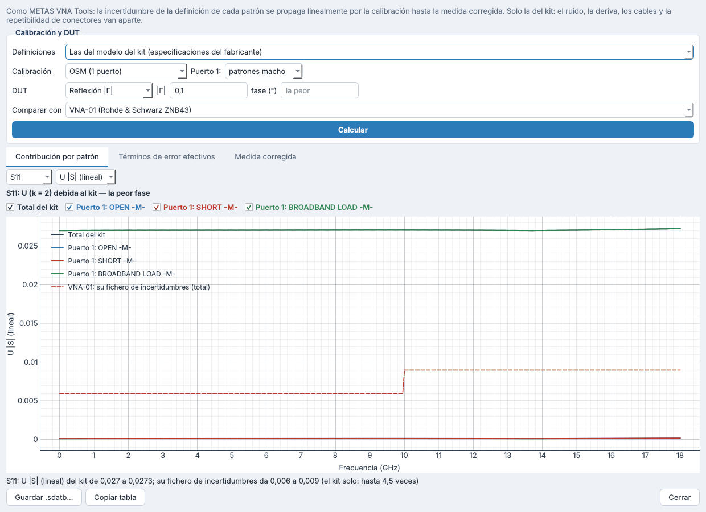
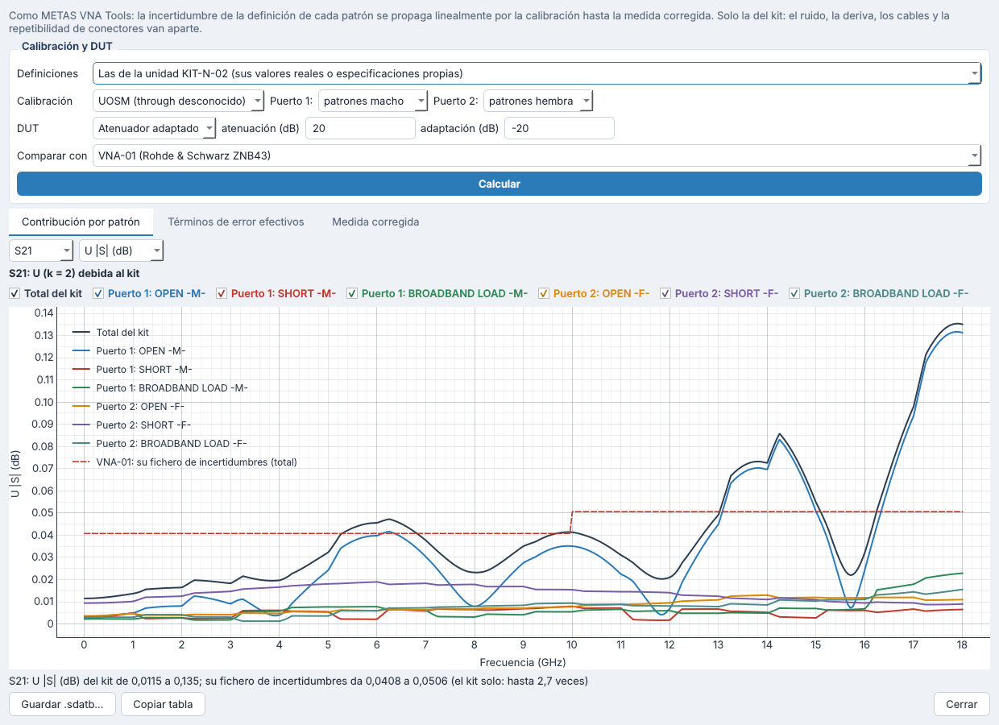

# Contribución del kit de calibración a la incertidumbre: OSM, TOSM / UOSM y normalización de transmisión — versión 0.12.4

## 1. Qué se evalúa

Cuánto aporta el kit de calibración a la incertidumbre de una medida corregida con una calibración del VNA:

- **OSM:** un puerto, con el abierto, el cortocircuito y la carga del género del plano;
- **TOSM:** dos puertos con OSM en cada uno y un through conocido (en los setups de CAL-ELEKTRA, plano);
- **UOSM:** dos puertos con OSM en cada uno y un through desconocido;
- **normalización de transmisión:** solo S21 y S12, con un through.

Las incertidumbres de los patrones son las de su definición:
- las especificaciones del fabricante (modelo del kit);
- o las especificaciones propias que salen de los valores reales de cada unidad (calibración del kit, [`15`](15_kits_de_calibracion.md) §6).

Solo se evalúa la parte del kit. Las demás fuentes (ruido, linealidad, deriva del VNA, estabilidad de los cables, repetibilidad de los conectores) son aparte.

## 2. El algoritmo: el de METAS VNA Tools

VNA Tools (manual V3.0.2, §3.8, §6 y apéndice E) resuelve cada calibración: One Port, SOLT (modelo de 12 términos), Unknown Thru, y normalización de reflexión y de transmisión. Propaga las incertidumbres de forma lineal (LinProp):

1. **Definiciones.** La definición de cada patrón es una magnitud incierta: su valor y sus dependencias de las entradas de su presupuesto (las «Electrical Specifications» o los datos de su certificado).
2. **Calibración.** Los términos de error se calculan con esas definiciones y heredan sus dependencias.
3. **Corrección.** La medida corregida hereda a su vez las de los términos de error. Su presupuesto dice cuánto aporta cada patrón, y la correlación entre frecuencias es la de las definiciones.

CAL-ELEKTRA hace lo mismo con su motor de propagación lineal (`sdata/`) y la matemática de calibración de `core/calibration.py`, generalizada a patrones con definición (`kits/contribution.py`). El resultado es la medida corregida con sus dependencias de las entradas del kit. Se ve en gráfica, tabla y correlación, y se guarda como `.sdatb` para abrirla en VNA Tools.

### 2.1 Por qué basta un VNA perfecto

El error que introducen las definiciones no depende de los errores propios del VNA. La calibración encuentra la transformación que lleva las lecturas de los patrones a sus definiciones. Aplicada al DUT, la medida corregida es la transformación que lleva los patrones reales a sus definiciones, aplicada al DUT real. En esa composición no queda nada del VNA.

Por eso la contribución se calcula:
- con un VNA perfecto (lecturas = valores reales);
- con los patrones y el DUT en sus valores nominales;
- en primer orden.

La calibración es holomorfa en las definiciones: cada sensibilidad es una derivada compleja. Se obtiene por diferencias centrales, con h = 10⁻⁶; por debajo de 10⁻⁸ es redondeo y cuenta como 0.

### 2.2 OSM: fórmula cerrada

La corrección de un puerto es una transformación de Möbius fijada por tres puntos. Sus perturbaciones son polinomios de grado 2 en Γ, de modo que el error es la base de Lagrange de los tres patrones (A = valores reales, δD = error de definición):

```
δΓ = Σᵢ δDᵢ · Πⱼ≠ᵢ (Γ − Aⱼ)/(Aᵢ − Aⱼ)
```

Con patrones ideales (abierto 1, corto −1, carga 0):

```
δΓ = δD_carga·(1 − Γ²) + δD_abierto·Γ(1 + Γ)/2 + δD_corto·Γ(Γ − 1)/2
```

- Un DUT adaptado solo ve la carga. Un DUT igual a un patrón tiene exactamente la incertidumbre de ese patrón.
- Los términos efectivos son:
  - directividad: δD_carga;
  - adaptación de fuente: (δD_abierto + δD_corto)/2 − δD_carga;
  - seguimiento de reflexión: (δD_abierto − δD_corto)/2.

Las pruebas comparan el cálculo numérico con esta fórmula (rtol 10⁻⁶) y comprueban que la derivada en la dirección imaginaria es la misma.

### 2.3 TOSM, UOSM y normalización

| Calibración | Qué entra del kit | Notas |
|---|---|---|
| TOSM, through plano | OSM de los dos puertos | La definición del through plano es exacta. La adaptación de carga sale de la directividad residual del otro puerto. En primer orden, el seguimiento de transmisión no depende del kit, y el through medido de nuevo da su definición (U = 0) |
| TOSM, through definido | Lo anterior y el through del kit, con sus especificaciones | Medido de nuevo, el through da su definición con su U |
| UOSM | OSM de los dos puertos | El through no necesita definición (reciprocidad): el seguimiento de transmisión es √(T₁·T₂), con la fase media de los dos seguimientos de reflexión. La adaptación de carga es la de fuente del otro puerto |
| Normalización | Solo el through: S21 = S21m·T21/T21m | Con through plano, el kit no interviene. Las reflexiones no se corrigen: su error es la adaptación propia del VNA («Unknown Error Terms» de VNA Tools), no el kit |

### 2.4 Términos de error efectivos

Son los términos de error resueltos con el VNA perfecto. Sus valores nominales son 0 (directividad, adaptaciones) o 1 (seguimientos), y su incertidumbre (k = 2) es lo que una hoja de datos llama «effective system data»:
- **Directividad y adaptaciones:** −20·log10 del radio, k·√λmax de la covarianza de su parte real e imaginaria.
- **Seguimientos:** U del módulo (dB) y U de la fase (°).

## 3. Lo que hace hoy el algoritmo del laboratorio

`uncertainty/engine.py` usa el fichero de incertidumbres del ZNB43 (`VNA_ZNB43_101683_uncertainties_calculation.yaml`), sacado de la hoja de datos de R&S (v07.00). Sus incertidumbres de reflexión y transmisión suponen una calibración con el kit **R&S ZN-Z229 (2,92 mm)**; su `effective_system_data` lo dice:

| Banda | Directividad | Adaptación de fuente | Adaptación de carga | Seguimiento de reflexión | Seguimiento de transmisión |
|---|---|---|---|---|---|
| ≤ 10 GHz | 45 dB | 41 dB | 44 dB | ±0,05 dB | ±0,03 dB |
| 10 – 20 GHz | 42 dB | 40 dB | 41 dB | ±0,05 dB | ±0,03 dB |

El kit con el que se calibra no aparece: va implícito en la hoja de datos. Con el AA180-VNACKN (tipo N) esa suposición no se cumple.

## 4. Resultados

Salen de `python tools/evaluar_contribucion_kit.py`: 180 frecuencias de 0,1 a 18 GHz, el peor valor de cada banda, k = 2. En reflexión, en la peor fase del DUT.

### 4.1 Lo que da el fichero del ZNB43 (total, con el ZN-Z229)

| Banda | U\|Γ\| a 0,03 | a 0,1 | a 0,33 | a 1 | U S21 a 0 dB | a −20 dB |
|---|---|---|---|---|---|---|
| ≤ 10 GHz | 0,006 | 0,006 | 0,013 | 0,013 | 0,041 dB | 0,041 dB |
| 10 – 18 GHz | 0,009 | 0,009 | 0,015 | 0,015 | 0,051 dB | 0,051 dB |

### 4.2 AA180-VNACKN con las especificaciones del fabricante

Las especificaciones son: fase del abierto y del cortocircuito ±1,5°; carga, VSWR 1,055 (−31,45 dB).

**OSM (el kit solo):**

| Patrones | Banda | U\|Γ\| a 0,03 | a 0,1 | a 0,33 | a 1 | Directividad | Adaptación de fuente | Seguimiento |
|---|---|---|---|---|---|---|---|---|
| macho | ≤ 10 GHz | 0,0268 | 0,0271 | 0,030 | 0,058 | 31,4 dB | 29,7 dB | ±0,006 dB, ±1,1° |
| macho | 10 – 18 GHz | 0,0269 | 0,0273 | 0,031 | 0,060 | 31,4 dB | 29,7 dB | ±0,023 dB, ±1,1° |
| hembra | ≤ 10 GHz | 0,0268 | 0,0271 | 0,030 | 0,058 | 31,4 dB | 29,7 dB | ±0,007 dB, ±1,1° |
| hembra | 10 – 18 GHz | 0,0269 | 0,0273 | 0,031 | 0,060 | 31,4 dB | 29,7 dB | ±0,027 dB, ±1,1° |

**Dos puertos** (puerto 1 macho, puerto 2 hembra):

| Calibración | DUT | U\|S11\| | U S21 | U ∠S21 |
|---|---|---|---|---|
| TOSM | through 0 dB | 0 | 0 | 0 |
| TOSM | atenuador 20 dB (adaptación −20 dB) | 0,027 | 0,047 dB | 0,33° |
| TOSM | cable 1 dB (adaptación −26 dB) | 0,0057 | 0,023 dB | 0,16° |
| UOSM | through 0 dB | 0,042 | 0,004 – 0,018 dB | 0,76° |
| UOSM | atenuador 20 dB | 0,027 | 0,040 – 0,049 dB | 0,81° |
| UOSM | cable 1 dB | 0,037 | 0,020 – 0,032 dB | 0,78° |

Términos efectivos:
- TOSM: adaptación de carga 31,4 dB y seguimiento de transmisión 0.
- UOSM: adaptación de carga 29,7 dB y seguimiento de transmisión ±0,018 dB, ±0,76°.

### 4.3 KIT-N-02 con sus valores reales (01/09/2026)

La especificación propia de cada patrón es su desviación, por bandas de 1 GHz, sin la incertidumbre del certificado.

**OSM:**

| Patrones | Banda | U\|Γ\| a 0,03 | a 0,1 | a 0,33 | a 1 | Directividad | Adaptación de fuente | Seguimiento |
|---|---|---|---|---|---|---|---|---|
| macho | ≤ 10 GHz | 0,0083 | 0,0084 | 0,010 | 0,049 | 41,6 dB | 26,5 dB | ±0,021 dB, ±2,7° |
| macho | 10 – 18 GHz | 0,018 | 0,018 | 0,026 | 0,135 | 35,0 dB | 18,0 dB | ±0,056 dB, ±7,1° |
| hembra | ≤ 10 GHz | 0,010 | 0,010 | 0,012 | 0,022 | 39,8 dB | 36,0 dB | ±0,036 dB, ±0,89° |
| hembra | 10 – 18 GHz | 0,017 | 0,017 | 0,019 | 0,037 | 35,4 dB | 34,3 dB | ±0,033 dB, ±0,57° |

**Dos puertos** (puerto 1 macho, puerto 2 hembra; ≤ 10 GHz / 10 – 18 GHz):

| Calibración | DUT | U\|S11\| | U S21 | U ∠S21 |
|---|---|---|---|---|
| TOSM | atenuador 20 dB | 0,008 / 0,018 | 0,039 / 0,108 dB | 0,27 / 0,64° |
| TOSM | cable 1 dB | 0,0017 / 0,0038 | 0,020 / 0,054 dB | 0,14 / 0,32° |
| UOSM | through 0 dB | 0,016 / 0,025 | 0,020 / 0,032 dB | 1,35 / 3,54° |
| UOSM | atenuador 20 dB | 0,008 / 0,018 | 0,047 / 0,135 dB | 1,62 / 3,80° |
| UOSM | cable 1 dB | 0,011 / 0,022 | 0,030 / 0,082 dB | 1,48 / 3,67° |

### 4.4 Normalización de transmisión

- **Through plano** (lo que diseñan los setups): el kit no aporta nada.
- **Through definido:** U de S21 = la especificación de transmisión del through (las pruebas lo comprueban con 0,05 dB y 0,5°).

El error dominante de una normalización es el desajuste sin corregir entre la adaptación del VNA y la del DUT, que no es del kit. VNA Tools lo trata con los «Unknown Error Terms» del VNA: directividad, adaptaciones y seguimientos sin corregir, k = 2.

## 5. Conclusiones

1. **Reflexión: el fichero del ZNB43 infravalora la incertidumbre al calibrar con el AA180-VNACKN.**
   - Con las especificaciones del fabricante, el kit solo da U(|Γ|) = 0,027 para un DUT adaptado. Es 4,5 veces el total del fichero (0,006) hasta 10 GHz y 3 veces (0,009) de 10 a 18 GHz.
   - Para |Γ| = 1 da 0,058 – 0,060, frente a 0,013 – 0,015.
   - La causa es la carga del AA180 (−31,45 dB, frente a una directividad de 45 dB del ZN-Z229) y la fase de ±1,5° de sus abiertos y cortocircuitos.
2. **Transmisión con TOSM (through plano):**
   - El kit apenas aporta en DUT bien adaptados (cable de 1 dB: 0,023 dB) y nada en el propio through.
   - En DUT desadaptados se acerca al total del fichero: atenuador de 20 dB con adaptación de −20 dB, 0,047 dB, frente a 0,041 dB.
3. **UOSM:** añade la fase de los seguimientos de reflexión a la de transmisión (0,76° con las especificaciones del fabricante; hasta 3,5° con los valores reales del abierto macho). La adaptación de carga es la de fuente del otro puerto (29,7 dB), y por eso la reflexión de un DUT casi transparente empeora: 0,042 en un through.
4. **Valores reales del KIT-N-02:**
   - Por debajo de 10 GHz mejoran mucho a las especificaciones (directividad de 40 – 42 dB).
   - El abierto macho (−14,1° a 18 GHz) hunde la adaptación de fuente del puerto macho hasta 18 dB y lleva U(|Γ| = 1) a 0,135 y U(S21) de un atenuador en UOSM a 0,135 dB.
   - Usar sus valores reales como definición (patrón por datos) quitaría esa desviación de la incertidumbre, que pasaría a ser la de su certificado.
5. **Normalización:** con through plano, el kit no interviene. El error que domina es la adaptación sin corregir del VNA.

## 6. Cómo llevarlo a la incertidumbre de las medidas

Hoy no se lleva: el cálculo del laboratorio (`uncertainty/engine.py`) sigue igual. Hay tres caminos, que el laboratorio debe elegir:

| Opción | Qué es | A favor | En contra |
|---|---|---|---|
| A. Sumar | Combinar en RSS la contribución del kit con la U del fichero | Inmediato | Cuenta dos veces el kit: la U de la hoja ya incluye los residuos del ZN-Z229 |
| B. Sustituir los residuos | Rehacer el modelo de la hoja de datos con los términos efectivos del kit en lugar de los del ZN-Z229 (directividad, adaptaciones, seguimientos), más la linealidad y el ruido del VNA | Coherente con el fichero actual; los términos efectivos ya los da CAL-ELEKTRA | Hace falta el modelo con el que R&S construye sus curvas (o el de la guía EURAMET cg-12) |
| C. Como VNA Tools | Propagación lineal de todo: kit (ya hecho), y además ruido, linealidad y deriva del VNA, estabilidad de cables y repetibilidad de conectores | El más completo, con correlación entre frecuencias y entre parámetros | Requiere caracterizar el VNA, los cables y los conectores (las bases de datos de VNA Tools §4.1 – 4.3) |

## 7. En CAL-ELEKTRA

- **Pestaña «Patrones» de la unidad del kit → «Contribución a la incertidumbre…».**
- **Opciones:**
  - definiciones de la unidad (valores reales o especificaciones propias) o del modelo (fabricante);
  - calibración y géneros de los patrones de cada puerto;
  - through (plano o el del kit);
  - DUT: |Γ| en una fase o en la peor; through; atenuador adaptado; o un fichero `.s1p` o `.s2p`.
- **Resultados:**
  - la contribución de cada patrón a U(|S|) lineal, en dB o a U(∠S), con la U del fichero de incertidumbres del VNA elegido para comparar;
  - los términos de error efectivos por bandas, junto a los del fichero;
  - la medida corregida con la incertidumbre del kit (gráfica, tabla y correlación), que se guarda como `.sdatb`.
- `tools/evaluar_contribucion_kit.py` regenera las tablas de §4.





### 7.1 Comprobarlo en VNA Tools

1. Definir los patrones del AA180-VNACKN en VNA Tools con el mismo modelo y las mismas «Electrical Specifications», como ya se comprobó (`docs/15`).
2. Hacer una calibración «One Port» o «SOLT» con el VNA de prueba de VNA Tools y corregir un DUT conocido.
3. Comparar la U de su S11 (o S21) en el Data Explorer con la de CAL-ELEKTRA para el mismo DUT. CAL-ELEKTRA la da en la pestaña «Medida corregida», o en su `.sdatb`, que VNA Tools abre. Solo la parte del kit: en VNA Tools, sin ruido ni deriva, o mirando el presupuesto por entradas.

## 8. Código y pruebas

| Fichero | Contenido |
|---|---|
| `kits/contribution.py` | `calibration_standards` (las definiciones de una calibración con el kit), `kit_contribution` (propagación por la calibración), `KitContribution.breakdown` (por patrón), `EffectiveTerm`, `worst_phase` |
| `core/calibration.py` | `solve_one_port` y `solve_tosm` con las definiciones de los patrones (through definido) |
| `sdata/model.py`, `sdata/unclib.py` | `SParamData.interpolated` y `UncVector.combination`: interpolación con incertidumbre |
| `catalog/library.py` | `calibration_standards` |
| `gui/kit_contribution.py` | El diálogo «Contribución a la incertidumbre…» |
| `tools/evaluar_contribucion_kit.py` | Las tablas de §4 |
| `tests/test_kit_contribution.py` | Fórmula de Lagrange, derivada holomorfa, TOSM con through plano y definido, UOSM, normalización, valores reales, interpolación |
| `tests/test_gui_kits.py` | El diálogo: OSM, UOSM, normalización, `.sdatb` guardado |
